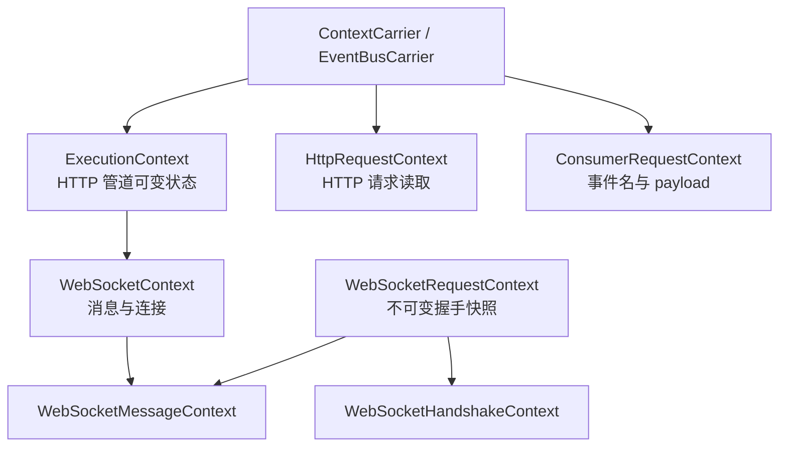

# 执行上下文

Spine 用小型接口区分 HTTP、消息消费者与 WebSocket 的输入，同时让拦截器和解析器共享必要能力。



## HTTP 管道上下文

`core.ExecutionContext` 供管道、路由、拦截器和内部解析器使用，包含方法、路径、header、路径/query 参数，以及 `Set`/`Get` 可变存储。

控制器不应依赖整个执行上下文。若要读取拦截器保存的数据，应注入只读的 `core.ControllerContext`：

```go
func (c *UserController) Me(ctx core.ControllerContext) (httpx.Response[User], error) {
	value, ok := ctx.Get("currentUser")
	if !ok {
		return httpx.Response[User]{}, httperr.Unauthorized("需要认证")
	}
	return httpx.Response[User]{Body: value.(User)}, nil
}
```

`HttpRequestContext` 提供 `Param`、`Query`、`Header`、完整集合、`Bind` 和 `MultipartForm`。解析器需要这些能力时应先进行接口检查，不应假定消息消费者也具有 HTTP 信息。

## 消息消费者上下文

`ConsumerRequestContext` 只公开 `Context()`、`EventBus()`、`EventName()` 和 `Payload()`。这种分离使消费者处理器可以复用依赖注入与解析器，而不会伪造 HTTP 方法或路径。

## WebSocket 上下文

`WebSocketContext` 在 `ExecutionContext` 之上增加 `ConnID()`、`MessageType()` 和 `Payload()`。v0.5.1 还保留 upgrade 请求的不可变快照：

- `WebSocketHandshakeContext` 供握手阶段认证使用。
- `WebSocketMessageContext` 在每条消息中同时提供消息数据和原始握手请求。
- `WebSocketRequestContext` 可读取 path、header、query、cookie、远端地址、host 和 request URI。

连接槽位会先被保留，然后调用 `PreHandshake`，最后才执行 HTTP upgrade。因此等待认证的连接也会占用 `MaxConnections`。

```go
func (i *AuthInterceptor) PreHandshake(
	ctx core.WebSocketHandshakeContext,
	meta core.HandlerMeta,
) error {
	if ctx.Header("Authorization") == "" {
		return httperr.Unauthorized("missing credentials")
	}
	return nil
}
```

## 设计原则

- 控制器依赖最小只读接口，协议细节留在解析器和拦截器中。
- 不支持的上下文类型应返回错误，而不是通过反射 panic。
- `Context()` 传播取消和截止时间；不要把请求范围值提升为全局状态。
- WebSocket 握手信息是快照，不会随外部请求对象改变。

完整签名见 [`core` 上下文 API](/zh-Hans/reference/api/execution-context)。
