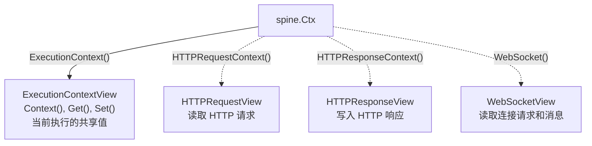

# 执行上下文

::: info 0.7.5
本文以 0.7.5 API 为准。已发布标签和兼容平台请查看[版本列表](/zh-Hans/community/versions)。
:::

## 统一入口 {#public-context}

HTTP 处理器需要请求上下文时，可以在任意位置声明 `spine.Ctx` 参数。 拦截器接收 `github.com/NARUBROWN/spine/pkg/spine.Ctx`。与根应用包一起导入时使用 `spinectx` 别名。向服务和仓储传递 `ctx.ExecutionContext().Context()` 返回的标准 Go context。仍兼容直接注入 context.Context 的旧处理器。

```go
import spinectx "github.com/NARUBROWN/spine/pkg/spine"

func readRequest(ctx spinectx.Ctx) {
	execution := ctx.ExecutionContext()
	execution.Set("userID", "alice")
	value, exists := execution.Get("userID")
	goContext := execution.Context()
	request, supported := ctx.HTTPRequestContext()
	if supported {
		_ = request.Header("Authorization")
	}
	_, _, _ = value, exists, goContext
}
```

## 公开契约 {#contract}



```go
type Ctx interface {
	ExecutionContext() ExecutionContextView
	HTTPRequestContext() (HTTPRequestView, bool)
	HTTPResponseContext() (HTTPResponseView, bool)
	WebSocket() (WebSocketView, bool)
	Get(key string) (any, bool) // Deprecated
}
type ExecutionContextView interface {
	Context() context.Context
	Get(key string) (any, bool)
	Set(key string, value any)
}
```

## 传输视图 {#views}

| getter | 可用操作 |
| --- | --- |
| `ExecutionContext()` | Go context 和每次执行的 Get/Set |
| `HTTPRequestContext()` | Method, Path, Param, Query, Header, MultipartForm |
| `HTTPResponseContext()` | SetHeader, AddHeader, IsCommitted, WriteStatus/JSON/String/Bytes |
| `WebSocket()` | handshake 请求、ConnID、MessageType、Payload |

不支持的 getter 返回 nil, false。HTTP 执行提供请求和响应视图；WS handshake 和消息提供 WS 视图。事件执行不保证提供 HTTP/WS 视图。Payload 和 multipart 头部均为副本。

<span id="event-publishing"></span>

## 生命周期与迁移 {#lifetime}

存储按请求或消息隔离，由该次执行的钩子和处理器共享。所有 AfterCompletion 结束后释放引用；此后 Get 返回 nil, false，Set 不执行操作。执行结束本身不会取消 Go context。WS handshake 与后续消息不共享存储。内部 writer 替换、Bind、SetRoute、EventBus 和 SenderKey 不属于公开契约。事件发布使用 `publish.Event(ctx.ExecutionContext().Context(), event)`；发送使用 `ws.Send(ctx.ExecutionContext().Context(), ws.TextMessage, data)`。默认 HTTP DTO 输入使用输入包装类型。

[输入与 DTO](/zh-Hans/learn/tutorial/2-controller) | [拦截器](/zh-Hans/learn/tutorial/4-interceptor)

## WebSocket 请求视图 {#websocket-request-context}

握手 PreHandshake 和消息钩子均接收 spine.Ctx。先检查 request, ok := ctx.WebSocket()，再读取 Header 或 Cookie。握手时 ConnID 为空，尚无消息类型或 payload，不要假定存在 HTTPRequestContext()。握手与每条消息使用独立 Set/Get 存储。

```go
type WebSocketRequestView interface {
	Context() context.Context
	Path() string
	Header(string) string
	Headers() map[string][]string
	Query(string) string
	Queries() map[string][]string
	Cookie(string) (string, bool)
	Cookies() map[string]string
	RemoteAddr() string
	Host() string
	RequestURI() string
}
type WebSocketView interface {
	WebSocketRequestView
	ConnID() string
	MessageType() int
	Payload() []byte
}
```
