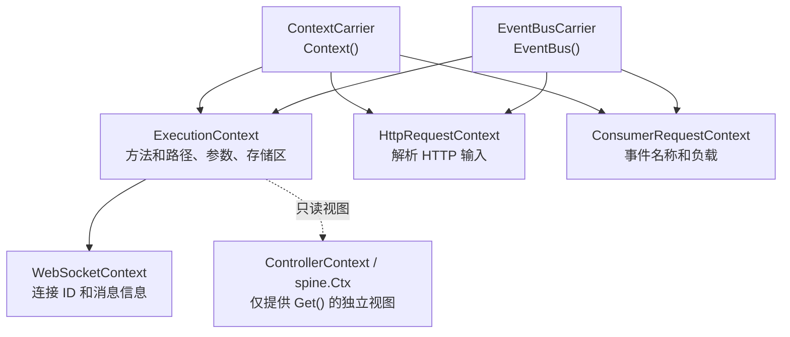

# 执行上下文（ExecutionContext）

::: info
旧输入 API 的兼容规则请参阅[输入迁移](/zh-Hans/learn/migration/v0.7.1-preview)，文档选项请参阅 [OpenAPI](/zh-Hans/reference/api/openapi)。
:::

Spine 为每个请求或消息创建执行上下文，将输入信息和执行状态传给流水线。拦截器通过 `core.ExecutionContext` 读写执行状态，HTTP 控制器则通过语义类型和只读的 `spine.Ctx` 仅接收所需的值。

本页的 `src/user` 示例使用[项目结构](/zh-Hans/learn/tutorial/1-project-structure)中的 `legacy` 布局。

理解这一区分后，就能将拦截器保存的值传给控制器，并判断 HTTP、事件消费者和 WebSocket 各自可使用哪些输入。本文的接口和行为以 Spine v0.7.1 为准。

应用处理器示例是对 [CLI 创建的项目](/zh-Hans/learn/tutorial/1-project-structure)的手动扩展。请保留生成的 `BuildApplication`，以及检查错误的 `user.Register(app)` 调用。`core/` 接口是公开契约，无需将 `internal/` 实现复制到应用中。

## 控制器和拦截器的访问范围

上下文的目的不是将一个庞大的对象暴露给所有代码，而是划分控制流水线的代码和业务逻辑各自所需的访问范围。

| 使用位置 | 接收的类型 | 可用功能 |
| --- | --- | --- |
| HTTP 控制器 | `context.Context` | 传递取消和超时信息、发布领域事件 |
| HTTP 控制器 | `pkg/spine.Ctx` | 查询拦截器保存的值 |
| HTTP 控制器 | `input.Path[T]`、`input.Query[T]`、DTO 等 | 已绑定的请求输入 |
| 拦截器 | `core.ExecutionContext` | 查询请求信息、读写存储区，以及在执行前后处理 |
| HTTP 参数解析器 | `core.HttpRequestContext` | 解析 HTTP 请求体、请求头和表单等输入 |
| 消费者参数解析器 | `core.ConsumerRequestContext` | 解析事件名称和负载 |
| WebSocket 参数解析器 | `core.WebSocketContext` | 解析连接 ID、消息类型和负载 |

本文中的 `spine.Ctx` 是 `github.com/NARUBROWN/spine/pkg/spine` 的类型，不属于根应用包 `github.com/NARUBROWN/spine`。如果在同一个文件中导入这两个包，请通过别名区分。

默认 HTTP 解析器不会将 `core.ExecutionContext` 或 `core.HttpRequestContext` 注入为控制器参数。控制器通过输入类型和 `httpx.Response[T]` 返回值表达所需行为，无需直接操作响应写入器或绑定请求体。

## 上下文契约之间的关系

`ContextCarrier` 和 `EventBusCarrier` 表示通用功能。HTTP 和消费者输入契约直接包含这两个契约，WebSocket 消息契约则扩展 `ExecutionContext`。



箭头表示契约的包含关系。`ControllerContext` 和 `spine.Ctx` 不会嵌入 `ExecutionContext`，而是仅暴露 `Get()` 的独立接口，用于查询同一个存储区。

对于 HTTP，内核 HTTPContext 包装平台输入视图并提供 `ExecutionContext` 和 `HttpRequestContext`。响应 writer 通过独立的 `core.HTTPResponseContext` 访问。`SetRoute` 保存的路由状态与用户 `Set/Get` 存储分离。消费者同时实现 `ExecutionContext` 和 `ConsumerRequestContext`。

## 通用基础契约

### ContextCarrier

传递 Go 标准库的 `context.Context`。用于将取消信号和截止时间传给服务、存储层及外部 API 调用。

```go
// core/context.go
type ContextCarrier interface {
    Context() context.Context
}
```

HTTP 使用请求的 `context.Context`。控制器将 `context.Context` 声明为参数后，标准上下文解析器会传入请求上下文，并关联发布领域事件所需的 EventBus。

### EventBusCarrier

访问属于本次执行的 EventBus。

```go
// core/context.go
type EventBusCarrier interface {
    EventBus() EventBus
}
```

`core.EventBus` 是用于收集和取出事件的最小契约。`publish.DomainEvent` 定义在 `github.com/NARUBROWN/spine/pkg/event/publish` 中。

```go
// core/event_bus.go
type EventBus interface {
    Publish(events ...publish.DomainEvent)
    Drain() []publish.DomainEvent
}
```

控制器通常不会直接调用 `EventBus()`，而是使用传入的 `context.Context` 调用 `publish.Event()`。具体用法参见下方的 [EventBus 与事件发布](#event-publishing)。

## ExecutionContext：流水线和拦截器的执行状态

`core.ExecutionContext` 是流水线、路由器和拦截器共同使用的契约。

```go
// core/context.go
type ExecutionContext interface {
    ContextCarrier
    EventBusCarrier

    Method() string
    Path() string
    Params() map[string]string
    Header(name string) string
    PathKeys() []string
    SetRoute(params map[string]string, pathKeys []string)
    Queries() map[string][]string
    Set(key string, value any)
    Get(key string) (any, bool)
}
```

### 请求和路由信息

| 方法 | 在 HTTP 中的含义 | 注意事项 |
| --- | --- | --- |
| `Method()` | `GET`、`POST` 等请求方法 | 消费者返回 `EVENT`，WebSocket 返回 `WS` |
| `Path()` | `/users/123` 等实际请求路径 | 与路由模式 `/users/:id` 区分 |
| `Header(name)` | 指定的请求头 | 没有该请求头时返回空字符串 |
| `Params()` | 路由器提取的路径值 | 全局 `PreHandle` 在 Spine 路由前执行 |
| `PathKeys()` | 路由中路径参数的声明顺序 | 用于按顺序绑定 `path.*` 类型 |
| `Queries()` | 保留多个值的查询参数映射 | 一个键可以对应多个值 |

例如，`/users/:userId/posts/:postId` 路由收到 `/users/123/posts/456?tag=go&tag=web` 请求后，可以在路由完成后读取以下信息。

```go
ctx.Method()   // "GET"
ctx.Path()     // "/users/123/posts/456"
ctx.Params()   // {"userId": "123", "postId": "456"}
ctx.PathKeys() // ["userId", "postId"]
ctx.Queries()  // {"tag": ["go", "web"]}
```

以上代码展示了拦截器等组件可以读取的值，并不表示 HTTP 控制器会直接收到这个上下文。

### Set() 和 Get()：在执行期间共享值

拦截器可以通过 `Set()` 保存认证结果或请求追踪信息。控制器通过只读视图的 `Get()` 读取相同的值。

```go
// 在拦截器中保存
ctx.Set("auth.user", authInfo)

// 在同一次执行中读取
value, ok := ctx.Get("auth.user")
```

`Get()` 同时返回值及其是否存在。键存在并不代表值属于所需类型，因此使用该值的代码还应检查类型。存储区属于一次请求或消息执行，不应作为全局缓存使用。

与普通映射一样，并发访问保证取决于具体实现。不要假定可以在多个 goroutine 中同时读写 HTTP 上下文的存储区。

## ControllerContext 和 spine.Ctx：控制器的只读视图

`core.ControllerContext` 和 `pkg/spine.Ctx` 提供相同的方法集。

```go
// core/context.go
type ControllerContext interface {
    Get(key string) (any, bool)
}
```

```go
// pkg/spine/types.go
type Ctx interface {
    Get(key string) (any, bool)
}
```

默认 HTTP 解析器将执行上下文包装为这个视图后传入。控制器可以调用 `Get()`，但不能调用 `Set()`、`Method()`、`EventBus()`。即使通过需要额外方法的自定义接口扩展类型，也不会自动得到支持。

### 读取拦截器保存的认证信息

以下方法是添加到认证拦截器已保存 `auth.user` 的应用中 `UserController` 的示例。需要导入 `context`、`github.com/NARUBROWN/spine/pkg/spine`、`pkg/input`、`pkg/httpx`。实际应用中，请根据认证策略检查 `authInfo` 是否存在及其类型。

```go
// src/user/user_controller.go
func (c *UserController) GetUser(ctx context.Context, cc spine.Ctx, userId input.Path[int64]) httpx.Response[any] {
    authInfo, _ := cc.Get("auth.user")
    return httpx.Response[any]{Body: authInfo}
}
```

即使声明为 `core.ControllerContext`，在 HTTP 中收到的也是同一个只读视图。在应用代码中，可以使用 `spine.Ctx` 表达所需的访问范围。认证拦截器的编写和注册方式参见[拦截器教程](/zh-Hans/learn/tutorial/4-interceptor)。

事件消费者和 WebSocket 的默认流水线未注册 `ControllerContextResolver`。不要直接在其他协议的处理器中声明 HTTP 可用的 `spine.Ctx` 参数。

## HttpRequestContext：解析 HTTP 输入

`core.HttpRequestContext` 是 HTTP 解析器读取单个参数、全部请求头、请求体和 multipart 表单的契约。它直接包含两个基础契约，不会嵌入 `ExecutionContext`。

```go
// core/context.go
type HttpRequestContext interface {
    ContextCarrier
    EventBusCarrier

    Param(name string) string
    Query(name string) string
    Header(name string) string

    Params() map[string]string
    Queries() map[string][]string
    Headers() map[string][]string

    Bind(out any) error
    MultipartForm() (*multipart.Form, error)
}
```

这里的 `multipart.Form` 是 Go 标准库 `mime/multipart` 中的类型。

| 方法 | 行为 |
| --- | --- |
| `Param(name)` | 查询指定路径参数的值 |
| `Query(name)` | 查询指定查询参数的第一个值，不存在时返回空字符串 |
| `Header(name)` | 查询请求头的值 |
| `Params()` | 查询路径参数映射 |
| `Queries()` | 查询保留多个值的查询参数映射 |
| `Headers()` | 查询全部请求头映射 |
| `Bind(out)` | 将请求输入绑定到传入的 DTO |
| `MultipartForm()` | 查询 multipart 表单和文件信息 |

### HTTP 适配器的行为

在 HTTP v3 中，Echo 或 net/http 提供原始请求，核心请求视图解析路径、查询、请求头和请求体。完整请求头映射的所有权可能因平台而异，因此请将返回值视为只读。

`Bind()` 和 `MultipartForm()` 由核心请求视图提供。普通请求体 DTO 解析器使用 `Bind()`，路径和查询不会合并到请求体 DTO。Spine DTO 输入不会调用 Echo Binder 或 JSONSerializer 扩展。

```go
func (c *UserController) CreateUser(req *CreateUserRequest) (httpx.Response[User], error)
```

这段代码是方法签名示例，`CreateUserRequest` 和 `User` 是应用自行定义的类型。表单 DTO 在字段上使用 `form` 标签，上传文件可通过 `pkg/multipart.UploadedFiles` 接收。

Spine `v0.7.1` 配合 Echo 平台 `v0.2.0-rc.1`，对格式错误的 JSON、数字或布尔路径值转换失败返回 HTTP 400，对不支持的正文 Content-Type 返回 415，对超出正文大小限制返回 413。绑定失败发生在控制器调用之前。请区分绑定失败与业务验证，并通过实际请求确认。 [执行流水线](/zh-Hans/learn/core-concepts/pipeline#error-responses)

## ConsumerRequestContext：解析事件输入

`core.ConsumerRequestContext` 提供事件名称和原始负载。

```go
// core/context.go
type ConsumerRequestContext interface {
    ContextCarrier
    EventBusCarrier

    EventName() string
    Payload() []byte
}
```

消费者适配器同时实现这个契约和 `ExecutionContext`。由于它不是 HTTP 请求，通用方法的行为如下。

| 方法 | 消费者中返回的值 |
| --- | --- |
| `Method()` | `EVENT` |
| `Path()` | 事件名称 |
| `EventName()` | 事件名称 |
| `Payload()` | 收到的消息的原始字节 |
| `Header(name)` | 空字符串 |
| `Params()` | `nil` |
| `PathKeys()` | `nil` |
| `Queries()` | `nil` |

默认消费者解析器支持 `context.Context`、字符串事件名称、`[]byte` 负载和结构体 DTO 值。DTO 通过反序列化 JSON 负载生成。HTTP DTO 的指针规则不直接适用于消费者。

如果缺少解析器所需的负载，或 JSON 反序列化失败，就不会调用处理器。如何将执行失败反映到消息确认、重试和死信处理中，由消费者运行时和消息传输配置负责。不要直接套用 HTTP 错误响应表。

## WebSocketContext：消息和连接信息

`core.WebSocketContext` 在 `ExecutionContext` 的基础上添加 WebSocket 消息信息。

```go
// core/context.go
type WebSocketContext interface {
    ExecutionContext

    ConnID() string
    MessageType() int
    Payload() []byte
}
```

WebSocket 运行时为每条收到的消息创建执行上下文。`Method()` 返回 `WS`，`Path()` 返回连接请求的实际路径。`ConnID()` 返回连接 ID，`MessageType()` 返回文本或二进制等帧类型，`Payload()` 返回该消息的字节。

默认解析器支持 `context.Context`、`pkg/ws.ConnectionID`、`[]byte` 和结构体 DTO 值。DTO 将消息负载作为 JSON 反序列化。与 HTTP 不同，DTO 以结构体值接收。

### 原始连接请求的信息

在 WebSocket 中，处理消息时仍可查询 HTTP upgrade 时收到的请求头、查询参数和 Cookie。为此，Spine 提供独立的请求视图。

```go
// core/context.go
type WebSocketRequestContext interface {
    ContextCarrier

    Path() string
    Header(name string) string
    Headers() map[string][]string
    Query(name string) string
    Queries() map[string][]string
    Cookie(name string) (string, bool)
    Cookies() map[string]string
    RemoteAddr() string
    Host() string
    RequestURI() string
}
```

```go
type WebSocketHandshakeContext interface {
    WebSocketRequestContext
}

type WebSocketMessageContext interface {
    WebSocketContext
    WebSocketRequestContext
}
```

默认 WebSocket 实现会复制并保存 upgrade 请求信息。`Headers()`、`Queries()`、`Cookies()` 也返回副本，因此修改查询结果不会改变保存的请求信息。这些值来自建立连接时，并不表示每条消息都会收到一个新的 HTTP 请求。

| 所需的值 | 使用的契约 |
| --- | --- |
| 消息负载和连接 ID | `core.WebSocketContext` |
| upgrade 前检查请求头、查询参数和 Cookie | `core.WebSocketHandshakeContext` |
| 处理消息时同时查询原始请求信息 | `core.WebSocketMessageContext` |

默认实现的 `Header()` 和 `Queries()` 查询的就是这些请求信息。值可能不存在，但不会仅仅因为使用 WebSocket 就始终返回空值。对于自行编写的 `WebSocketContext` 实现，请检查类型，不要假定它也支持额外的请求视图。

```go
// 在处理 WebSocket 消息的拦截器中读取的示例
if requestCtx, ok := ctx.(core.WebSocketMessageContext); ok {
    origin := requestCtx.Header("Origin")
    _ = origin
}
```

这段代码不是控制器参数注入示例，而是在拦截器收到的 `core.ExecutionContext` 上检查是否支持额外功能。

### 连接前检查和消息预处理

如果需要在连接前进行认证或权限检查，请实现可选的 `core.WebSocketHandshakeInterceptor` 契约。

```go
type WebSocketHandshakeInterceptor interface {
    PreHandshake(ctx WebSocketHandshakeContext, meta HandlerMeta) error
}
```

如果注册为应用于 WebSocket 的 `core.Interceptor` 同时实现了这个契约，运行时会先预留连接名额，再在 HTTP upgrade 前调用 `PreHandshake`。等待认证的连接也计入连接上限。普通的 `core.Interceptor.PreHandle` 则在建立连接后，每次处理消息时调用。请区分需要拒绝连接本身的检查和逐条消息的预处理。

## 各协议的输入比较

即使使用相同的执行流水线，上下文的含义和默认参数类型也各不相同。

| 项目 | HTTP | 事件消费者 | WebSocket |
| --- | --- | --- | --- |
| 执行单位 | 一个 HTTP 请求 | 一个收到的事件 | 一条收到的消息 |
| `Method()` | HTTP 方法 | `EVENT` | `WS` |
| `Path()` | 实际请求路径 | 事件名称 | 连接请求的实际路径 |
| `Header()` | 请求头 | 空字符串 | 保存的 upgrade 请求头 |
| `Queries()` | 请求查询参数 | `nil` | 保存的 upgrade 请求查询参数 |
| 请求体输入 | HTTP `Bind()` | 事件 `Payload()` | 消息 `Payload()` |
| 默认 DTO 类型 | 结构体指针 | 结构体值 | 结构体值 |
| `context.Context` 参数 | 支持 | 支持 | 支持 |
| `spine.Ctx` 参数 | 支持 | 默认未注册 | 默认未注册 |

使用协议特有的功能前，应通过相应接口进行类型检查。拥有 `ExecutionContext` 并不意味着可以调用 HTTP 的 `Bind()` 或 WebSocket 的 `ConnID()` 等所有方法。

## 存储区键与执行时点

路由状态与 HTTP 响应 writer 使用具有明确类型的契约，与用户 Set/Get 存储分离。路由器通过 `SetRoute` 保存路径值，HTTP 管道通过 `HTTPResponseContext` 选择 writer。

| API | 值的类型 | 用途 |
| --- | --- | --- |
| `Params()` | `map[string]string` | 路由器提取的路径参数 |
| `PathKeys()` | `[]string` | 路径参数的声明顺序 |
| `HTTPResponseContext.ResponseWriter()` | `core.ResponseWriter` | HTTP 响应写入和缓冲处理 |

`HTTPResponseContext.ResponseWriter()` 返回 HTTP 响应 writer。管道在准备响应时将其替换为 staging writer，并在发送前恢复。控制器通常返回 `httpx.Response[T]`、`httpx.Redirect` 或 `httpx.Binary`，而不是直接访问 writer。

能够从上下文读取哪些值，也取决于执行时点。全局 `PreHandle` 在路由前执行，路由 `PreHandle` 在路由和参数绑定后执行。设计时应同时考虑存储区中必须有值的时点，以及生成该值的阶段。

## EventBus 与事件发布 {#event-publishing}

控制器声明 `context.Context` 后，标准上下文解析器会关联本次执行的 EventBus，再传给控制器。控制器可以使用这个上下文收集领域事件。

以下代码片段中的 `publish` 从 `github.com/NARUBROWN/spine/pkg/event/publish` 导入。`OrderCreated` 是应用自行定义的事件类型，实现 `Name() string` 和 `OccurredAt() time.Time`。

```go
// src/user/user_controller.go
func (c *UserController) CreateOrder(ctx context.Context, orderId input.Path[int64]) httpx.Response[string] {
    // 通过关联到 context.Context 的 EventBus 收集事件。
    publish.Event(ctx, OrderCreated{
        OrderID: *orderId,
        At:      time.Now(),
    })

    return httpx.Response[string]{Body: "OK"}
}
```

调用 `publish.Event()` 本身并不代表已向外部消息代理发送完毕。它将事件收集到关联的 EventBus 中；如果注册了事件分发钩子，钩子会在成功响应的序列化和验证后取出事件，交给分发器。注册钩子需要配置事件发布器。

如果处理器返回错误，或成功响应准备失败，就不会执行分发钩子。如果分发失败，该错误会被视为流水线的执行错误。分发钩子先于 `BeforeResponse` 和实际 HTTP 响应发送执行，因此不能仅凭事件已收集或已分发，就判断事务已提交或响应已发送完毕。

事件发布、事务收尾和响应写入的顺序参见[执行流水线](/zh-Hans/learn/core-concepts/pipeline)。
