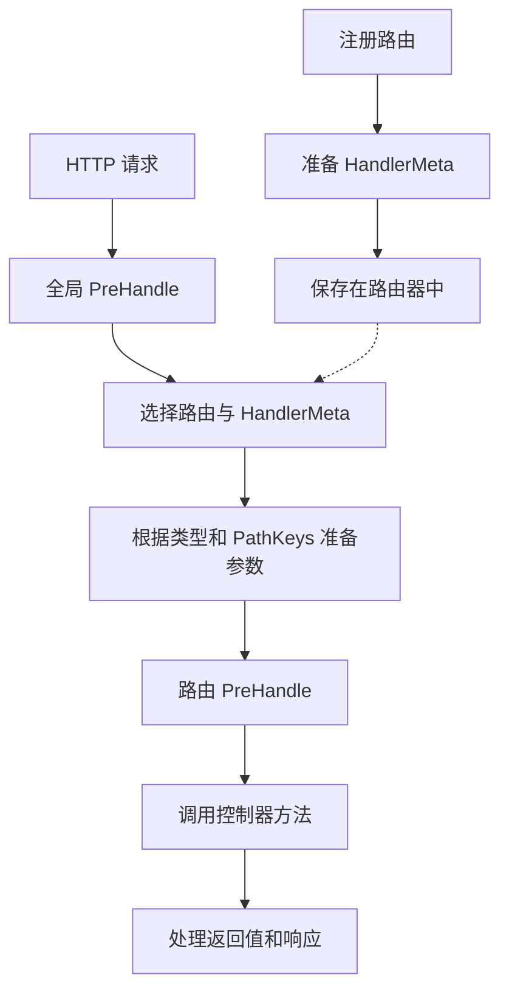

# 处理器元数据（HandlerMeta）

::: warning v0.7.0 Preview 输入 API 迁移
本页现有 API 说明和示例以稳定版 `v0.6.5` 为基准。从 `v0.7.0-preview.1` 起，可按输入来源使用独立的 Path、Query 和 Header DTO。`query.Values`、`header.Values` 及其构造和读取 API、`query.Pagination`、`path.Int`、`path.String`、`path.Boolean` 均标记为 Deprecated。

新的 DTO 方式不能直接用于 `v0.6.5`。在 Preview 中，同一处理器混用新 DTO 和 Deprecated 输入也会在启动时被拒绝。现有请求体 DTO 和上下文仍可与任一方式一起使用。

适用版本和迁移示例见 [Preview 处理器输入迁移](/zh-Hans/learn/migration/v0.7.0-preview)，规范选项见 [运行时 OpenAPI](/zh-Hans/reference/api/openapi)。
:::

`core.HandlerMeta` 保存执行与请求匹配的控制器方法所需的信息，包括控制器类型、方法、路径参数的顺序和路由拦截器。应用通过 `app.Route` 注册处理器，拦截器则可以读取 `HandlerMeta` 来确认执行目标。

本页按功能划分的 `src/user` 示例使用[项目结构](/zh-Hans/learn/tutorial/1-project-structure)中通过 `--layout legacy` 创建的 `my-app`。CLI `v0.4.2` 默认生成按角色划分的 `layered-v1` 结构。两种布局都使用 Spine `v0.6.5` 和 Echo 平台 `v0.1.0`。

本页以 Spine v0.6.5 的公开类型和 HTTP 执行流程为准。应用无需自行编写元数据创建函数或路由器的内部实现。

## 在 CLI 项目中的位置

以[CLI 项目结构](/zh-Hans/learn/tutorial/1-project-structure)中生成的 `example.com/my-app` 为例，用户路由声明在 `src/user/user_route.go` 的 `Register(app)` 中。生成的处理器是 `(*UserController).Get`，路径是 `GET /user/:id`。`internal/application/application.go` 中的 `BuildApplication` 会检查并返回 `user.Register(app)` 的错误，生成的 `main.go` 负责验证和运行。

```go
// 摘自 src/user/user_route.go 中的 Register
app.Route(
    "GET",
    "/user/:id",
    (*UserController).Get,  // 方法表达式
)
```

下面的 `GetUser`、管理员处理器和认证拦截器是用于说明概念的应用扩展示例。它们使用的方法与 CLI 生成的 `Get` 不同，要直接添加这些代码，还需实现相应的类型和方法。拦截器的完整实现和注册方法请参阅[拦截器教程](/zh-Hans/learn/tutorial/4-interceptor)。

## HandlerMeta 的字段

`core.HandlerMeta` 的字段如下，通过 `reflect` 类型表示控制器和方法信息。

```go
// core/handler_meta.go
type HandlerMeta struct {
    // 控制器类型（Container Resolve 的目标）
    ControllerType reflect.Type

    // 要调用的方法
    Method reflect.Method

    // 路由中声明的路径参数键的顺序
    PathKeys []string

    // 应用于处理器的拦截器
    Interceptors []Interceptor
}
```

| 字段 | 类型 | 作用 |
| --- | --- | --- |
| `ControllerType` | `reflect.Type` | 在依赖容器中查找的控制器指针类型 |
| `Method` | `reflect.Method` | 要调用的方法的名称、签名和函数信息 |
| `PathKeys` | `[]string` | 路由中声明的路径参数名称的顺序 |
| `Interceptors` | `[]core.Interceptor` | 应用于该路由的拦截器列表 |

如果 `ControllerType` 是 `*UserController`，`Method.Name` 是 `GetUser`，流水线就会从容器获取 `*UserController` 实例，然后调用 `GetUser`。

```go
meta.ControllerType  // reflect.Type of *UserController
```

```go
meta.Method.Name           // "GetUser"
meta.Method.Type           // func(*UserController, path.Int) (httpx.Response[User], error)
meta.Method.Func           // 可调用的 reflect.Value
```

`PathKeys` 保存路径参数的名称，而非实际请求值。例如，`/users/:userId/orders/:orderId` 会按顺序保存 `userId`、`orderId`，并按此顺序关联处理器中 `path` 类型的参数。每次请求中可能不同的路径参数值从请求上下文读取。

`Interceptors` 只包含路由拦截器。通过 `app.Interceptor` 注册的全局拦截器由流水线单独管理。

```go
meta.Interceptors  // []core.Interceptor（路由级别）
```

## 使用方法表达式注册处理器

向路由传入 `(*UserController).GetUser` 这样的**方法表达式**。这种表达式是未绑定到特定控制器实例的函数，第一个参数接收控制器指针。

```go
// 方法表达式的实际类型
func(*UserController, path.Int) (httpx.Response[User], error)
//   ↑ receiver 转为第一个参数
```

Spine 根据这些信息确定控制器类型和要调用的方法，再根据应用注册的构造函数，从依赖容器获取控制器实例。

请区分以下注册形式。

| 注册形式 | 是否使用 | 说明 |
| --- | --- | --- |
| `(*UserController).GetUser` | 使用 | 第一个参数为 `*UserController` 的方法表达式 |
| `UserController.GetUser` | 不使用 | 第一个参数接收值类型，不满足指针类型的要求 |
| `ctrl.GetUser` | 不使用 | 这是绑定到特定实例的方法值，不再单独接收控制器参数 |
| 普通函数或闭包 | 不使用 | 不符合用于识别控制器类型和方法的注册形式 |

这些条件针对传给路由的表达式形式。请按照教程使用指针接收者编写应用的控制器，并以 `(*Controller).Method` 的形式注册。

## 指定路由拦截器

`route.WithInterceptors` 接收应用于该路由的拦截器。使用时需导入 `github.com/NARUBROWN/spine/pkg/route`。

```go
app.Route(
    "GET",
    "/users/:id",
    (*UserController).GetUser,
    route.WithInterceptors(&AuthInterceptor{}),
)
```

有两种传入拦截器的方式。

| 传入值 | 创建方式 |
| --- | --- |
| `&AuthInterceptor{}` | 直接使用应用创建的实例 |
| `(*AuthInterceptor)(nil)` | 在启动初始化时，由容器创建该指针类型的实例 |

对于需要依赖注入的拦截器，可以传入带类型的 nil 指针。此时必须注册拦截器构造函数及其所需依赖。传入不带类型信息的 `nil` 会导致路由拦截器注册失败。

```go
// 摘自 src/user/user_route.go 中的 Register
app.Route("GET", "/users/:id", (*UserController).GetUser)

// 搭配路由拦截器
app.Route("GET", "/admin/users/:id", (*AdminController).GetUser,
    route.WithInterceptors((*AuthInterceptor)(nil)),  // nil 指针 → 在 Container 中 Resolve
)
```

全局拦截器和路由拦截器也可以一起使用。全局拦截器应用于所有请求，路由拦截器仅应用于对应路由。

```go
// 全局：应用于所有请求（路由匹配前执行）
app.Interceptor(&CORSInterceptor{})

// 路由：仅应用于特定处理器（路由匹配后、Controller 调用前执行）
app.Route("GET", "/admin/:id", (*AdminController).Get,
    route.WithInterceptors(&AuthInterceptor{}),
)
```

## 在拦截器中确认执行目标

拦截器的 `PreHandle`、`PostHandle`、`BeforeResponse` 和 `AfterCompletion` 都接收 `HandlerMeta`。记录日志或应用针对特定处理器的策略时，可以读取这些信息。

全局 `PreHandle` 在路由匹配之前执行，因此收到的 `HandlerMeta` 为空。此时 `ControllerType` 为 nil，`Method.Name` 也为空。路由确定后会传入实际处理器的元数据，但如果请求在路由匹配时就失败，仍可能没有执行目标。请在访问字段前先检查。

下面仅摘录了 `PreHandle` 方法作为示例，需要导入 `core` 和 `log`。要将拦截器注册到应用中，还需实现其余三个方法。

```go
// src/interceptor/logging_interceptor.go
func (i *LoggingInterceptor) PreHandle(ctx core.ExecutionContext, meta core.HandlerMeta) error {
    controllerName := "<unresolved>"
    if meta.ControllerType != nil {
        controllerName = meta.ControllerType.String()
    }
    log.Printf(
        "[REQ] %s %s -> %s.%s",
        ctx.Method(),
        ctx.Path(),
        controllerName,
        meta.Method.Name,            // "GetUser"
    )
    return nil
}
```

`core.ExecutionContext` 用于让拦截器访问请求信息。HTTP 控制器无需将同一类型声明为参数。请在控制器中声明符合[基于类型的参数注入](/zh-Hans/learn/tutorial/2-controller)要求的请求类型。

## 注册阶段与请求执行阶段

启动初始化时，路由声明会被整理为执行所需的信息。

1. 从 `app.Route` 声明的处理器中确定控制器类型和方法。
2. 准备路由拦截器，并将其关联到 `HandlerMeta`。
3. 向路由器注册完整路径和路径参数的顺序。
4. 提前创建已注册的控制器及其依赖。

如果处理器形式不正确，或者无法创建控制器、拦截器的依赖，服务器启动就会失败。请保留生成项目中的错误返回路径，将这类失败传递给调用方。

请求到达后，按以下顺序使用准备好的元数据。

1. 执行全局拦截器的 `PreHandle`。
2. 查找与请求匹配的路由，获取 `HandlerMeta`。
3. 根据方法的参数类型和 `PathKeys` 准备参数。
4. 执行路由拦截器的 `PreHandle`。
5. 获取控制器实例并调用方法。
6. 处理返回值，完成响应前处理，然后发送响应。

正常执行的流程如下。发生错误或拦截器请求中断时，后续步骤可能被跳过。



对于成功的请求，`PostHandle` 先在路由拦截器中执行，再在全局拦截器中执行；各列表内部则按注册的逆序调用。`BeforeResponse` 和 `AfterCompletion` 的错误处理及执行条件请参阅[拦截器教程](/zh-Hans/learn/tutorial/4-interceptor)。

## 发生错误时的检查位置

| 情况 | 检查内容 |
| --- | --- |
| 处理器注册失败 | 检查是否为 `(*Controller).Method` 形式，以及是否能找到对应方法 |
| 控制器创建失败 | 检查是否注册了控制器构造函数及其接收的依赖 |
| 路由拦截器创建失败 | 检查是否使用了带类型的 nil 指针，以及是否注册了所需构造函数 |
| 请求参数准备失败 | 检查处理器参数类型是否受支持，以及路径参数声明顺序是否正确 |
| 没有匹配的路由 | 检查 HTTP 方法、路径和全局路径前缀。默认 HTTP 处理会返回 404 错误响应 |

`HandlerMeta` 描述处理器的执行目标。请求数据的转换由参数解析器负责，将实际返回值转换为 HTTP 响应则由返回值处理器负责。在自行替换这些组件的职责之前，请先检查路由声明和控制器签名。
