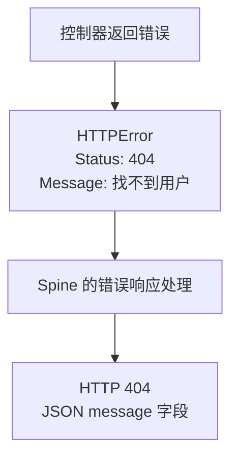

# httperr 包

`httperr` 是用于保存 HTTP 状态码和向客户端传递的错误消息的包。控制器返回 `httperr.NotFound("사용자를 찾을 수 없습니다")` 这样的错误时，Spine 会将其转换为状态码和 JSON 错误响应。控制器无需直接操作 Echo 等框架的响应对象。

本页以 Spine v0.6.5 的 `github.com/NARUBROWN/spine/pkg/httperr` 为准。

## 在 CLI 项目中使用

下面的控制器代码片段可添加到[通过 CLI 生成的项目](/zh-Hans/learn/tutorial/1-project-structure)中。`httpx`、`httperr` 和 `path` 分别是 `github.com/NARUBROWN/spine/pkg` 下的包。请将控制器构造函数和路由接入 `BuildApplication` 使用的注册流程。`User`、存储库和服务等业务类型由应用定义。

成功值使用 `httpx.Response[T]` 包装，失败时同时返回空响应值和错误。接收请求正文的示例中，DTO 声明为 `*PaymentRequest` 这样的指针类型。

```go
func (c *UserController) GetUser(userId path.Int) (httpx.Response[User], error) {
    if userId.Value <= 0 {
        return httpx.Response[User]{}, httperr.BadRequest("유효하지 않은 사용자 ID입니다")
    }

    user, err := c.repo.FindByID(userId.Value)
    if err != nil {
        return httpx.Response[User]{}, httperr.NotFound("사용자를 찾을 수 없습니다")
    }

    return httpx.Response[User]{Body: user}, nil
}
```

如果将此方法注册到 `GET /users/:id`，响应如下。示例假设将存储库的所有查询错误都作为 404 处理。实际应用中，请区分查询结果不存在和数据库故障，再选择相应的状态码。

```bash
# 잘못된 ID
GET /users/-1
→ 400 {"message": "유효하지 않은 사용자 ID입니다"}

# 존재하지 않는 사용자
GET /users/999
→ 404 {"message": "사용자를 찾을 수 없습니다"}

# 정상
GET /users/123
→ 200 {"id": 123, "name": "john"}
```



## HTTPError 的字段

`HTTPError` 实现了 Go 的 `error` 接口，`Error()` 返回 `Message`。

```go
// pkg/httperr/types.go
type HTTPError struct {
    Status  int    // HTTP 상태 코드
    Message string // 에러 메시지
    Cause   error  // 원인 에러 (선택)
}

// error 인터페이스 구현
func (e *HTTPError) Error() string {
    return e.Message
}
```

| 字段 | 类型 | 用途 |
| --- | --- | --- |
| `Status` | `int` | 发送给客户端的 HTTP 错误状态码 |
| `Message` | `string` | 发送到 JSON 响应 `message` 字段的消息 |
| `Cause` | `error` | 应用保存的原始错误，不包含在 JSON 响应中 |

辅助函数返回 `error` 接口类型，但实际值是 `*httperr.HTTPError`。可以通过 `errors.As` 查找此类型。即使使用 `fmt.Errorf("문맥: %w", err)` 这样的形式包装错误，Spine 也会找到内部的 `HTTPError`，并使用它的状态码和 `Message`。

`Message` 会原样传给客户端。SQL、机密值、内部路径等不应公开的信息不要放在消息中，应保存在原始错误或日志中。

## 基础辅助函数

Spine v0.6.5 提供以下四个辅助函数，都接收 `msg string` 并返回 `error`。

| 函数 | 状态码 | 适用情况 |
| --- | --- | --- |
| `BadRequest(msg)` | 400 | 请求值不满足 API 的要求 |
| `Unauthorized(msg)` | 401 | 缺少认证信息或认证失败 |
| `NotFound(msg)` | 404 | 找不到请求的资源 |
| `InternalServerError(msg)` | 500 | 需要以明确的消息响应服务器内部错误 |

### 无效的请求值

类型转换完成后，如果仍需检查业务条件，可以使用 `BadRequest`。

```go
func BadRequest(msg string) error {
    return &HTTPError{Status: 400, Message: msg}
}
```

```go
if userId.Value <= 0 {
    return httpx.Response[User]{}, httperr.BadRequest("유효하지 않은 사용자 ID입니다")
}
```

### 认证失败

需要认证或认证失败时，使用 `Unauthorized`。如果用户已通过认证但权限不足，可以像下方扩展示例那样选择 403 状态码。

```go
func Unauthorized(msg string) error {
    return &HTTPError{Status: 401, Message: msg}
}
```

```go
if !c.auth.IsValid(token) {
    return httpx.Response[User]{}, httperr.Unauthorized("인증이 필요합니다")
}
```

### 资源不存在

请求的资源不存在时，使用 `NotFound`。

```go
func NotFound(msg string) error {
    return &HTTPError{Status: 404, Message: msg}
}
```

```go
user, err := c.repo.FindByID(id)
if err != nil {
    return httpx.Response[User]{}, httperr.NotFound("사용자를 찾을 수 없습니다")
}
```

### 服务器内部错误

`InternalServerError` 返回状态码 500 和指定的消息。与直接返回普通 `error` 不同，这条消息会向客户端公开。

```go
func InternalServerError(msg string) error {
    return &HTTPError{Status: 500, Message: msg}
}
```

```go
result, err := c.externalService.Call()
if err != nil {
    return httpx.Response[Result]{}, httperr.InternalServerError("외부 서비스 호출에 실패했습니다")
}
```

## 控制器返回值与错误响应

Spine 会先在控制器返回值中查找非 nil 的错误。如果存在错误，就不会将成功值作为响应处理。

| 返回值 | 默认 HTTP 处理 |
| --- | --- |
| `httpx.Response[T]`，nil 错误 | 处理成功值 |
| `httpx.Response[T]`、`httperr.NotFound(...)` | 以 404 错误响应代替成功值 |
| `httpx.Response[T]`、普通 `error` | 以 500 错误响应代替成功值 |
| 只返回 `error`，且值为 nil | 不写入错误响应 |

请将 JSON 成功值放入 `httpx.Response[T]` 返回。重定向和二进制响应分别使用 `httpx.Redirect` 和 `httpx.Binary`。返回任意 DTO 与返回 HTTP 成功响应类型是不同的。

错误响应正文的格式为 `{"message":"..."}`。默认处理的区别如下。

| 错误类型 | 状态码 | `message` |
| --- | --- | --- |
| `*httperr.HTTPError` | `Status` 中指定的错误状态码 | `Message` |
| 通过 `%w` 包装 `HTTPError` 的错误 | 内部 `HTTPError` 的状态码 | 内部 `HTTPError` 的 `Message` |
| 普通 `error` | 500 | `"Internal server error"` |

普通错误的 `Error()` 字符串不会暴露在默认错误响应中。请通过 `httperr` 明确表达客户端需要知道的失败条件，并在日志中查看详细原因。

## 验证业务规则

接收请求正文后，仍需检查金额、限额、余额等由应用规定的条件。在各失败分支返回错误后，Spine 会处理该错误，不再创建成功响应。

```go
func (c *PaymentController) Process(req *PaymentRequest) (httpx.Response[Receipt], error) {
    if req.Amount <= 0 {
        return httpx.Response[Receipt]{}, httperr.BadRequest("결제 금액은 0보다 커야 합니다")
    }

    if req.Amount > 10000000 {
        return httpx.Response[Receipt]{}, httperr.BadRequest("1회 결제 한도를 초과했습니다")
    }

    balance, err := c.wallet.GetBalance(req.UserID)
    if err != nil {
        return httpx.Response[Receipt]{}, httperr.NotFound("지갑을 찾을 수 없습니다")
    }

    if balance < req.Amount {
        return httpx.Response[Receipt]{}, httperr.BadRequest("잔액이 부족합니다")
    }

    receipt, err := c.processPayment(req)
    if err != nil {
        return httpx.Response[Receipt]{}, err
    }
    return httpx.Response[Receipt]{Body: receipt}, nil
}
```

示例中的 `PaymentRequest`、`Receipt`、钱包查询和支付处理都由应用实现。区分钱包不存在与查询系统故障也是应用的责任。如果 `c.processPayment` 返回普通错误，客户端会收到默认的 500 消息。

## 只返回错误的处理器

不需要成功响应正文的方法可以只返回 `error`。

```go
func (c *UserController) DeleteUser(userId path.Int) error {
    exists, err := c.repo.Exists(userId.Value)
    if err != nil || !exists {
        return httperr.NotFound("사용자를 찾을 수 없습니다")
    }

    if err := c.repo.Delete(userId.Value); err != nil {
        return httperr.BadRequest("삭제할 수 없습니다")
    }

    return nil  // 성공 시 nil 반환
}
```

返回 nil 时，不会写入错误响应。仅凭这种形式不会指定某个成功状态码。如果删除成功后需要明确返回 204 等状态码，请使用 `httpx` 响应类型。

为保持简洁，示例分别将存在性检查错误和删除错误作为 404、400 处理。实际应用中，必须根据存储库错误的类型区分状态码和重试策略。

## 使用其他错误状态码

对于基础辅助函数未提供的状态码，可以直接创建 `HTTPError`。以下函数是由应用定义的示例，不是 `httperr` 提供的函数。

```go
// 직접 HTTPError 생성
func Forbidden(msg string) error {
    return &httperr.HTTPError{Status: 403, Message: msg}
}

func Conflict(msg string) error {
    return &httperr.HTTPError{Status: 409, Message: msg}
}

func UnprocessableEntity(msg string) error {
    return &httperr.HTTPError{Status: 422, Message: msg}
}

func TooManyRequests(msg string) error {
    return &httperr.HTTPError{Status: 429, Message: msg}
}
```

错误状态码请使用 400 到 599 之间的值。写入响应时也会检查状态码是否有效，因此不要向 `HTTPError.Status` 填入成功或重定向状态码来控制流程。

## 保存原始错误与记录日志

使用 `Cause` 可以同时保存展示给客户端的消息和内部原因。下面的 `WithCause` 是应用自行定义的辅助函数。

```go
func WithCause(status int, msg string, cause error) error {
    return &httperr.HTTPError{
        Status:  status,
        Message: msg,
        Cause:   cause,
    }
}

// 사용
user, err := c.repo.FindByID(id)
if err != nil {
    return httpx.Response[User]{}, WithCause(404, "사용자를 찾을 수 없습니다", err)
}
```

`HTTPError.Unwrap()` 返回 `Cause`。可使用 `errors.Is` 和 `errors.As` 检查原因链，也可直接读取 `Cause` 字段。原因错误不会包含在 JSON 响应中。

在拦截器的 `AfterCompletion` 中，可以在请求结束后记录原始错误。下面仅摘录了该方法作为示例，使用了 `core`、`httperr`、`errors` 和 `log` 包。要将实现注册到应用中，还需要 `PreHandle`、`PostHandle` 和 `BeforeResponse` 方法。

```go
func (i *LoggingInterceptor) AfterCompletion(ctx core.ExecutionContext, meta core.HandlerMeta, err error) {
    if err != nil {
        var httpErr *httperr.HTTPError
        if errors.As(err, &httpErr) && httpErr.Cause != nil {
            log.Printf("[ERR] %s %s: %s (cause: %v)",
                ctx.Method(), ctx.Path(), httpErr.Message, httpErr.Cause)
        }
    }
}
```

## 执行期间的错误与响应完成之后

除控制器返回的错误外，路由匹配、参数转换、控制器调用和响应处理期间也可能发生错误。Spine 会在 HTTP 执行流程中，将这些错误转换为最终错误响应。

| 情况 | 默认行为 |
| --- | --- |
| 没有匹配的路由 | 404 错误响应 |
| 执行期间发生 `HTTPError` | 使用指定的错误状态码和消息响应 |
| 所选验证器的 DTO 规则违反（`validation.Error`） | 包含 `message` 和 `fields` 的 400 响应 |
| 发生普通执行错误 | 500，`"Internal server error"` 响应 |
| 超出请求正文大小限制 | 413，`"Request entity too large"` 响应 |
| 实际响应已经写入 | 不再写入额外错误响应，避免重复响应 |

Spine v0.6.5 会在完成响应前处理后，将准备好的响应写入实际传输层。如果 `BeforeResponse` 中发生错误，正在准备的成功响应可能会变为错误响应。`AfterCompletion` 在响应处理之后执行，因此在此阶段应记录错误和传输结果，而非尝试写入新的错误响应。

请通过 Go 返回值传递错误。不要使用 `panic` 表达正常的输入验证失败或业务失败。拦截器的中断和收尾处理请参阅[拦截器教程](/zh-Hans/learn/tutorial/4-interceptor)。
