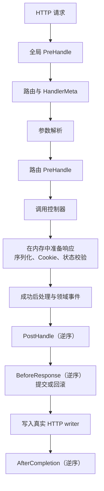

# 执行管道

控制器示例用于扩展 [CLI 生成的项目](/zh-Hans/learn/tutorial/1-project-structure)。成功响应使用 `github.com/NARUBROWN/spine/pkg/httpx` 中的 `httpx.Response[T]` 包装，请求 DTO 使用指针，并在 `BuildApplication` 注册构造函数及路由。

Spine 在写出 HTTP 响应之前完成业务执行、响应准备和可失败的提交阶段。v0.5.1 的顺序如下：



## 阶段保证

1. 全局拦截器在路由前执行 `PreHandle`；路由拦截器在参数解析后、控制器前执行。
2. 控制器错误和响应准备错误都会成为 `executionErr`。
3. JSON 序列化、Cookie/状态校验和返回值处理先在内存中完成。
4. 只有响应可准备时才运行领域事件后处理；随后执行 `PostHandle`。
5. 成功完成 `PreHandle` 的拦截器按逆序执行 `BeforeResponse`。任一错误都会阻止成功响应写出。
6. 准备好的响应仅在所有 `BeforeResponse` 成功后写入真实 writer。
7. `AfterCompletion` 最后执行，用于日志、指标和清理，不用于决定事务提交。

## 拦截器错误与中止

`PreHandle` 返回普通错误时，管道进入错误响应路径。返回 `core.ErrAbortPipeline` 表示拦截器已经完成所需处理，例如 CORS 预检；仍会为已进入的拦截器执行完成阶段。

```go
type Interceptor interface {
	PreHandle(ctx ExecutionContext, meta HandlerMeta) error
	PostHandle(ctx ExecutionContext, meta HandlerMeta)
	BeforeResponse(ctx ExecutionContext, meta HandlerMeta, executionErr error) error
	AfterCompletion(ctx ExecutionContext, meta HandlerMeta, err error)
}
```

## 响应与外部副作用

准备响应后再派发领域事件，可以防止序列化或 Cookie/状态校验失败时提前发布事件。但数据库提交、消息代理发布和物理套接字写入不能构成同一个原子事务。需要可靠跨系统一致性时，应使用 transactional outbox、幂等键和至少一次交付设计。

## HTTP、消费者与 WebSocket

HTTP、消息消费者和 WebSocket 都复用管道概念，但上下文与返回处理器按传输区分。`App.Interceptor` 默认同时注册到 HTTP 与 WebSocket；需要显式范围时使用 `InterceptorFor`。WebSocket 握手认证是消息管道之前的独立阶段，连接槽位先保留，再调用 `PreHandshake`，最后才 upgrade。

有关事务边界，请参阅[事务管理教程](/zh-Hans/learn/tutorial/6-transaction)。
