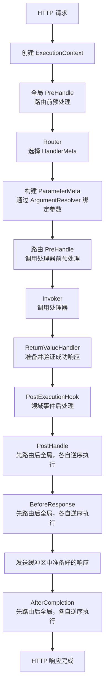

# 执行流水线

::: info
旧构造函数和方法表达式为兼容性保留。回调请参阅[控制器迁移](/zh-Hans/learn/migration/preview-controller-routes)，输入限制请参阅[输入迁移](/zh-Hans/learn/migration/v0.7.1-preview)，文档选项请参阅 [OpenAPI](/zh-Hans/reference/api/openapi)。
:::

Spine 的执行流水线接收请求、选择处理器、绑定参数，再将返回值转换为响应。要理解拦截器应在哪个时点执行，以及发生错误后流程会进行到哪一步，可以以这条流程为依据。

本文说明 Spine v0.7.1 的 HTTP 执行顺序。HTTP、事件消费者和 WebSocket 使用相同的流水线实现，但解析输入的解析器和响应处理配置各不相同。

控制器示例是添加到 [CLI 生成的项目](/zh-Hans/learn/tutorial/1-project-structure)中的代码。请求 DTO 使用指针接收，普通的成功响应使用 `github.com/NARUBROWN/spine/pkg/httpx` 中的 `httpx.Response[T]` 返回。构造函数和路由在 `BuildApplication` 中注册。

## HTTP 请求的执行顺序

正常请求按以下顺序处理。各拦截器的 `PreHandle` 按注册顺序执行，后处理方法按相反顺序执行。



处理器返回的成功响应不会立即发送。流水线先在缓冲区中准备响应，等后处理和 `BeforeResponse` 完成后，再写入实际的 HTTP 响应。如果中途发生错误，可以将待发送的响应替换为错误响应。

## 创建请求上下文

HTTP 适配器为每个请求创建一个 `core.ExecutionContext`。流水线通过这个对象读取请求方法和路径、共享拦截器保存的值，并收集属于该请求的事件。

即使使用同一个上下文，各组件的访问范围也不同。

| 组件 | 上下文的使用方式 |
| --- | --- |
| 路由器 | 根据方法和路径查找处理器，并保存路径参数 |
| 拦截器 | 查询请求信息、保存执行状态，以及在响应前后处理 |
| 参数解析器 | 从上下文中生成控制器参数 |
| 返回值处理器 | 使用上下文关联的响应写入器准备响应 |
| 控制器 | 通过语义类型、`context.Context` 和只读的 `spine.Ctx` 仅接收所需的值 |

`core.ExecutionContext` 不会直接注入控制器。如果控制器需要读取拦截器保存的值，请使用 `pkg/spine.Ctx`。各方法的访问范围参见[执行上下文](/zh-Hans/learn/core-concepts/execution-context)。

## 全局拦截器：路由前处理

通过 `app.Interceptor()` 注册的全局拦截器，其 `PreHandle` 最先执行。此时尚未选择处理器，因此会向这次调用传入空的 `core.HandlerMeta{}`。

这个阶段用于 CORS 预检等需要在选择路由前处理的工作。例如，CORS 拦截器可以为获准的 `OPTIONS` 请求准备响应，然后返回 `core.ErrAbortPipeline`，中止后续执行。

在全局 `PreHandle` 中，需要考虑以下限制。

- 尚未确定要执行的控制器和方法。
- Spine 路由器尚未保存路径参数。
- 请求 DTO 和 `input.Path[int64]` 等控制器参数也尚未生成。

路由成功后执行的 `PostHandle`、`BeforeResponse`、`AfterCompletion` 会收到所选处理器的元数据。如果在路由前中止或失败，则使用空元数据完成后续收尾。

## 路由器：选择处理器和路径参数

路由器通过 `ctx.Method()` 和 `ctx.Path()` 查找已注册的处理器。找不到匹配的处理器时，返回 404 错误。如果路径中有参数，则将值保存到上下文中，并在元数据中保留声明顺序。

`HandlerMeta` 包含执行目标和路由配置。

```go
// core/handler_meta.go
type HandlerMeta struct {
    ControllerType reflect.Type   // 从依赖容器中查找的控制器类型
    Method         reflect.Method // 要调用的方法
    Callback       reflect.Value
    PathKeys       []string       // 路由中声明的路径参数顺序
    Interceptors   []Interceptor  // 要应用于此处理器的拦截器
}
```

`HandlerMeta` 不要求为每个请求新建控制器。旧方法表达式从容器获取控制器；新路由回调调用准备阶段绑定的函数。详情参见 [HandlerMeta](/zh-Hans/learn/core-concepts/handler-meta)。

## 参数绑定：ParameterMeta 和 ArgumentResolver

选定处理器后，流水线读取函数签名，为每个参数构建表示其类型和位置的 `ParameterMeta`。随后，在已注册的解析器中，由第一个支持该类型的解析器生成值。

如果解析器无法生成值，或没有支持该类型的解析器，流程会跳过控制器调用，转入错误处理。**这个阶段先于路由拦截器的 `PreHandle` 执行。** 因此，不要假定路由拦截器能在请求体绑定前执行检查。

### 路径输入绑定

在 v0.7.1 中，每个路径变量对应一个标量 `input.Path[T]` 参数，顺序与路由一致。数量必须相同，且不能在同一处理器中混用路径 DTO 或旧路径包装类型。

### HTTP 支持的输入

除 `context.Context` 和 `spine.Ctx` 外，处理器还可接收 `input.Path[T]`、`input.Query[T]` 和 `input.Body[T]`。请求头使用带 `header` 标签的独立结构体指针，文件使用 `multipart.UploadedFiles`。旧 `path` 包装类型、`query.Values`、`header.Values` 和 `query.Pagination` 已弃用，不能在同一处理器中与新的 Path、Query 或 Header 输入混用。

### 解析器的契约

以下是内部解析器遵循的契约。应用无需复制这个接口或 `internal/` 包来注册它们。

```go
type ArgumentResolver interface {
    Supports(parameterMeta ParameterMeta) bool
    Resolve(ctx core.ExecutionContext, parameterMeta ParameterMeta) (any, error)
}
```

解析器接收通用的 `ExecutionContext` 后，如果需要 HTTP 输入，会通过类型断言检查是否支持 `core.HttpRequestContext`。消费者和 WebSocket 解析器分别从对应协议的上下文中读取消息体。

## 路由拦截器：调用处理器前处理

通过 `api.Interceptors()` / `route.WithInterceptors()` 注册的拦截器仅应用于指定处理器。由于 `PreHandle` 在路由和参数绑定完成后调用，因此可以使用选定的 `HandlerMeta` 和路径参数。

| 类别 | 注册方式 | `PreHandle` 执行时点 | 传入的元数据 |
| --- | --- | --- | --- |
| 全局 | `app.Interceptor()` | 路由前 | 空的 `HandlerMeta{}` |
| 路由 | `api.Interceptors()` / `route.WithInterceptors()` | 参数绑定后、调用处理器前 | 选定的 `HandlerMeta` |

两种方式都实现 `core.Interceptor` 的四个方法。

```go
// core/interceptor.go
type Interceptor interface {
    PreHandle(ctx ExecutionContext, meta HandlerMeta) error
    PostHandle(ctx ExecutionContext, meta HandlerMeta)
    BeforeResponse(ctx ExecutionContext, meta HandlerMeta, executionErr error) error
    AfterCompletion(ctx ExecutionContext, meta HandlerMeta, err error)
}
```

如果 `PreHandle` 返回普通错误，流程转入错误处理。如果返回 `core.ErrAbortPipeline`，则视为主动结束请求。这种情况下，拦截器必须自行准备所需的响应。两种情况下，后续的 `PreHandle` 和控制器都不会执行。

注册示例参见[拦截器教程](/zh-Hans/learn/tutorial/4-interceptor)。

## Invoker：调用控制器

Invoker 使用绑定的参数调用新路由回调。对于旧方法表达式，它先从依赖容器获取控制器实例。处理器检查输入、调用服务并返回结果或错误。

以下方法是添加到已有 `UserController`、`User` 和 `c.repo` 的应用中的示例。`input`、`httpx`、`httperr` 分别从 Spine 的 `pkg/` 包导入。

```go
func (c *UserController) GetUser(userId input.Path[int64]) (httpx.Response[User], error) {
    if *userId <= 0 {
        return httpx.Response[User]{}, httperr.BadRequest("유효하지 않은 사용자 ID")
    }
    user, err := c.repo.FindByID(*userId)
    if err != nil {
        return httpx.Response[User]{}, err
    }
    return httpx.Response[User]{Body: user}, nil
}
```

`userId` 的数值转换在调用控制器前就已完成。上面的 `BadRequest` 只在转换后的数值小于等于 0 时执行。不要假定无法转换为数值的路径值会进入这项检查。

## ReturnValueHandler：将返回值转换为响应

流水线首先在返回值中查找非 `nil` 的 `error`。如果存在错误，就跳过成功值处理，转入错误响应流程。如果没有错误，则将第一个非 `nil` 的成功值交给支持它的返回值处理器。

带有类型信息的指针或接口中包含 `nil` 的情况也会被跳过。返回不受支持的成功值类型会导致错误。请使用 `httpx.Response[T]` 包装普通结构体，不要直接返回结构体。

| 返回值处理器 | 支持的返回类型 | HTTP 响应 |
| --- | --- | --- |
| `RedirectReturnValueHandler` | `httpx.Redirect` 及其指针 | `Location` 响应头和状态码，默认 302 |
| `BinaryReturnHandler` | `httpx.Binary` 及其指针 | 二进制响应体 |
| `StringReturnHandler` | `httpx.Response[string]` 及其指针 | 文本响应体 |
| `JSONReturnHandler` | 响应体不是字符串的 `httpx.Response[T]` 及其指针 | JSON 响应体 |
| `ErrorReturnHandler` | `error` | 包含状态码和 `message` 的 JSON |

可以通过 `ResponseOptions` 指定状态码、响应头和 Cookie。如果在准备响应时序列化或 Cookie 验证失败，则不会发送成功响应。

内部返回值处理器的契约如下。

```go
type ReturnValueHandler interface {
    Supports(returnType reflect.Type) bool
    Handle(value any, ctx core.ExecutionContext) error
}
```

## PostExecutionHook：事件后处理

成功返回值的序列化和响应验证完成后，执行已注册的 `PostExecutionHook`。领域事件分发钩子从请求的 EventBus 中取出事件，再交给分发器。

如果处理器返回了错误，或成功响应准备失败，就不会进入这个阶段。钩子本身返回错误时，也会视为执行失败，并跳过后续的 `PostHandle`。

这个阶段结束并不代表 HTTP 响应已发送完毕。`BeforeResponse` 和实际响应发送会在后面执行。事件收集和发布方式参见[执行上下文的 EventBus](/zh-Hans/learn/core-concepts/execution-context#event-publishing)。

## 响应前后的拦截器处理

### PostHandle

处理器、成功响应准备和后处理钩子全部成功后，才会调用 `PostHandle`。先逆序执行路由拦截器，再逆序执行全局拦截器。

`PostHandle` 不能返回错误。事务提交等需要将结果反映到最终响应中的工作，应在 `BeforeResponse` 中处理。

### BeforeResponse

在成功和失败两条路径中，`BeforeResponse` 都**只调用 `PreHandle` 已成功的拦截器**。先逆序执行路由拦截器，再逆序执行全局拦截器。

`executionErr` 会收到截至该时点发生的错误。如果 `BeforeResponse` 返回新错误，流水线会将其与已有错误合并，传给下一个拦截器和最终错误处理。事务拦截器可以在此时根据执行是否成功来提交或回滚。

在 `PreHandle` 中返回错误或 `core.ErrAbortPipeline` 的拦截器自身，不会被调用 `BeforeResponse`。

### AfterCompletion

响应处理后，调用 `AfterCompletion`。如果已经选定路由，先逆序调用全部路由拦截器，再逆序调用全部全局拦截器。成功、错误和主动中止都会经过这个清理阶段。

调用范围与 `BeforeResponse` 不同。即使拦截器未能执行 `PreHandle`，或在 `PreHandle` 中失败，也可能被调用 `AfterCompletion`。请确保清理代码在尚未创建资源时也能正常工作。如果在路由前结束，因为尚未选择路由拦截器，所以只执行全局清理。

这个阶段用于日志记录、指标收集和资源清理。由于此时已尝试写入 HTTP 响应，`AfterCompletion` 中发生的错误无法改变已经发送的响应。

## 错误响应与响应发送 {#error-responses}

执行错误在 `BeforeResponse` 结束后转换为 HTTP 错误响应。如果已准备成功响应，则撤销它并准备错误响应。随后，将缓冲区中的响应写入实际的响应写入器。

| 错误条件 | HTTP 处理 |
| --- | --- |
| 找不到已注册的处理器 | 404 |
| 有效的 `httperr.HTTPError` | 指定的状态码和消息 |
| 所选验证器的 DTO 规则违反（`validation.Error`） | 包含 `message` 和 `fields` 的 400 响应 |
| 请求体超出限制的 `http.MaxBytesError` | 413 |
| 未单独映射的执行错误 | 500、`Internal server error` |
| 实际响应已经提交 | 不重复写入响应 |

Spine `v0.7.1` 配合 Echo 平台 `v0.2.0`，对格式错误的 JSON、数字或布尔路径值转换失败返回 HTTP 400，对不支持的正文 Content-Type 返回 415，对超出正文大小限制返回 413。绑定失败发生在控制器调用之前。请区分绑定失败与业务验证，并通过实际请求确认。

如果实际发送响应时发生错误，该错误会计入最终执行错误。如果响应尚未提交，流水线会尝试写入 500 响应。已经发送的响应无法撤销。

## 不同中止点的执行范围

以下示例假设分别注册了一个全局拦截器和一个路由拦截器。`before` 表示 `BeforeResponse`，`after` 表示 `AfterCompletion`。

### 正常处理

```text
pre:global → routing → binding → pre:route → handler
→ return → hook → post:route → post:global
→ before:route → before:global → flush → after:route → after:global
```

### 在路由 PreHandle 中中止

```text
pre:global → routing → binding → pre:route(中止)
→ before:global → flush → after:route → after:global
```

不会调用控制器。中止流程的路由拦截器不会被调用 `BeforeResponse`，但会被调用 `AfterCompletion`。

### 在全局 PreHandle 中中止

```text
pre:global(中止) → flush → after:global
```

不会执行路由和参数绑定。这个示例中没有成功的 `PreHandle`，因此也不会调用 `BeforeResponse`。

### 参数绑定失败

```text
pre:global → routing → binding(失败)
→ before:global → 准备错误响应 → flush → after:route → after:global
```

由于路由拦截器已被选定，因此会调用 `AfterCompletion`。但该拦截器的 `PreHandle` 尚未执行，所以不会调用路由 `BeforeResponse`。

## HTTP 之外的执行

事件消费者和 WebSocket 也在各自的流水线实例中使用相同的执行结构。HTTP 的解析器和返回值处理器不会原样应用于这些协议。

| 执行类型 | 路由依据 | 默认参数 | 响应处理 |
| --- | --- | --- | --- |
| HTTP | HTTP 方法和请求路径 | `context.Context`、`spine.Ctx`、路径和查询参数类型、DTO 等 | 通过 HTTP 返回值处理器准备响应 |
| 事件消费者 | `EVENT` 和事件名称 | `context.Context`、事件名称、原始负载、结构体 DTO | 由消费者运行时处理执行结果 |
| WebSocket | `WS` 和连接请求路径 | `context.Context`、`ws.ConnectionID`、原始负载、结构体 DTO | 使用消息处理器的发送 API |

尤其要注意，HTTP DTO 接收指针，而默认的消费者和 WebSocket DTO 解析器支持结构体值。HTTP 的 `spine.Ctx` 解析器也未注册到默认的消费者和 WebSocket 流水线中。各协议的上下文和输入差异参见[执行上下文](/zh-Hans/learn/core-concepts/execution-context)。
