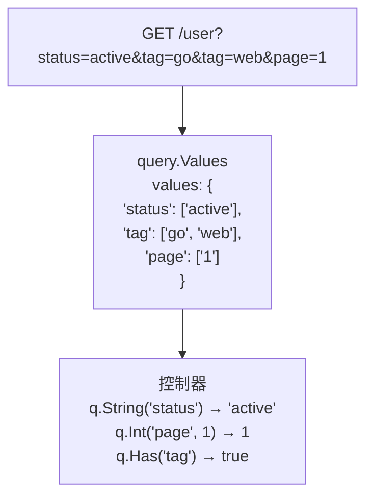

# query.Values

使用 `query.Values` 可以读取 HTTP 查询参数并指定默认值。在控制器参数中声明 `q query.Values` 后，即可按需将键对应的值读取为字符串、整数或布尔值。不支持将查询参数自动映射到任意 DTO。

本页按功能划分的 `src/user` 示例使用[项目结构](/zh-Hans/learn/tutorial/1-project-structure)中通过 `--layout legacy` 创建的 `my-app`。CLI `v0.4.2` 默认生成按角色划分的 `layered-v1` 结构。两种布局都使用 Spine `v0.6.5` 和 Echo 平台 `v0.1.0`。

本页以 Spine v0.6.5 的 `github.com/NARUBROWN/spine/pkg/query` 为准。

## 在 CLI 项目中使用

先按照[第一个应用](/zh-Hans/learn/getting-started/first-app)创建项目，再按照[控制器](/zh-Hans/learn/tutorial/2-controller)生成 `src/user` 资源，然后继续本页内容。将示例处理器添加到同一个 `package user` 中，并注册使用该处理器的路由。

`User`、搜索条件、分页响应类型，以及服务的搜索方法都由应用自行定义。商品和订单示例也是以同样方式扩展功能。各示例是独立的实现方案，只需添加所需的方法和路由。成功响应使用 `httpx.Response[T]` 包装，并导入以下两个包。

```go
import (
    "github.com/NARUBROWN/spine/pkg/httpx"
    "github.com/NARUBROWN/spine/pkg/query"
)
```

基础示例从查询参数中读取 `id` 和 `name`，并返回响应。

```go
// src/user/user_controller.go
func (c *UserController) GetUserQuery(q query.Values) httpx.Response[User] {
    return httpx.Response[User]{Body: User{
        ID:   q.Int("id", 0),
        Name: q.String("name"),
    }}
}
```

将此方法注册到 `GET /user` 后，请求和响应如下。

```bash
# 요청
GET /user?id=123&name=john

# 응답
{
    "id": 123,
    "name": "john"
}
```

## 查询值的传递方式

HTTP 请求的查询参数可以在一个键下包含多个字符串值。例如，`?tag=go&tag=web` 包含两个 `tag` 值。Spine 将这个查询映射包装成 `query.Values`，再传给控制器。



在处理器中，将 `query.Values` 声明为值类型。默认解析器只处理这个确切类型，`*query.Values` 不是相同的注入目标。查询值注入用于 HTTP 请求，不应期望 Consumer 或 WebSocket 处理器具有相同行为。

`query.Values` 的读取方法不会修改原始查询映射。在应用代码或单元测试中自行创建时，可以使用 `query.NewValues(values map[string][]string)`。

```go
// pkg/query/types.go
type Values struct {
    values map[string][]string
}

func NewValues(values map[string][]string) Values {
    return Values{values: values}
}
```

`NewValues` 会保存传入的映射，不会复制它。创建后如果修改原始映射，包装同一映射的 `Values` 也会读取到修改后的值。在常规 HTTP 处理器中无需自行创建。

## 读取方法

| 方法 | 返回类型 | 值不存在或无法转换时 |
| --- | --- | --- |
| `Get(key)` | `string` | 空字符串 |
| `String(key)` | `string` | 空字符串，行为与 `Get` 相同 |
| `Int(key, def)` | `int64` | 调用时指定的 `def` |
| `GetBoolByKey(key, def)` | `bool` | 调用时指定的 `def` |
| `Has(key)` | `bool` | 键不存在时为 `false` |

读取值的方法只使用第一个值。即使同一个键重复出现，`Get`、`String`、`Int` 和 `GetBoolByKey` 也不会返回或检查所有值。

### 读取字符串

`Get` 和 `String` 的行为相同。键不存在或值列表为空时，返回空字符串。

```go
// GET /user?name=john&status=active

q.Get("name")    // "john"
q.Get("status")  // "active"
q.Get("missing") // ""
```

```go
q.String("name")  // "john"
```

### 读取整数

`Int(key string, def int64) int64` 将第一个值转换为十进制的 64 位有符号整数。键不存在或值为空字符串时，返回 `def`。值不是数字或超出 `int64` 范围时，也会使用 `def`，不会返回错误。

```go
// GET /user?page=3&size=20

q.Int("page", 1)    // 3
q.Int("size", 10)   // 20
q.Int("offset", 0)  // 0 (키 없음 → 기본값)
q.Int("page", 1)    // 1 (만약 page=abc라면 → 기본값)
```

转换成功的负数或 0 会原样返回。对于页码、价格范围等只允许正数的值，应用必须另行检查。

### 读取布尔值

`GetBoolByKey(key string, def bool) bool` 先将第一个值转换为小写，再按以下字符串进行判断。

| 结果 | 识别的值 |
| --- | --- |
| `true` | `"true"`, `"1"`, `"yes"`, `"y"`, `"on"` |
| `false` | `"false"`, `"0"`, `"no"`, `"n"`, `"off"` |
| `def` | 键不存在，或值不在上述列表中 |

不区分大小写，但不会去除空格。例如，`" TRUE "` 不在识别列表中，因此会使用默认值。

```go
// GET /user?active=true&verified=1&premium=yes

q.GetBoolByKey("active", false)    // true
q.GetBoolByKey("verified", false)  // true
q.GetBoolByKey("premium", false)   // true
q.GetBoolByKey("deleted", false)   // false (키 없음 → 기본값)
q.GetBoolByKey("active", false)    // false (만약 active=maybe → 기본값)
```

### 检查键是否存在

`Has(key string) bool` 检查键是否存在，不检查值。像 `?empty=` 这样，即使值为空，只要存在该键就返回 `true`。

```go
// GET /user?status=active&empty=

q.Has("status")  // true
q.Has("empty")   // true (값은 비었지만 키는 존재)
q.Has("missing") // false
```

如果需要区分键不存在和显式传入空字符串的情况，除了 `Get` 的结果，还应检查 `Has`。同样，`Has` 为 `true` 也不表示整数或布尔值转换成功。

## 用于搜索和筛选

可以在调用处为每个筛选条件指定默认值。下面的示例读取搜索词、分类、价格范围和是否有库存，并传给服务。

```go
func (c *ProductController) Search(q query.Values) httpx.Response[SearchResult] {
    keyword := q.String("q")
    category := q.String("category")
    minPrice := q.Int("min_price", 0)
    maxPrice := q.Int("max_price", 999999)
    inStock := q.GetBoolByKey("in_stock", true)

    products := c.service.Search(SearchCriteria{
        Keyword:  keyword,
        Category: category,
        MinPrice: minPrice,
        MaxPrice: maxPrice,
        InStock:  inStock,
    })

    return httpx.Response[SearchResult]{Body: SearchResult{
        Query:    keyword,
        Count:    len(products),
        Products: products,
    }}
}
```

```bash
GET /product?q=laptop&category=electronics&min_price=500&in_stock=true
```

此示例对无效的数字或布尔值也使用默认值。如果 API 需要对无效输入返回 400 响应，请使用 `String` 读取原始字符串，检查 `strconv.ParseInt` 等函数的转换结果，然后返回 `httperr.BadRequest`。默认值处理与有效性验证是两种不同的策略。

### 只应用已传入的筛选条件

对于可选的筛选条件，可以通过 `Has` 检查是否传入了对应的键。

```go
func (c *OrderController) List(q query.Values) httpx.Response[[]Order] {
    filters := OrderFilters{}

    if q.Has("user_id") {
        filters.UserID = q.Int("user_id", 0)
    }

    if q.Has("status") {
        filters.Status = q.String("status")
    }

    if q.Has("from_date") {
        filters.FromDate = parseDate(q.String("from_date"))
    }

    if q.Has("to_date") {
        filters.ToDate = parseDate(q.String("to_date"))
    }

    return httpx.Response[[]Order]{Body: c.service.FindByFilters(filters)}
}
```

`OrderFilters` 和 `parseDate` 是应用定义的类型和函数。日期格式、起止日期的先后顺序，以及省略筛选条件时的行为，也必须由应用确定。此示例中的 `Has` 检查不能替代格式验证。

### 自行选择允许的筛选条件

也可以像下面这样，只检查应用接受的筛选条件名称，并将其传给服务。

```go
// 동적 필터 처리
func (c *ProductController) Search(q query.Values) httpx.Response[[]Product] {
    filters := make(map[string]string)

    // 어떤 필터가 올지 미리 알 수 없음
    if q.Has("min_price") {
        filters["min_price"] = q.String("min_price")
    }
    if q.Has("max_price") {
        filters["max_price"] = q.String("max_price")
    }
    if q.Has("category") {
        filters["category"] = q.String("category")
    }

    return httpx.Response[[]Product]{Body: c.service.FindByFilters(filters)}
}
```

## 配合分页使用

可以将固定的 `page`、`size` 处理交给 `query.Pagination`，再用 `query.Values` 读取搜索条件。

```go
func (c *UserController) List(p query.Pagination, q query.Values) httpx.Response[PagedResult] {
    status := q.String("status")
    sortBy := q.String("sort_by")

    users := c.service.FindAll(status, sortBy, p.Page, p.Size)
    total := c.service.Count(status)

    return httpx.Response[PagedResult]{Body: PagedResult{
        Data:  users,
        Page:  p.Page,
        Size:  p.Size,
        Total: total,
    }}
}
```

```bash
GET /user?page=2&size=20&status=active&sort_by=created_at
```

| 项目 | `query.Values` | `query.Pagination` |
| --- | --- | --- |
| 用途 | 名称和默认值由应用确定的查询参数 | 使用 `page`、`size` 的分页 |
| 默认值 | 调用各读取方法时指定 | `page=1`、`size=20` |
| 类型转换 | 对每个所需的键调用方法 | 注入分页参数时转换 |

可以在同一个请求中同时声明这两种类型。`query.Values` 也能读取 `page`、`size`，因此请确定以哪一方提供的分页信息为准并传给服务，避免重复处理。

```go
// 고정된 페이지네이션만 필요 → query.Pagination
func List(p query.Pagination) httpx.Response[[]User]

// 동적 필터 + 페이지네이션 → 둘 다 사용
func Search(p query.Pagination, q query.Values) httpx.Response[[]User]

// 완전히 동적인 쿼리 → query.Values만
func CustomSearch(q query.Values) httpx.Response[[]User]
```

## 同一个键有多个值时

HTTP 查询可以像下面这样重复同一个键。

```
GET /product?tag=go&tag=web&tag=api
```

对于此请求，`q.String("tag")` 和 `q.Get("tag")` 只返回 `"go"`。Spine v0.6.5 的 `query.Values` 没有获取完整值列表的公开方法，应用也无法直接访问私有字段 `values`。

如果需要接收多个值，一种方法是将 API 定义为接收一个用逗号分隔的字符串，再由应用拆分。下面的示例还需要 `strings` 包。

```go
// 쉼표 구분 방식
// GET /product?tags=go,web,api

func (c *ProductController) Search(q query.Values) httpx.Response[[]Product] {
    tagsRaw := q.String("tags")
    tags := strings.Split(tagsRaw, ",")

    return httpx.Response[[]Product]{Body: c.service.FindByTags(tags)}
}
```

此示例中，如果 `tags` 为空，`strings.Split` 的结果会包含空字符串。是否允许空项、重复标签和标签名称中的逗号，应由应用确定并检查。

将查询参数的键、默认值和允许范围放在控制器附近，有助于查看请求处理规则。接收请求正文 DTO 的方法请参阅[控制器教程](/zh-Hans/learn/tutorial/2-controller)，错误响应请参阅 [httperr](/zh-Hans/learn/core-concepts/httperr)。
