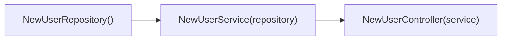

# 依赖注入

以[控制器](/zh-Hans/learn/tutorial/2-controller)中创建的 `src/user` 资源为基础，了解构造函数注册和依赖注入（DI）。完成后，你将能够连接控制器、服务和仓储，并检查循环依赖或缺失的构造函数。

请准备好[第一个应用](/zh-Hans/learn/getting-started/first-app)中的项目，并在 `hello-spine` 根目录继续操作。后面的数据库和包装类型示例是独立扩展，不会自动包含在基本资源中。


## 核心概念

Spine 根据已注册构造函数的参数类型，先创建所需对象，再将其传入。无需使用 `@Autowired`、`@Injectable` 等注解，也不需要 DI 专用配置文件。`spine.toml` 是 CLI 的项目配置文件。

在以下构造函数中，`*UserRepository` 是 `UserService` 所需的依赖。

```go
// 파라미터 타입을 보고 자동으로 의존성 주입
func NewUserService(repository *UserRepository) *UserService {
    return &UserService{repository: repository}
}
```

## CLI 生成的依赖

如果尚未生成资源，请在 `hello-spine` 根目录执行以下命令。如果已经生成，请勿重复执行。

```bash
spine generate resource user --dry-run
```

在预览中确认待生成的文件和注册代码的变更后，运行以下命令生成文件。

```bash
spine generate resource user
```

以下仅摘录了 CLI 在同一个 `user` 包中生成的类型和构造函数。请勿用这些代码覆盖现有文件。保留生成文件中控制器的 `Get` 方法。

```go
// src/user/user_repository.go
package user

type UserRepository struct{}

func NewUserRepository() *UserRepository { return &UserRepository{} }
```

```go
// src/user/user_service.go
package user

type UserService struct{ repository *UserRepository }

func NewUserService(repository *UserRepository) *UserService {
    return &UserService{repository: repository}
}
```

```go
// src/user/user_controller.go
package user

type UserController struct{ service *UserService }

func NewUserController(service *UserService) *UserController {
    return &UserController{service: service}
}
```

`src/user/user_route.go` 中的 `Register` 注册三个构造函数和 `GET /user/:id`。CLI 会在 `internal/application/application.go` 的 `BuildApplication()` 中添加 `user.Register(app)` 调用及错误处理。请勿重复添加已经注册的构造函数。

```go
// src/user/user_route.go: Register
app.Constructor(NewUserRepository, NewUserService, NewUserController)
app.Route("GET", "/user/:id", (*UserController).Get)
```

## 注册顺序和解析顺序

构造函数的注册顺序不决定对象的创建顺序。创建控制器需要服务，创建服务需要仓储，因此会先创建仓储。生成的实例由容器共享，不会为每个请求重新创建。

即使像下面这样更改注册顺序，依赖的解析顺序也相同。

```go
// user_route.go의 기존 Constructor 호출을 대체하는 예시입니다.
app.Constructor(NewUserController, NewUserService, NewUserRepository)
```



## 构造函数规则

### 参数

每个参数类型都必须有已注册的构造函数来提供。没有依赖时可以省略参数，需要多个依赖时则声明多个参数。

以下示例仅展示签名。实际代码需要实现各函数的函数体和返回类型。

```go
// 저장소 의존성 선언
func NewUserService(repo *UserRepository) *UserService

// 여러 의존성 선언
func NewUserController(svc *UserService, logger *Logger) *UserController

// 의존성 없는 생성자
func NewLogger() *Logger
```

### 返回类型

构造函数必须且只能返回一个值。该返回类型就是注册到容器中的类型。不支持返回 `(值, error)` 的构造函数；如果返回指针或接口的构造函数返回了 `nil`，依赖解析将失败。

```go
func NewUserService(repository *UserRepository) *UserService {
    return &UserService{repository: repository}
}
```

数据库连接函数也应像[数据库示例](/zh-Hans/learn/tutorial/5-database)中的 `database.NewDB() *bun.DB` 一样，只返回一个值。仅在 `BuildApplication` 中注册构造函数并不会调用连接函数。因此，生成的验证测试成功并不代表数据库连接成功。请在应用启动并执行构造函数的阶段检查连接初始化和错误处理。

```go
// internal/application/application.go: BuildApplication
app.Constructor(database.NewDB)
```

## 使用接口

将参数声明为接口类型时，会按以下顺序查找依赖。

1. 使用返回类型与该接口完全一致的构造函数。
2. 如果没有完全一致的构造函数，则查找返回类型可赋值给该接口的构造函数。
3. 如果只有一个候选，则注入该依赖；如果有多个候选，则返回 `multiple constructors registered for interface` 错误。如果没有候选，则返回依赖缺失错误。

以下是在已完成[数据库](/zh-Hans/learn/tutorial/5-database)配置的应用中使用的扩展示例。CLI 的 `resource` 生成结果不包含 Bun 配置。

### 数据库和事务的通用类型

如果将仓储字段固定为 `*bun.DB`，就无法向该字段传入 `bun.Tx`。

```go
// 이 필드에는 *bun.DB만 저장할 수 있음
type UserRepository struct {
    db *bun.DB  // bun.Tx를 받을 수 없음
}
```

使用 `*bun.DB` 和 `bun.Tx` 均实现的 `bun.IDB`，就能通过同一个契约处理两种类型。以下代码展示了仓储构造函数接收 `bun.IDB` 依赖的方式。

```go
// *bun.DB와 bun.Tx는 모두 bun.IDB를 구현
type UserRepository struct {
    db bun.IDB
}

func NewUserRepository(db bun.IDB) *UserRepository {
    return &UserRepository{db: db}
}
```

### 传递每个请求的事务

构造函数注入与请求值传递的生命周期不同。由构造函数创建的服务和仓储在应用中共享，因此，每个请求创建的 `bun.Tx` 不会自动重新注入已有实例的字段。将请求专属事务覆盖到共享字段中，可能使其与其他请求混用。

按以下顺序传递每个请求的事务。

1. 在拦截器的 `PreHandle` 中启动事务，并通过 `ctx.Set("tx", tx)` 保存。
2. 控制器通过 `spine.Ctx.Get("tx")` 读取值，并确认其类型为 `bun.Tx`。
3. 控制器调用服务和仓储的方法，以 `bun.IDB` 参数显式传入事务。
4. 在拦截器的 `BeforeResponse` 中根据执行结果提交或回滚，并返回此过程中的错误。

关于拦截器四个生命周期方法的实现和注册方式，请参阅[需要依赖注入的拦截器](/zh-Hans/learn/tutorial/4-interceptor)。


## 按功能注册

通过 CLI 生成其他功能时，会连接对应包的 `Register` 函数和组装应用的 `BuildApplication`。以下是可选的独立 `order` 资源添加示例。CLI 会添加 `order.Register(app)` 调用，请勿手动重复注册。

```bash
spine generate resource order --dry-run
```

在预览中确认待生成的文件和注册代码的变更后，运行以下命令生成文件。

```bash
spine generate resource order
```

### 分多次调用注册构造函数

在同一个 `Register` 中，也可以分多次调用完成注册。每种类型只注册一次。

```go
// src/user/user_route.go: Register
app.Constructor(NewUserRepository)
app.Constructor(NewUserService)
app.Constructor(NewUserController)
```

## 同一类型的多个实例

如果以同一类型注册主数据库和副本数据库，仅凭参数名无法区分两者。请声明不同的包装类型来区分。

以下是一个独立的仓储设计示例。`App`、`UserRepository` 的 `writer` 和 `reader` 字段，以及 `connectToPrimary`、`connectToReplica`，需要根据应用自行实现。

```go
// 파라미터 이름만으로 인스턴스를 구분할 수 없음
func NewApp(db1 *bun.DB, db2 *bun.DB) *App  // 어떤 게 어떤 건지?

// 서로 다른 래퍼 타입으로 구분
type PrimaryDB struct{ *bun.DB }
type ReplicaDB struct{ *bun.DB }

func NewPrimaryDB() *PrimaryDB {
    return &PrimaryDB{connectToPrimary()}
}

func NewReplicaDB() *ReplicaDB {
    return &ReplicaDB{connectToReplica()}
}

func NewUserRepository(primary *PrimaryDB, replica *ReplicaDB) *UserRepository {
    return &UserRepository{
        writer: primary.DB,
        reader: replica.DB,
    }
}
```

## 检查依赖错误

### 循环依赖

如果 `A` 需要 `B`，而 `B` 又需要 `A`，就无法先创建其中任何一个对象。以下伪代码展示了这种关系。

```go
// A → B → A 순환
func NewA(b *B) *A { ... }
func NewB(a *A) *B { ... }

// 부팅 시 에러 발생
// circular dependency detected: *user.A -> *user.B -> *user.A
```

### 缺失的依赖

所需类型没有对应的构造函数时，依赖解析会失败。以下示例省略了 `NewUserRepository` 的注册。

```go
// UserRepository를 등록하지 않으면
app.Constructor(
    NewUserService,     // *UserRepository 필요
    NewUserController,
)

// 부팅 시 에러 발생
// no constructor registered for *user.UserRepository
```

## 验证注册并检查运行结果

在项目根目录执行以下命令。

```bash
spine doctor
spine contract check
spine verify
```

`spine contract check` 检查从源代码提取的 DI 契约，`spine verify` 还会检查格式、`go vet` 和测试。仅有 `app.Validate(options)` 成功，并不能证明构造函数已经执行或实例已经初始化。

请通过 `spine dev` 启动应用后，检查实际的初始化和请求处理。如果接入了数据库，还需要单独确认实际连接和查询。循环依赖或缺失的构造函数会在依赖解析过程中返回错误，生成的 `main.go` 会检查 `Run` 错误。

## 后续步骤

- [教程：拦截器](/zh-Hans/learn/tutorial/4-interceptor) — 请求前后处理
- [教程：数据库](/zh-Hans/learn/tutorial/5-database) — 连接 Bun ORM
