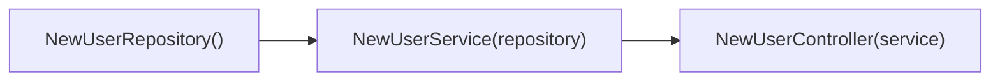

# 依赖注入

查看[控制器](/zh-Hans/learn/tutorial/2-controller)中 CLI 生成的 `src/user` 资源的依赖关系。安装和生成项目请参考[第一个应用](/zh-Hans/learn/getting-started/first-app)。

了解 Spine 的 DI。

## 关键概念

Spine 的依赖注入是**基于构造函数的**。

- 无注释（`@Autowired`、`@Injectable` 不需要）
- 没有配置文件
- 构造函数参数被声明为依赖项

```go
// 通过查看参数类型自动注入依赖项
func NewUserService(repository *UserRepository) *UserService {
    return &UserService{repository: repository}
}
```

## CLI 生成的依赖

尚未生成资源时，在 `hello-spine` 根目录运行以下命令。已经存在时请跳过。

```bash
spine generate resource user --dry-run
```

在预览中检查生成文件与注册代码的变更，然后执行下方命令生成。

```bash
spine generate resource user
```

CLI 在 `src/user` 的同一个 `package user` 中生成以下构造函数。

```go
// src/user/user_repository.go
package user

type UserRepository struct{}

func NewUserRepository() *UserRepository { return &UserRepository{} }
```

```go
// src/user/user_service.go
package user

type UserService struct{ repository *UserRepository }

func NewUserService(repository *UserRepository) *UserService {
    return &UserService{repository: repository}
}
```

```go
// src/user/user_controller.go
package user

type UserController struct{ service *UserService }

func NewUserController(service *UserService) *UserController {
    return &UserController{service: service}
}
```

`src/user/user_route.go` 的 `Register` 注册这些构造函数和 `GET /user/:id`。CLI 在 `internal/application/application.go` 的 `BuildApplication()` 中添加检查错误的 `user.Register(app)`。请勿重复注册相同构造函数。

```go
// src/user/user_route.go: Register
app.Constructor(NewUserRepository, NewUserService, NewUserController)
app.Route("GET", "/user/:id", (*UserController).Get)
```

## 注册与解析顺序

无论注册顺序如何，都会先解析所需的依赖。容器共享已创建的实例，不会为每个请求重新创建。

```go
// 此示例替换 user_route.go 中现有的 Constructor 调用。
app.Constructor(NewUserController, NewUserService, NewUserRepository)
```



## 构造函数规则

### 参数

构造函数参数必须是**已注册的类型**。

```go
// ✅ 正确的例子
func NewUserService(repo *UserRepository) *UserService

// ✅ 可能有多个依赖项
func NewUserController(svc *UserService, logger *Logger) *UserController

// ✅ 没有依赖性
func NewLogger() *Logger
```

### 返回类型

构造函数必须只返回一个值，不支持返回 `(值, error)`。返回类型确定提供的类型；返回 nil 也会报错。

```go
func NewUserService(repository *UserRepository) *UserService {
    return &UserService{repository: repository}
}
```

数据库provider也应像[数据库示例](/zh-Hans/learn/tutorial/5-database)中的 `database.NewDB() *bun.DB` 一样只返回一个值，并注册构造函数。`BuildApplication` 只负责注册，因此生成的验证测试不会连接数据库。连接错误在应用启动、执行provider时处理；实际连接需要单独验证。

```go
// internal/application/application.go: BuildApplication
app.Constructor(database.NewDB)
```

## 使用接口

本节是[数据库](/zh-Hans/learn/tutorial/5-database)中的手动扩展；`resource` 不生成 Bun 配置。优先使用类型精确匹配的接口 provider，否则只能有一个实现该接口的 provider。多个候选会产生错误。请求中的 `bun.Tx` 不会自动重新注入应用级构造函数。应从请求上下文读取事务，经控制器和服务传给接受 `bun.IDB` 的仓储方法。

### 问题情况

使用事务时，存储库必须同时处理 `*bun.DB` 和 `bun.Tx`。

```go
// ❌这将禁用交易
type UserRepository struct {
    db *bun.DB  // 无法接收 bun.Tx
}
```

### 已解决：使用接口

`bun.IDB` 接口允许您同时容纳两者。

```go
// ✅ *bun.DB 和 bun.Tx 都实现了 bun.IDB
type UserRepository struct {
    db bun.IDB
}

func NewUserRepository(db bun.IDB) *UserRepository {
    return &UserRepository{db: db}
}
```

### 拦截器中的事务注入

```go
// 拦截器/tx_interceptor.go
func (i *TxInterceptor) PreHandle(ctx core.ExecutionContext, meta core.HandlerMeta) error {
    tx, err := i.db.BeginTx(ctx.Context(), nil)
    if err != nil {
        return err
    }

    ctx.Set("tx", tx)  // 保存事务
    return nil
}

func (i *TxInterceptor) PostHandle(ctx core.ExecutionContext, meta core.HandlerMeta) {}

func (i *TxInterceptor) BeforeResponse(ctx core.ExecutionContext, meta core.HandlerMeta, executionErr error) error {
    v, ok := ctx.Get("tx")
    if !ok {
        return nil
    }

    tx, ok := v.(bun.Tx)
    if !ok {
        return errors.New("transaction type is invalid")
    }

    if executionErr != nil {
        return tx.Rollback()
    }
    return tx.Commit()
}

func (i *TxInterceptor) AfterCompletion(ctx core.ExecutionContext, meta core.HandlerMeta, err error) {}
```

## 按功能注册

使用 CLI 生成另一个功能后，它会注册到同一个组装入口。以下生成独立的 `order` 资源。CLI 会添加 `user.Register` 和 `order.Register` 调用，请勿手动重复添加。

```bash
spine generate resource order --dry-run
```

在预览中检查生成文件与注册代码的变更，然后执行下方命令生成。

```bash
spine generate resource order
```

### 多次调用 Constructor

可以在同一个 `Register` 中分多次调用注册。每个类型只注册一次。

```go
// src/user/user_route.go: Register
app.Constructor(NewUserRepository)
app.Constructor(NewUserService)
app.Constructor(NewUserController)
```

## 多个相同类型

如果需要同一类型的多个实例，请使用包装类型。

```go
// ❌ 难以区分
func NewApp(db1 *bun.DB, db2 *bun.DB) *App  // 无法区分各自用途

// ✅ 按包装类型分类
type PrimaryDB struct{ *bun.DB }
type ReplicaDB struct{ *bun.DB }

func NewPrimaryDB() *PrimaryDB {
    return &PrimaryDB{connectToPrimary()}
}

func NewReplicaDB() *ReplicaDB {
    return &ReplicaDB{connectToReplica()}
}

func NewUserRepository(primary *PrimaryDB, replica *ReplicaDB) *UserRepository {
    return &UserRepository{
        writer: primary.DB,
        reader: replica.DB,
    }
}
```

## 错误处理

### 循环依赖

```go
// ❌A→B→A循环
func NewA(b *B) *A { ... }
func NewB(a *A) *B { ... }

// 启动时出现错误
// circular dependency detected: *user.A -> *user.B -> *user.A
```

### 缺少依赖项

```go
// 如果您没有注册UserRepository
app.Constructor(
    NewUserService,     // *需要 UserRepository
    NewUserController,
)

// 启动时出现错误
// no constructor registered for *user.UserRepository
```

## 验证范围

```bash
spine doctor
spine contract check
spine verify
```

`contract check` 检查静态 DI 契约，`verify` 还执行本地代码检查。仅调用 `app.Validate(options)` 不能证明构造函数执行或 DI warm-up 成功。实际初始化、数据库连接和请求需要运行应用并单独进行 E2E 验证。循环或缺少依赖会在解析时返回错误，生成的 main 会检查 Run 错误。

## 主要摘要

|概念|描述 |
|------|------|
| **基于构造函数** |声明与参数类型的依赖关系 |
| **自动解析** |不考虑注册顺序，图分析后生成|
| **类型匹配** |相同类型自动注入 |
| **界面** |灵活的依赖性处理成为可能 |

## 后续步骤

- [教程：拦截器](/zh-Hans/learn/tutorial/4-interceptor) — 请求前/请求后处理
- [教程：数据库](/zh-Hans/learn/tutorial/5-database) — Bun ORM 连接
