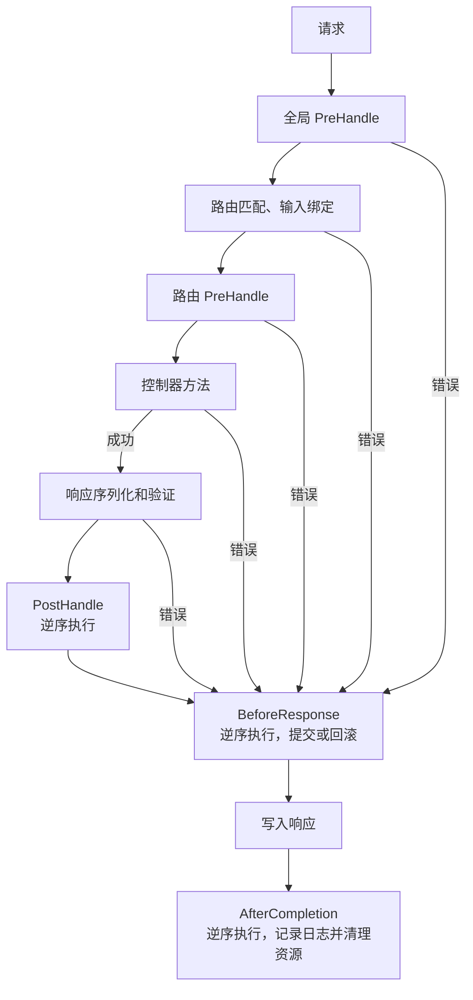

# 拦截器

为用户查询请求添加日志记录和演示认证，并确认请求经过拦截器的顺序。拦截器负责多个处理器共用的认证、权限检查、日志记录和事务处理。

本页按功能划分的 `src/user` 示例使用[项目结构](/zh-Hans/learn/tutorial/1-project-structure)中通过 `--layout legacy` 创建的 `my-app`。CLI `v0.4.2` 默认生成按角色划分的 `layered-v1` 结构。两种布局都使用 Spine `v0.6.5` 和 Echo 平台 `v0.1.0`。

## 从 CLI 项目开始

使用[第一个应用](/zh-Hans/learn/tutorial/1-project-structure)和[项目结构](/zh-Hans/learn/tutorial/1-project-structure)中创建的项目。示例代码使用模块路径 `example.com/my-app`；如果创建项目时使用了其他模块路径，请按项目实际情况修改。

如果还没有用户资源，请在项目根目录生成。如果已经创建，请跳过生成步骤。

```sh
spine generate resource user --dry-run
```

在预览中确认待生成的文件和注册代码的变更后，再执行生成。

```sh
spine generate resource user
```

CLI 会生成 `src/user` 下的文件，以及 `BuildApplication` 中的 `user.Register(app)` 调用。由于没有拦截器生成器，请创建 `src/interceptor` 目录，并手动编写下文的日志和认证拦截器文件。

应用级注册写在 `internal/application/application.go` 中，用户路由的认证策略写在 `src/user/user_route.go` 中。保留根目录 `main.go` 中的构建、验证和运行流程。后面的审计日志和订单事务示例是独立扩展，验证基本应用时无需实现。


## 拦截器生命周期

在 Spine v0.6.5 中，HTTP 请求依次经过全局拦截器、路由匹配与输入绑定、路由拦截器和控制器。拦截器必须实现全部四个生命周期方法。



输入绑定失败时，路由的 `PreHandle` 也不会执行。需要在检查请求体格式之前完成认证的策略，请放在全局拦截器中处理。


## 接口

```go
type Interceptor interface {
    PreHandle(ctx ExecutionContext, meta HandlerMeta) error
    PostHandle(ctx ExecutionContext, meta HandlerMeta)
    BeforeResponse(ctx ExecutionContext, meta HandlerMeta, executionErr error) error
    AfterCompletion(ctx ExecutionContext, meta HandlerMeta, err error)
}
```

| 方法 | 执行时机 | 返回值 | 用途 |
|--------|----------|------|------|
| `PreHandle` | 全局拦截器在路由匹配前，路由拦截器在输入绑定后 | `error` | 认证、验证、启动事务 |
| `PostHandle` | 控制器和响应准备均成功后 | 无 | 记录处理完成、执行后续操作 |
| `BeforeResponse` | 实际写入响应前 | `error` | 提交或回滚事务 |
| `AfterCompletion` | 尝试写入响应后 | 无 | 记录日志、清理资源 |

`BeforeResponse` 通过 `executionErr` 接收此前的执行错误，以及响应序列化、Cookie 和状态码验证错误。只有 `PreHandle` 成功的拦截器才会执行此方法，因此它适合用于结束在该阶段启动的事务。如果提交或回滚失败，请返回错误。

即使发生错误，`AfterCompletion` 也会在全局拦截器和通过路由匹配确定的路由拦截器上调用。其中可能包含尚未执行到 `PreHandle` 的拦截器，因此必须先检查是否存在需要清理的资源。此时响应可能已经写入，不应再用此方法修改响应。


## 全局拦截器和路由拦截器

应用级策略注册到全局拦截器，特定路由的策略注册到路由拦截器。

| 类别 | 全局拦截器 | 路由拦截器 |
|------|--------------|----------------|
| 适用范围 | 对应传输方式的所有请求 | 仅特定路由 |
| 注册方法 | `app.Interceptor()` | `route.WithInterceptors()` |
| 用途 | CORS、日志记录、事务 | 认证、权限检查 |
| 执行顺序 | 先执行 | 在全局拦截器之后执行 |


## 全局拦截器

将以下日志拦截器注册为全局拦截器后，会记录请求方法和路径。成功时可以查看 `PostHandle` 的日志，失败时可以查看 `AfterCompletion` 的日志。

### 日志拦截器示例

```go
// src/interceptor/logging_interceptor.go
package interceptor

import (
    "log"
    "github.com/NARUBROWN/spine/core"
)

type LoggingInterceptor struct{}

func (i *LoggingInterceptor) PreHandle(ctx core.ExecutionContext, meta core.HandlerMeta) error {
    log.Printf("[REQ] %s %s", ctx.Method(), ctx.Path())
    return nil
}

func (i *LoggingInterceptor) PostHandle(ctx core.ExecutionContext, meta core.HandlerMeta) {
    log.Printf("[RES] %s %s OK",
        ctx.Method(),
        ctx.Path(),
    )
}

func (i *LoggingInterceptor) BeforeResponse(ctx core.ExecutionContext, meta core.HandlerMeta, executionErr error) error {
    return nil
}

func (i *LoggingInterceptor) AfterCompletion(ctx core.ExecutionContext, meta core.HandlerMeta, err error) {
    if err != nil {
        log.Printf("[ERR] %s %s : %v",
            ctx.Method(),
            ctx.Path(),
            err,
        )
    }
}
```

全局 HTTP `PreHandle` 在路由匹配前执行，因此这一阶段的 `HandlerMeta` 中没有控制器类型和方法。如果需要这些信息，请在路由拦截器或后续生命周期阶段读取。

### 注册全局拦截器

按以下方式修改 `internal/application/application.go`。保留生成的健康检查控制器和 `user.Register(app)` 调用，并添加日志拦截器。

```go
// internal/application/application.go
package application

import (
    echoplatform "github.com/NARUBROWN/spine-echo-platform"
    "os"

    "example.com/my-app/src/interceptor"
    "example.com/my-app/src/user"
    "github.com/NARUBROWN/spine"
    "github.com/NARUBROWN/spine/pkg/boot"
    "github.com/NARUBROWN/spine/pkg/httpx"
)

type HealthController struct{}

func NewHealthController() *HealthController { return &HealthController{} }

func (c *HealthController) Get() httpx.Response[map[string]string] {
    return httpx.Response[map[string]string]{Body: map[string]string{"status": "ok"}}
}

func BuildApplication() (spine.App, boot.Options, error) {
    app := spine.New(echoplatform.Option())
    app.Constructor(NewHealthController)
    app.Route("GET", "/health", (*HealthController).Get)
    app.Interceptor(&interceptor.LoggingInterceptor{})

    if err := user.Register(app); err != nil {
        return nil, boot.Options{}, err
    }

    address := ":8080"
    if port := os.Getenv("SPINE_PORT"); port != "" {
        address = ":" + port
    }
    return app, boot.Options{Address: address, HTTP: &boot.HTTPOptions{}}, nil
}
```


## 路由拦截器

将认证拦截器注册到 `GET /user/:id`，以 HTTP 401 拒绝没有令牌的请求。健康检查路由 `/health` 不应用此认证策略。

### 认证拦截器示例

```go
// src/interceptor/auth_interceptor.go
package interceptor

import (
    "errors"

    "github.com/NARUBROWN/spine/core"
    "github.com/NARUBROWN/spine/pkg/httperr"
)

type AuthInterceptor struct{}

func (i *AuthInterceptor) PreHandle(ctx core.ExecutionContext, meta core.HandlerMeta) error {
    token := ctx.Header("Authorization")

    if token == "" {
        return httperr.Unauthorized("인증이 필요합니다.")
    }

    user, err := validateToken(token)
    if err != nil {
        return httperr.Unauthorized("유효하지 않은 토큰입니다.")
    }

    ctx.Set("currentUser", user)
    return nil
}

func (i *AuthInterceptor) PostHandle(ctx core.ExecutionContext, meta core.HandlerMeta) {}

func (i *AuthInterceptor) BeforeResponse(ctx core.ExecutionContext, meta core.HandlerMeta, executionErr error) error { return nil }

func (i *AuthInterceptor) AfterCompletion(ctx core.ExecutionContext, meta core.HandlerMeta, err error) {}

func validateToken(token string) (map[string]string, error) {
    if token != "Bearer demo-token" {
        return nil, errors.New("invalid demo token")
    }
    return map[string]string{"id": "1", "name": "Alice"}, nil
}
```

此示例只允许 `Authorization: Bearer demo-token`，其他令牌均返回 HTTP 401。固定令牌是用于验证行为的公开演示，请在实际应用中替换为认证服务。

### 注册路由拦截器

将生成的 `src/user/user_route.go` 修改为以下代码。通过 `route.WithInterceptors()` 添加认证策略，并保留 `BuildApplication` 中的 `user.Register(app)` 调用。

```go
// src/user/user_route.go
package user

import (
    "example.com/my-app/src/interceptor"
    "github.com/NARUBROWN/spine"
    "github.com/NARUBROWN/spine/pkg/route"
)

func Register(app spine.App) error {
    app.Constructor(NewUserRepository, NewUserService, NewUserController)
    app.Route(
        "GET",
        "/user/:id",
        (*UserController).Get,
        route.WithInterceptors(&interceptor.AuthInterceptor{}),
    )
    return nil
}
```


## 同时应用日志记录、认证和 CORS

将上一节的 `BuildApplication` 替换为以下代码，即可在日志记录之外应用 CORS 策略。用户路由的认证拦截器仍保留在 `user_route.go` 中。

CORS 配置为允许来自 `https://app.example.com` 的请求。请检查 `cors.NewValidated` 的配置错误；由于该策略仅适用于 HTTP，使用 `InterceptorFor(boot.InterceptorHTTP, ...)` 注册。

```go
// internal/application/application.go
package application

import (
    echoplatform "github.com/NARUBROWN/spine-echo-platform"
    "os"

    "example.com/my-app/src/interceptor"
    "example.com/my-app/src/user"
    "github.com/NARUBROWN/spine"
    "github.com/NARUBROWN/spine/pkg/boot"
    "github.com/NARUBROWN/spine/pkg/httpx"
    "github.com/NARUBROWN/spine/interceptor/cors"
)

type HealthController struct{}

func NewHealthController() *HealthController { return &HealthController{} }

func (c *HealthController) Get() httpx.Response[map[string]string] {
    return httpx.Response[map[string]string]{Body: map[string]string{"status": "ok"}}
}

func BuildApplication() (spine.App, boot.Options, error) {
    app := spine.New(echoplatform.Option())
    app.Constructor(NewHealthController)
    app.Route("GET", "/health", (*HealthController).Get)
    app.Interceptor(&interceptor.LoggingInterceptor{})
    corsInterceptor, err := cors.NewValidated(cors.Config{
        AllowOrigins:     []string{"https://app.example.com"},
        AllowMethods:     []string{"GET", "POST", "PUT", "DELETE", "OPTIONS"},
        AllowHeaders:     []string{"Authorization", "Content-Type"},
        AllowCredentials: true,
    })
    if err != nil {
        return nil, boot.Options{}, err
    }
    app.InterceptorFor(boot.InterceptorHTTP, corsInterceptor)

    if err := user.Register(app); err != nil {
        return nil, boot.Options{}, err
    }

    address := ":8080"
    if port := os.Getenv("SPINE_PORT"); port != "" {
        address = ":" + port
    }
    return app, boot.Options{Address: address, HTTP: &boot.HTTPOptions{}}, nil
}
```


## 验证日志记录和认证行为

应用基本示例中的日志记录、认证和 CORS 代码后，在项目根目录执行以下命令。`spine contract check` 检查静态契约，`spine verify` 检查本地代码。实际请求的认证和响应需要启动服务器后另行确认。

```sh
gofmt -w src/interceptor/*.go src/user/user_route.go internal/application/application.go
spine contract check
spine verify
spine dev
```

在另一个终端中发送以下请求。

- `/health` 应在无需认证的情况下返回 HTTP 200。
- 不带令牌的 `/user/1` 请求应返回 HTTP 401。
- 携带演示令牌的 `/user/1` 请求应返回 HTTP 200 和 `{"id":1}`。
- 最后一个响应应包含 `Access-Control-Allow-Origin: https://app.example.com` 响应头。

```bash
curl -i http://localhost:8080/health
curl -i http://localhost:8080/user/1
curl -i http://localhost:8080/user/1 \
  -H 'Authorization: Bearer demo-token' \
  -H 'Origin: https://app.example.com'
```

上述请求仅验证演示 HTTP 认证。实际认证服务、WebSocket 认证和数据库事务的行为，需要配置相应环境后单独验证。

## 执行顺序

`PreHandle` 按注册顺序执行。成功后的 `PostHandle`、`BeforeResponse` 和 `AfterCompletion` 先逆序执行路由拦截器，再逆序执行全局拦截器。

### 成功请求的执行流程

此前注册的日志、CORS 和认证拦截器均成功时，按以下顺序执行。

```text
请求 (GET /user/1)
   │
   ├─→ Logging.PreHandle     (全局 1)
   ├─→ CORS.PreHandle        (全局 2)
   ├─→ 路由匹配和输入绑定
   ├─→ Auth.PreHandle        (路由 1)
   │
   ├─→ UserController.Get
   ├─→ 响应序列化和验证
   │
   ├─→ Auth.PostHandle       (路由 1)
   ├─→ CORS.PostHandle       (全局 2)
   ├─→ Logging.PostHandle    (全局 1)
   │
   ├─→ Auth.BeforeResponse       (路由 1)
   ├─→ CORS.BeforeResponse       (全局 2)
   ├─→ Logging.BeforeResponse    (全局 1)
   │
   ├─→ 写入响应
   │
   ├─→ Auth.AfterCompletion       (路由 1)
   ├─→ CORS.AfterCompletion       (全局 2)
   └─→ Logging.AfterCompletion    (全局 1)

完成
```

即使控制器执行成功，只要响应序列化或验证失败，`PostHandle` 就不会执行。`BeforeResponse` 仅在 `PreHandle` 成功的拦截器上执行，而 `AfterCompletion` 的清理范围还包括通过路由匹配确定的拦截器。


## 处理发生错误的请求

### 在 PreHandle 中返回错误

`PreHandle` 返回错误后，不会调用后续拦截器的 `PreHandle` 和控制器。已经成功执行 `PreHandle` 的拦截器仍会执行 `BeforeResponse`，最后通过 `AfterCompletion` 清理。

以下代码仅摘录了认证失败的分支。将此前编写的 `AuthInterceptor` 替换为这段代码会丢失令牌有效性检查，因此请保留原实现。

```go
func (i *AuthInterceptor) PreHandle(ctx core.ExecutionContext, meta core.HandlerMeta) error {
    token := ctx.Header("Authorization")
    if token == "" {
        return httperr.Unauthorized("인증이 필요합니다.")
    }
    return nil
}
```

```text
请求 (GET /user/1, 无令牌)
   │
   ├─→ Logging.PreHandle     (成功)
   ├─→ CORS.PreHandle        (成功)
   ├─→ 路由匹配和输入绑定
   ├─→ Auth.PreHandle        (返回错误)
   │
   ├─→ CORS.BeforeResponse
   ├─→ Logging.BeforeResponse
   │
   ├─→ 写入响应 (401 Unauthorized)
   │
   ├─→ Auth.AfterCompletion
   ├─→ CORS.AfterCompletion
   └─→ Logging.AfterCompletion

完成
```


## 共享请求值：ExecutionContext

拦截器通过 `core.ExecutionContext` 读取请求信息，并向处理同一请求的其他拦截器或控制器传递值。控制器通过只读的 `spine.Ctx` 读取共享值。

### 方法

| 方法 | 说明 |
|--------|------|
| `Context()` | 返回 `context.Context` |
| `Method()` | HTTP 方法（GET、POST 等） |
| `Path()` | 请求路径 |
| `Header(name)` | 读取请求头的值 |
| `Params()` | 读取所有路径参数 |
| `PathKeys()` | 路由中声明的路径参数名的顺序 |
| `Queries()` | 读取所有查询参数 |
| `EventBus()` | 读取请求的事件总线 |
| `Set(key, value)` | 保存值 |
| `Get(key)` | 读取值 |

### 在拦截器之间传递数据

以下示例仅摘录了审计拦截器读取认证拦截器所保存的 `currentUser` 的部分。要添加审计拦截器，请实现 `AuditInterceptor` 类型及其四个生命周期方法，并在认证拦截器之后注册。请勿重复声明现有认证拦截器的 `PreHandle`。

```go
// AuthInterceptor — 保存用户信息
func (i *AuthInterceptor) PreHandle(ctx core.ExecutionContext, meta core.HandlerMeta) error {
    token := ctx.Header("Authorization")
    user, err := validateToken(token)
    if err != nil {
        return httperr.Unauthorized("invalid credentials")
    }
    ctx.Set("currentUser", user)
    return nil
}

// 控制器通过只读的 spine.Ctx 读取
// 或在其他拦截器中读取
func (i *AuditInterceptor) PreHandle(ctx core.ExecutionContext, meta core.HandlerMeta) error {
    user, ok := ctx.Get("currentUser")
    if ok {
        log.Printf("User %v accessing %s", user, ctx.Path())
    }
    return nil
}
```


## 处理器信息：HandlerMeta

`core.HandlerMeta` 包含通过路由匹配确定的控制器和方法信息。执行全局 `PreHandle` 时尚未进行路由匹配，因此还无法使用类型和方法。

| 字段 | 类型 | 说明 |
|------|------|------|
| `ControllerType` | `reflect.Type` | 控制器类型 |
| `Method` | `reflect.Method` | 处理器方法 |
| `PathKeys` | `[]string` | 路由中声明的路径参数名的顺序 |
| `Interceptors` | `[]Interceptor` | 绑定到路由的拦截器 |

### 使用示例

以下是展示元数据读取方式的独立示例。在路由拦截器中执行时，可以记录控制器和方法。请勿重复声明与现有日志拦截器相同的方法。

```go
func (i *LoggingInterceptor) PreHandle(ctx core.ExecutionContext, meta core.HandlerMeta) error {
    if meta.ControllerType != nil {
        log.Printf("컨트롤러: %s", meta.ControllerType.String())
    }
    log.Printf("메서드: %s", meta.Method.Name)              // GetUser
    return nil
}
```


## 需要依赖注入的拦截器

对于接收依赖的拦截器，先将构造函数注册到 `app.Constructor`，再在注册拦截器时传入表示类型的指针。容器会创建该类型的实例并注入。

### 事务拦截器示例

以下是添加到已接入[数据库](/zh-Hans/learn/tutorial/5-database)的应用中的独立扩展示例。验证基本日志和认证示例时无需实现。

`PreHandle` 将事务保存到请求上下文，`BeforeResponse` 在存在执行错误时回滚，否则提交。控制器需要从 `spine.Ctx` 读取事务，并传入服务和仓储方法。每个请求的事务不会自动重新注入由共享构造函数创建的服务或仓储。

```go
// src/interceptor/tx_interceptor.go
package interceptor

import (
    "github.com/NARUBROWN/spine/core"
    "github.com/uptrace/bun"
)

type TxInterceptor struct {
    db *bun.DB
}

func NewTxInterceptor(db *bun.DB) *TxInterceptor {
    return &TxInterceptor{db: db}
}

func (i *TxInterceptor) PreHandle(ctx core.ExecutionContext, meta core.HandlerMeta) error {
    tx, err := i.db.BeginTx(ctx.Context(), nil)
    if err != nil {
        return err
    }
    ctx.Set("tx", tx)
    return nil
}

func (i *TxInterceptor) PostHandle(ctx core.ExecutionContext, meta core.HandlerMeta) {}

func (i *TxInterceptor) BeforeResponse(ctx core.ExecutionContext, meta core.HandlerMeta, executionErr error) error {
    v, ok := ctx.Get("tx")
    if !ok {
        return nil
    }

    tx, ok := v.(bun.Tx)
    if !ok {
        return nil
    }
    if executionErr != nil {
        return tx.Rollback()
    } else {
        return tx.Commit()
    }
}

func (i *TxInterceptor) AfterCompletion(ctx core.ExecutionContext, meta core.HandlerMeta, err error) {}
```

### 全局注册

以下注册代码应添加到 `BuildApplication` 内部。`NewDB` 必须实现为仅返回一个 `*bun.DB` 的构造函数。

```go
app.Constructor(
    NewDB,
    interceptor.NewTxInterceptor,
)

app.Interceptor(
    (*interceptor.TxInterceptor)(nil),  // 通过类型引用
)
```

### 路由注册

要仅对创建订单的请求应用该拦截器，请按以下方式注册到路由，代替全局注册。`OrderController` 的构造函数和 `CreateOrder` 方法需要单独实现并注册。

```go
app.Constructor(
    NewDB,
    interceptor.NewTxInterceptor,
)

app.Route(
    "POST",
    "/orders",
    (*OrderController).CreateOrder,
    route.WithInterceptors((*interceptor.TxInterceptor)(nil)),  // 通过类型引用
)
```


## 选择注册方式

无论是全局注册还是路由注册，没有依赖的拦截器都可以直接传入实例。接收依赖的拦截器则先注册构造函数，再通过类型引用。

| 方式 | 全局注册 | 路由注册 |
|------|----------|------------|
| 传入实例 | `app.Interceptor(&interceptor.LoggingInterceptor{})` | `route.WithInterceptors(&interceptor.AuthInterceptor{})` |
| 引用由构造函数解析的类型 | `app.Interceptor((*interceptor.TxInterceptor)(nil))` | `route.WithInterceptors((*interceptor.TxInterceptor)(nil))` |


## 后续步骤

- [教程：数据库](/zh-Hans/learn/tutorial/5-database) — 连接 Bun ORM
- [教程：错误处理](/zh-Hans/learn/tutorial/7-error-handling) — httperr 用法
