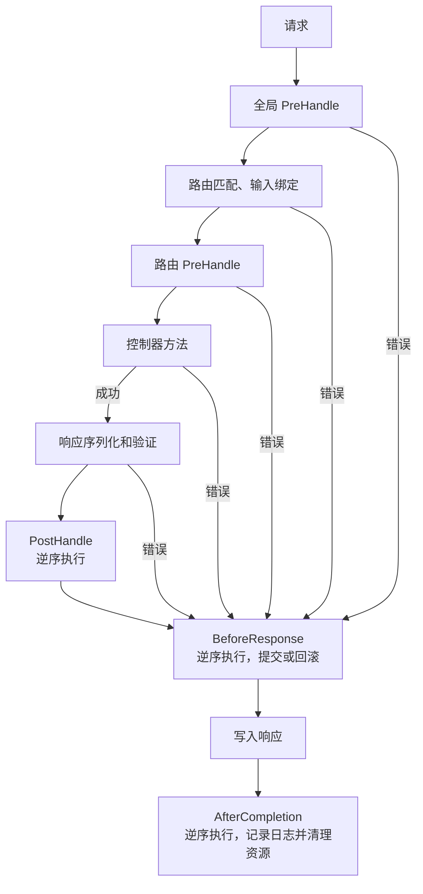

# 拦截器

拦截器处理认证和日志等共通逻辑。此独立应用为分组中的所有路由和单个路由应用认证。令牌仅用于演示。

## 应用到分组和路由

将以下代码保存为独立 Go 模块中的 `main.go` 并运行。

```bash
go get github.com/NARUBROWN/spine@v0.7.1 github.com/NARUBROWN/spine-echo-platform@v0.2.0
```

```go
package main

import (
	"github.com/NARUBROWN/spine"
	echoplatform "github.com/NARUBROWN/spine-echo-platform"
	"github.com/NARUBROWN/spine/core"
	"github.com/NARUBROWN/spine/pkg/api"
	"github.com/NARUBROWN/spine/pkg/boot"
	"github.com/NARUBROWN/spine/pkg/constructor"
	"github.com/NARUBROWN/spine/pkg/httperr"
	"github.com/NARUBROWN/spine/pkg/httpx"
	"github.com/NARUBROWN/spine/pkg/input"
	"log"
)

type Auth struct{}

func (*Auth) PreHandle(ctx core.ExecutionContext, meta core.HandlerMeta) error {
	if ctx.Header("Authorization") != "Bearer demo-token" {
		return httperr.Unauthorized("unauthorized")
	}
	return nil
}
func (*Auth) PostHandle(core.ExecutionContext, core.HandlerMeta)                  {}
func (*Auth) BeforeResponse(core.ExecutionContext, core.HandlerMeta, error) error { return nil }
func (*Auth) AfterCompletion(core.ExecutionContext, core.HandlerMeta, error)      {}

type Controller struct{}

func (*Controller) Constructor() *Controller { return &Controller{} }
func (*Controller) RegisterRoutes(r *api.Registry) {
	users := r.Group("/users", api.Interceptors(&Auth{}))
	users.GET("/:id", func(id input.Path[int64]) httpx.Response[map[string]int64] {
		return httpx.Response[map[string]int64]{Body: map[string]int64{"id": *id}}
	})
	r.GET("/profile", func() httpx.Response[string] {
		return httpx.Response[string]{Body: "profile"}
	}, api.Interceptors(&Auth{}))
}
func main() {
	app := spine.New(echoplatform.Option())
	app.Constructor(constructor.Controller(&Controller{}))
	if err := app.Run(boot.Options{Address: ":8080", HTTP: &boot.HTTPOptions{}}); err != nil {
		log.Fatal(err)
	}
}
```

`/users/:id` 从分组继承认证，`/profile` 在路由上直接指定认证。嵌套分组也会继承父分组的配置。

未认证的请求返回 401，携带令牌的请求返回 200。生产环境中请实现安全的令牌验证。

```bash
curl -i http://localhost:8080/users/1
curl -i -H 'Authorization: Bearer demo-token' http://localhost:8080/users/1
curl -i -H 'Authorization: Bearer demo-token' http://localhost:8080/profile
```

## 拦截器生命周期

在 Spine v0.7.1 中，HTTP 请求依次经过全局拦截器、路由匹配与输入绑定、路由拦截器和控制器。拦截器必须实现全部四个生命周期方法。



输入绑定失败时，路由的 `PreHandle` 也不会执行。需要在检查请求体格式之前完成认证的策略，请放在全局拦截器中处理。


## 接口

```go
type Interceptor interface {
    PreHandle(ctx ExecutionContext, meta HandlerMeta) error
    PostHandle(ctx ExecutionContext, meta HandlerMeta)
    BeforeResponse(ctx ExecutionContext, meta HandlerMeta, executionErr error) error
    AfterCompletion(ctx ExecutionContext, meta HandlerMeta, err error)
}
```

| 方法 | 执行时机 | 返回值 | 用途 |
|--------|----------|------|------|
| `PreHandle` | 全局拦截器在路由匹配前，路由拦截器在输入绑定后 | `error` | 认证、验证、启动事务 |
| `PostHandle` | 控制器和响应准备均成功后 | 无 | 记录处理完成、执行后续操作 |
| `BeforeResponse` | 实际写入响应前 | `error` | 提交或回滚事务 |
| `AfterCompletion` | 尝试写入响应后 | 无 | 记录日志、清理资源 |

`BeforeResponse` 通过 `executionErr` 接收此前的执行错误，以及响应序列化、Cookie 和状态码验证错误。只有 `PreHandle` 成功的拦截器才会执行此方法，因此它适合用于结束在该阶段启动的事务。如果提交或回滚失败，请返回错误。

即使发生错误，`AfterCompletion` 也会在全局拦截器和通过路由匹配确定的路由拦截器上调用。其中可能包含尚未执行到 `PreHandle` 的拦截器，因此必须先检查是否存在需要清理的资源。此时响应可能已经写入，不应再用此方法修改响应。


## 了解更多

全局注册、构造函数注入和生命周期详情请参阅[拦截器 API](/zh-Hans/reference/api/interceptor)。
