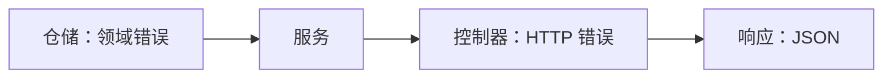

# 错误处理

::: warning Preview
本页包含稳定版 `v0.6.5` 示例。Preview 中的 `app.Route` 已标记为 Deprecated。请参阅[控制器与路由迁移](/zh-Hans/learn/migration/preview-controller-routes)。
:::

::: warning v0.7.0 Preview 输入 API 迁移
本页现有 API 说明和示例以稳定版 `v0.6.5` 为基准。从 `v0.7.0-preview.1` 起，可按输入来源使用独立的 Path、Query 和 Header DTO。`query.Values`、`header.Values` 及其构造和读取 API、`query.Pagination`、`path.Int`、`path.String`、`path.Boolean` 均标记为 Deprecated。

新的 DTO 方式不能直接用于 `v0.6.5`。在 Preview 中，同一处理器混用新 DTO 和 Deprecated 输入也会在启动时被拒绝。现有请求体 DTO 和上下文仍可与任一方式一起使用。

适用版本和迁移示例见 [Preview 处理器输入迁移](/zh-Hans/learn/migration/v0.7.0-preview)，规范选项见 [运行时 OpenAPI](/zh-Hans/reference/api/openapi)。
:::

根据用户查询失败的原因返回 HTTP 400 或 404，并在响应中隐藏意外错误的内部详情。

本页按功能划分的 `src/user` 示例使用[项目结构](/zh-Hans/learn/tutorial/1-project-structure)中通过 `--layout legacy` 创建的 `my-app`。CLI `v0.4.2` 默认生成按角色划分的 `layered-v1` 结构。两种布局都使用 Spine `v0.6.5` 和 Echo 平台 `v0.1.0`。

使用[第一个应用](/zh-Hans/learn/tutorial/1-project-structure)和[控制器](/zh-Hans/learn/tutorial/2-controller)中的 CLI 项目。需要通过 `spine generate resource user` 生成的 `src/user`。以下步骤将 GET 处理器替换为只读的内存查询，请与数据库教程分开应用。将领域错误映射到 HTTP 状态的代码需要手动编写。

## HTTP 错误与响应

将成功结果放入 `httpx.Response[T]`，将错误通过单独的 `error` 返回值传递。处理器的返回类型应为 `(httpx.Response[User], error)`，不要使用 `(User, error)`。`httperr` 提供以下四个函数。

| 函数 | HTTP 状态 | 用途 |
|---|---|---|
| `httperr.BadRequest(message)` | 400 | 无效输入 |
| `httperr.Unauthorized(message)` | 401 | 需要认证 |
| `httperr.NotFound(message)` | 404 | 资源不存在 |
| `httperr.InternalServerError(message)` | 500 | 可向客户端公开的服务器错误消息 |

`HTTPError.Message` 会暴露给客户端，因此不要直接填入内部数据库错误或秘密值。如果返回普通 `error`，则会转换为 HTTP 500 和 `{"message":"Internal server error"}`。

## 为生成的资源添加查询错误

用以下内容替换生成的 `src/user/user_repository.go` 和 `src/user/user_controller.go`，并在 `src/user/user_service.go` 中添加 `Find` 方法。所有文件均放在 `package user` 中。保留现有构造函数名称、`user.Register(app)` 和 `GET /user/:id` 注册。

仓储只保存 ID 为 1 的 Alice。此示例用于复现查询错误，不会向数据库保存数据。

```go
// src/user/user_repository.go
package user

import "errors"

var ErrUserNotFound = errors.New("user not found")
var ErrEmailAlreadyExists = errors.New("email already exists")

type User struct {
    ID int64 `json:"id"`
    Name string `json:"name"`
}

type UserRepository struct{ users map[int64]User }

func NewUserRepository() *UserRepository {
    return &UserRepository{users: map[int64]User{1: {ID: 1, Name: "Alice"}}}
}

func (r *UserRepository) FindByID(id int64) (User, error) {
    user, ok := r.users[id]
    if !ok {
        return User{}, ErrUserNotFound
    }
    return user, nil
}
```

```go
// src/user/user_service.go
func (s *UserService) Find(id int64) (User, error) {
    return s.repository.FindByID(id)
}
```

```go
// src/user/user_controller.go
package user

import (
    "errors"
    "net/http"

    "github.com/NARUBROWN/spine/pkg/httperr"
    "github.com/NARUBROWN/spine/pkg/httpx"
    "github.com/NARUBROWN/spine/pkg/path"
)

type UserController struct{ service *UserService }

func NewUserController(service *UserService) *UserController {
    return &UserController{service: service}
}

func (c *UserController) Get(id path.Int) (httpx.Response[User], error) {
    if id.Value <= 0 {
        return httpx.Response[User]{}, httperr.BadRequest("invalid user ID")
    }
    user, err := c.service.Find(id.Value)
    if err != nil {
        return httpx.Response[User]{}, toHTTPError(err)
    }
    return httpx.Response[User]{Body: user}, nil
}

func toHTTPError(err error) error {
    switch {
    case errors.Is(err, ErrUserNotFound):
        return httperr.NotFound("user not found")
    case errors.Is(err, ErrEmailAlreadyExists):
        return &httperr.HTTPError{
            Status: http.StatusConflict,
            Message: "email already exists",
            Cause: err,
        }
    default:
        return err
    }
}
```

## 各层职责

仓储返回领域错误，服务将其传递给控制器。控制器将预期的错误转换为 HTTP 状态。使用 `errors.Is` 还可以识别被其他错误包装的领域错误。

未知错误直接返回，由常规的 HTTP 500 处理逻辑处理。如果将其改为 `BadRequest(err.Error())`，内部错误消息就会暴露在响应中。上述内存仓储只返回 `ErrUserNotFound`，`ErrEmailAlreadyExists` 分支是供后续添加保存功能时使用的映射示例。



## HTTPError 与其他状态

`HTTPError.Unwrap()` 返回 `Cause`。可使用 `errors.Is` 和 `errors.As` 检查原因链，也可直接读取 `Cause` 字段。原因错误不会包含在 JSON 响应中。

```go
type HTTPError struct {
    Status int
    Message string
    Cause error
}

func (e *HTTPError) Error() string { return e.Message }
func (e *HTTPError) Unwrap() error { return e.Cause }
```

```go
return &httperr.HTTPError{
    Status: http.StatusForbidden,
    Message: "permission denied",
}
```

## 验证请求 DTO

若要添加输入验证，请编写以下 `src/user/user_create.go`。`Validate()` 不会自动调用，需要在处理器中手动调用，并通过指针接收请求 DTO。

如果名称或邮箱为空，或者名称超过 100 个字符，此 POST 处理器会返回 HTTP 400。验证通过后，将输入数据以 HTTP 201 返回，不会保存用户。使用时还需要将以下 POST 路由添加到 `src/user/user_route.go` 的 `Register` 中。

```go
// src/user/user_create.go
package user

import (
    "errors"
    "net/http"
    "unicode/utf8"

    "github.com/NARUBROWN/spine/pkg/httperr"
    "github.com/NARUBROWN/spine/pkg/httpx"
)

type CreateUserRequest struct {
    Name string `json:"name"`
    Email string `json:"email"`
}

func (r *CreateUserRequest) Validate() error {
    if r == nil || r.Name == "" {
        return errors.New("name is required")
    }
    if utf8.RuneCountInString(r.Name) > 100 {
        return errors.New("name must be at most 100 characters")
    }
    if r.Email == "" {
        return errors.New("email is required")
    }
    return nil
}

func (c *UserController) Create(req *CreateUserRequest) (httpx.Response[CreateUserRequest], error) {
    if err := req.Validate(); err != nil {
        return httpx.Response[CreateUserRequest]{}, httperr.BadRequest(err.Error())
    }
    return httpx.Response[CreateUserRequest]{
        Body: *req,
        Options: httpx.ResponseOptions{Status: http.StatusCreated},
    }, nil
}
```

```go
// src/user/user_route.go: Register
app.Route("POST", "/user", (*UserController).Create)
```

## 拦截器中的错误处理

如果在 `PreHandle` 中返回错误，控制器将不会执行。以下代码是具有自有认证服务的拦截器中的方法片段，仅复制此方法无法使用。需要在 `src/interceptor` 中定义类型和认证服务，并完整实现 `PreHandle`、`PostHandle`、`BeforeResponse`、`AfterCompletion` 四个方法。若要应用于 HTTP 请求，请在 `BuildApplication()` 中以 `boot.InterceptorHTTP` 范围注册。

```go
func (i *AuthInterceptor) PreHandle(ctx core.ExecutionContext, meta core.HandlerMeta) error {
    token := ctx.Header("Authorization")
    if token == "" {
        return httperr.Unauthorized("authentication required")
    }
    user, err := i.auth.Validate(token)
    if err != nil {
        return httperr.Unauthorized("invalid token")
    }
    ctx.Set("auth.user", user)
    return nil
}
```

## 错误日志

可以在 `AfterCompletion` 中记录最终执行错误。以下代码同样是从日志拦截器中摘录的方法，因此需要完整的拦截器类型和注册。不要在日志中记录认证令牌或请求中的秘密值。

```go
func (i *LoggingInterceptor) AfterCompletion(ctx core.ExecutionContext, meta core.HandlerMeta, err error) {
    if err != nil {
        log.Printf("[ERR] %s %s: %v", ctx.Method(), ctx.Path(), err)
    }
}
```

## 验证与 HTTP 检查

```bash
gofmt -w src/user
go mod tidy
go mod download all
spine doctor
spine contract check
spine verify
spine dev
```

通过契约检查和本地检查后，在另一终端中检查响应。以下结果是应用只读内存示例后的行为。

```bash
curl -i http://localhost:8080/user/1
curl -i http://localhost:8080/user/0
curl -i http://localhost:8080/user/2
```

| 请求 | HTTP 状态 | JSON |
|---|---|---|
| `/user/1` | 200 | `{"id":1,"name":"Alice"}` |
| `/user/0` | 400 | `{"message":"invalid user ID"}` |
| `/user/2` | 404 | `{"message":"user not found"}` |

上述请求检查的是传递到处理器的整数 ID 的处理逻辑。无法解析为数字的路径值所触发的错误处理，与本示例中的 `id.Value <= 0` 验证相互独立。

连接实际数据库或认证服务后，也需要主动请求这些服务的失败路径并检查结果。仅凭静态契约检查无法验证外部服务的错误映射。

- [httperr](/zh-Hans/learn/core-concepts/httperr)
- [拦截器](/zh-Hans/learn/tutorial/4-interceptor)
