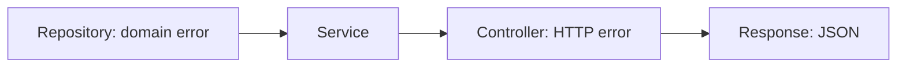

# 错误处理

使用[第一个应用](/zh-Hans/learn/getting-started/first-app)与[控制器](/zh-Hans/learn/tutorial/2-controller)中的 CLI 项目，手动扩展 `spine generate resource user` 生成的 `src/user` GET 处理函数。CLI 负责生成和注册，领域错误与 HTTP 映射由应用实现。

## HTTP 错误与响应

将成功结果放入 `httpx.Response[T]` 并单独返回 `error`，不支持直接将普通结构体 `(User, error)` 作为 HTTP 响应。当前 `httperr` 包提供四个辅助函数。

| Helper | HTTP | |
|---|---|---|
| `httperr.BadRequest(message)` | 400 | 无效输入 |
| `httperr.Unauthorized(message)` | 401 | 需要认证 |
| `httperr.NotFound(message)` | 404 | 资源不存在 |
| `httperr.InternalServerError(message)` | 500 | 有意公开的错误消息 |

`HTTPError.Message` 会暴露给客户端，不要直接放入数据库内部错误或秘密值。未知的普通错误会转换为 HTTP 500 与 `{"message":"Internal server error"}`。

## 为生成的资源添加查询错误

以下是教学用的只读内存查询。替换生成的 repository、controller 文件，并为服务添加 `Find`。所有文件放在同一个 `package user`。沿用现有构造函数名、`user.Register(app)` 和 `GET /user/:id` 注册。此示例不提供数据库持久化或完整 CRUD。

```go
// src/user/user_repository.go
package user

import "errors"

var ErrUserNotFound = errors.New("user not found")
var ErrEmailAlreadyExists = errors.New("email already exists")

type User struct {
    ID int64 `json:"id"`
    Name string `json:"name"`
}

type UserRepository struct{ users map[int64]User }

func NewUserRepository() *UserRepository {
    return &UserRepository{users: map[int64]User{1: {ID: 1, Name: "Alice"}}}
}

func (r *UserRepository) FindByID(id int64) (User, error) {
    user, ok := r.users[id]
    if !ok {
        return User{}, ErrUserNotFound
    }
    return user, nil
}
```

```go
// src/user/user_service.go
func (s *UserService) Find(id int64) (User, error) {
    return s.repository.FindByID(id)
}
```

```go
// src/user/user_controller.go
package user

import (
    "errors"
    "net/http"

    "github.com/NARUBROWN/spine/pkg/httperr"
    "github.com/NARUBROWN/spine/pkg/httpx"
    "github.com/NARUBROWN/spine/pkg/path"
)

type UserController struct{ service *UserService }

func NewUserController(service *UserService) *UserController {
    return &UserController{service: service}
}

func (c *UserController) Get(id path.Int) (httpx.Response[User], error) {
    if id.Value <= 0 {
        return httpx.Response[User]{}, httperr.BadRequest("invalid user ID")
    }
    user, err := c.service.Find(id.Value)
    if err != nil {
        return httpx.Response[User]{}, toHTTPError(err)
    }
    return httpx.Response[User]{Body: user}, nil
}

func toHTTPError(err error) error {
    switch {
    case errors.Is(err, ErrUserNotFound):
        return httperr.NotFound("user not found")
    case errors.Is(err, ErrEmailAlreadyExists):
        return &httperr.HTTPError{
            Status: http.StatusConflict,
            Message: "email already exists",
            Cause: err,
        }
    default:
        return err
    }
}
```

## 各层职责

仓储返回领域错误，服务将其向上传递，控制器只把预期错误映射为 HTTP 状态码。`errors.Is` 也能识别包装过的错误。将未知错误转换成 `BadRequest(err.Error())` 会泄露内部细节，应原样返回以使用通用的脱敏 500 响应。



## HTTPError 与其他状态码

使用 `HTTPError` 表达没有辅助函数的状态，如 403、409。`Cause` 可通过 `Unwrap()` 追踪原因，不会出现在 JSON 响应中。

```go
type HTTPError struct {
    Status int
    Message string
    Cause error
}

func (e *HTTPError) Error() string { return e.Message }
func (e *HTTPError) Unwrap() error { return e.Cause }
```

```go
return &httperr.HTTPError{
    Status: http.StatusForbidden,
    Message: "permission denied",
}
```

## 验证请求 DTO

下面是可选的输入验证扩展。Spine 不会自动调用 `Validate()`，需要在处理函数中调用。请求 DTO 必须使用指针。此 POST 只返回验证后的输入，不会保存用户；使用时在 `Register` 中手动添加 POST 路由。

```go
// src/user/user_create.go
package user

import (
    "errors"
    "net/http"
    "unicode/utf8"

    "github.com/NARUBROWN/spine/pkg/httperr"
    "github.com/NARUBROWN/spine/pkg/httpx"
)

type CreateUserRequest struct {
    Name string `json:"name"`
    Email string `json:"email"`
}

func (r *CreateUserRequest) Validate() error {
    if r == nil || r.Name == "" {
        return errors.New("name is required")
    }
    if utf8.RuneCountInString(r.Name) > 100 {
        return errors.New("name must be at most 100 characters")
    }
    if r.Email == "" {
        return errors.New("email is required")
    }
    return nil
}

func (c *UserController) Create(req *CreateUserRequest) (httpx.Response[CreateUserRequest], error) {
    if err := req.Validate(); err != nil {
        return httpx.Response[CreateUserRequest]{}, httperr.BadRequest(err.Error())
    }
    return httpx.Response[CreateUserRequest]{
        Body: *req,
        Options: httpx.ResponseOptions{Status: http.StatusCreated},
    }, nil
}
```

```go
// src/user/user_route.go: Register
app.Route("POST", "/user", (*UserController).Create)
```

## 拦截器错误处理

`PreHandle` 返回错误会停止控制器执行。下面是 `src/interceptor` 中使用自定义认证服务的方法片段。完整类型必须实现 `PreHandle`、`PostHandle`、`BeforeResponse` 和 `AfterCompletion`，并在 `BuildApplication()` 中以 HTTP scope 注册。

```go
func (i *AuthInterceptor) PreHandle(ctx core.ExecutionContext, meta core.HandlerMeta) error {
    token := ctx.Header("Authorization")
    if token == "" {
        return httperr.Unauthorized("authentication required")
    }
    user, err := i.auth.Validate(token)
    if err != nil {
        return httperr.Unauthorized("invalid token")
    }
    ctx.Set("auth.user", user)
    return nil
}
```

## 记录错误

`AfterCompletion` 可以记录执行错误。以下也是完整日志拦截器中的方法片段。不要记录认证令牌或请求中的秘密值。

```go
func (i *LoggingInterceptor) AfterCompletion(ctx core.ExecutionContext, meta core.HandlerMeta, err error) {
    if err != nil {
        log.Printf("[ERR] %s %s: %v", ctx.Method(), ctx.Path(), err)
    }
}
```

## 验证并检查 HTTP 响应

```bash
gofmt -w src/user
go mod tidy
spine doctor
spine contract check
spine verify
spine dev
```

通过契约与本地检查后，在另一个终端确认实际响应。以下结果对应上方只读内存示例。

```bash
curl -i http://localhost:8080/user/1
curl -i http://localhost:8080/user/0
curl -i http://localhost:8080/user/2
```

| Request | HTTP | JSON |
|---|---|---|
| `/user/1` | 200 | `{"id":1,"name":"Alice"}` |
| `/user/0` | 400 | `{"message":"invalid user ID"}` |
| `/user/2` | 404 | `{"message":"user not found"}` |

连接真实数据库或认证服务后，需要单独进行失败路径 E2E 检查。静态契约不能证明外部服务的错误映射正确。

- [httperr](/zh-Hans/learn/core-concepts/httperr)
- [Interceptors](/zh-Hans/learn/tutorial/4-interceptor)
