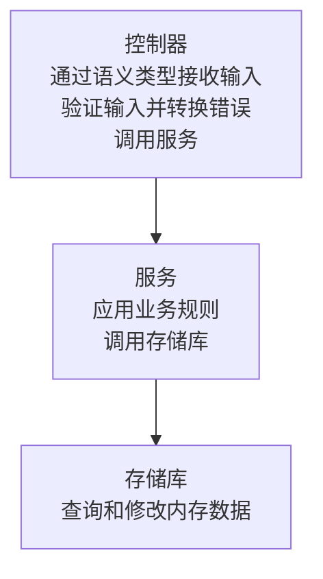

# 创建用户 CRUD API

::: info 0.7.5 API
本文以 0.7.5 API 为准。已发布标签和兼容平台请查看[版本列表](/zh-Hans/community/versions)。
:::

创建用于新增、列出、查询、修改和删除用户的 HTTP API。示例使用内存存储库，不依赖 ORM，因此无需准备数据库即可运行。

## 开始前的准备

完成 [CLI 安装](/zh-Hans/learn/getting-started/installation)后，使用支持 0.7.5 API 的 Preview CLI。CLI 安装通道与应用依赖通道独立。

服务器进程结束后，保存的用户数据会消失。

请求依次经过控制器、服务和存储库。各组件的职责如下。



## 1. 创建项目

创建基础应用，检查依赖和项目配置。后续命令均在 `crud-example/` 中运行。

以下命令选择 Preview 依赖，请在生成的 go.mod 中确认实际核心和平台版本。

```sh
spine new crud-example --module example.com/crud-example --channel preview --validator playground --no-interactive
cd crud-example
spine doctor
```

### 文件布局

在后续步骤中，在 `src/` 下添加五个文件，并替换生成的 `internal/application/application.go`。继续使用根目录中的 `main.go` 和 `spine.toml`。

```text
crud-example/
├── go.mod
├── go.sum
├── main.go
├── spine.toml
├── internal/application/
│   ├── application.go
│   └── application_test.go
└── src/
    ├── model/user.go
    ├── repository/user_repository.go
    ├── dto/user_dto.go
    ├── service/user_service.go
    └── controller/user_controller.go
```

## 2. 添加用户模型

新建 `src/model/user.go`。其中的结构体用于保存用户信息、创建时间和修改时间。

```go
// src/model/user.go
package model

import "time"

type User struct {
	ID        int64     `json:"id"`
	Name      string    `json:"name"`
	Email     string    `json:"email"`
	CreatedAt time.Time `json:"created_at"`
	UpdatedAt time.Time `json:"updated_at"`
}
```

## 3. 添加内存存储库

新建 `src/repository/user_repository.go`。它负责查询、保存和删除用户，并提供检查邮箱是否重复的函数。

```go
// src/repository/user_repository.go
package repository

import (
	"errors"
	"sync"
	"time"

	"example.com/crud-example/src/model"
)

var (
	ErrUserNotFound       = errors.New("user not found")
	ErrEmailAlreadyExists = errors.New("email already exists")
)

type UserRepository struct {
	mu      sync.RWMutex
	users   map[int64]*model.User
	counter int64
}

func (*UserRepository) Constructor() *UserRepository {
	return &UserRepository{
		users:   make(map[int64]*model.User),
		counter: 0,
	}
}

func (r *UserRepository) FindAll() []*model.User {
	r.mu.RLock()
	defer r.mu.RUnlock()

	result := make([]*model.User, 0, len(r.users))
	for _, user := range r.users {
		result = append(result, user)
	}
	return result
}

func (r *UserRepository) FindByID(id int64) (*model.User, error) {
	r.mu.RLock()
	defer r.mu.RUnlock()

	user, ok := r.users[id]
	if !ok {
		return nil, ErrUserNotFound
	}
	return user, nil
}

func (r *UserRepository) FindByEmail(email string) (*model.User, error) {
	r.mu.RLock()
	defer r.mu.RUnlock()

	for _, user := range r.users {
		if user.Email == email {
			return user, nil
		}
	}
	return nil, ErrUserNotFound
}

func (r *UserRepository) ExistsByEmail(email string) bool {
	_, err := r.FindByEmail(email)
	return err == nil
}

func (r *UserRepository) Save(user *model.User) *model.User {
	r.mu.Lock()
	defer r.mu.Unlock()

	now := time.Now()

	if user.ID == 0 {
		r.counter++
		user.ID = r.counter
		user.CreatedAt = now
	}
	user.UpdatedAt = now

	r.users[user.ID] = user
	return user
}

func (r *UserRepository) Delete(id int64) error {
	r.mu.Lock()
	defer r.mu.Unlock()

	if _, ok := r.users[id]; !ok {
		return ErrUserNotFound
	}

	delete(r.users, id)
	return nil
}

func (r *UserRepository) Count() int {
	r.mu.RLock()
	defer r.mu.RUnlock()
	return len(r.users)
}
```

## 4. 添加请求和响应 DTO

新建 `src/dto/user_dto.go`。定义请求接收的字段和响应发送的字段，并将存储库中的用户模型转换为响应 DTO。

```go
// src/dto/user_dto.go
package dto

import (
	"time"

	"example.com/crud-example/src/model"
)

// 请求 DTO

type CreateUserRequest struct {
	Name  string `json:"name" validate:"required"`
	Email string `json:"email" validate:"required,email"`
}

type UpdateUserRequest struct {
	Name  string `json:"name" validate:"required"`
	Email string `json:"email" validate:"required,email"`
}

// 响应 DTO

type UserResponse struct {
	ID        int64     `json:"id"`
	Name      string    `json:"name"`
	Email     string    `json:"email"`
	CreatedAt time.Time `json:"created_at"`
	UpdatedAt time.Time `json:"updated_at"`
}

type UserListResponse struct {
	Users []UserResponse `json:"users"`
	Total int            `json:"total"`
}

// 转换函数

func ToUserResponse(user *model.User) UserResponse {
	return UserResponse{
		ID:        user.ID,
		Name:      user.Name,
		Email:     user.Email,
		CreatedAt: user.CreatedAt,
		UpdatedAt: user.UpdatedAt,
	}
}

func ToUserListResponse(users []*model.User) UserListResponse {
	responses := make([]UserResponse, len(users))
	for i, user := range users {
		responses[i] = ToUserResponse(user)
	}
	return UserListResponse{
		Users: responses,
		Total: len(responses),
	}
}
```

## 5. 添加用户服务

新建 `src/service/user_service.go`。在创建和修改前检查邮箱是否重复，并将存储库的返回值转换为响应 DTO。

```go
// src/service/user_service.go
package service

import (
	"example.com/crud-example/src/dto"
	"example.com/crud-example/src/model"
	"example.com/crud-example/src/repository"
)

type UserService struct {
	repo *repository.UserRepository
}

func (*UserService) Constructor(repo *repository.UserRepository) *UserService {
	return &UserService{repo: repo}
}

func (s *UserService) GetAllUsers() dto.UserListResponse {
	users := s.repo.FindAll()
	return dto.ToUserListResponse(users)
}

func (s *UserService) GetUserByID(id int64) (*dto.UserResponse, error) {
	user, err := s.repo.FindByID(id)
	if err != nil {
		return nil, err
	}

	response := dto.ToUserResponse(user)
	return &response, nil
}

func (s *UserService) CreateUser(req *dto.CreateUserRequest) (*dto.UserResponse, error) {
	// 检查邮箱是否重复
	if s.repo.ExistsByEmail(req.Email) {
		return nil, repository.ErrEmailAlreadyExists
	}

	user := &model.User{
		Name:  req.Name,
		Email: req.Email,
	}

	saved := s.repo.Save(user)
	response := dto.ToUserResponse(saved)
	return &response, nil
}

func (s *UserService) UpdateUser(id int64, req *dto.UpdateUserRequest) (*dto.UserResponse, error) {
	user, err := s.repo.FindByID(id)
	if err != nil {
		return nil, err
	}

	// 更改邮箱时检查是否重复
	if req.Email != user.Email && s.repo.ExistsByEmail(req.Email) {
		return nil, repository.ErrEmailAlreadyExists
	}

	user.Name = req.Name
	user.Email = req.Email

	saved := s.repo.Save(user)
	response := dto.ToUserResponse(saved)
	return &response, nil
}

func (s *UserService) DeleteUser(id int64) error {
	return s.repo.Delete(id)
}
```

## 6. 添加用户控制器

新建 `src/controller/user_controller.go`。验证输入值后调用服务，并将用户不存在和邮箱重复的情况转换为 HTTP 错误。

```go
// src/controller/user_controller.go
package controller

import (
	"errors"

	"github.com/NARUBROWN/spine/pkg/api"
	"github.com/NARUBROWN/spine/pkg/httperr"
	"github.com/NARUBROWN/spine/pkg/httpx"
	"github.com/NARUBROWN/spine/pkg/input"

	"example.com/crud-example/src/dto"
	"example.com/crud-example/src/repository"
	"example.com/crud-example/src/service"
)

type UserController struct {
	service *service.UserService
}

func (*UserController) Constructor(service *service.UserService) *UserController {
	return &UserController{service: service}
}

func (c *UserController) RegisterRoutes(r *api.Registry) {
	r.GET("/users", c.List)
	r.GET("/users/:id", c.GetByID)
	r.POST("/users", c.Create)
	r.PUT("/users/:id", c.Update)
	r.DELETE("/users/:id", c.Delete)
}

// GET /users
func (c *UserController) List() httpx.Response[dto.UserListResponse] {
	return httpx.Response[dto.UserListResponse]{Body: c.service.GetAllUsers()}
}

// GET /users/:id
func (c *UserController) GetByID(id input.Path[int64]) (httpx.Response[dto.UserResponse], error) {
	if *id <= 0 {
		return httpx.Response[dto.UserResponse]{}, httperr.BadRequest("用户 ID 无效")
	}

	user, err := c.service.GetUserByID(*id)
	if err != nil {
		return httpx.Response[dto.UserResponse]{}, toHTTPError(err)
	}

	return httpx.Response[dto.UserResponse]{Body: *user}, nil
}

// POST /users
func (c *UserController) Create(req input.Body[dto.CreateUserRequest]) (httpx.Response[dto.UserResponse], error) {

	user, err := c.service.CreateUser(req)
	if err != nil {
		return httpx.Response[dto.UserResponse]{}, toHTTPError(err)
	}

	return httpx.Response[dto.UserResponse]{Body: *user}, nil
}

// PUT /users/:id
func (c *UserController) Update(id input.Path[int64], req input.Body[dto.UpdateUserRequest]) (httpx.Response[dto.UserResponse], error) {
	if *id <= 0 {
		return httpx.Response[dto.UserResponse]{}, httperr.BadRequest("用户 ID 无效")
	}

	user, err := c.service.UpdateUser(*id, req)
	if err != nil {
		return httpx.Response[dto.UserResponse]{}, toHTTPError(err)
	}

	return httpx.Response[dto.UserResponse]{Body: *user}, nil
}

// DELETE /users/:id
func (c *UserController) Delete(id input.Path[int64]) error {
	if *id <= 0 {
		return httperr.BadRequest("用户 ID 无效")
	}

	err := c.service.DeleteUser(*id)
	if err != nil {
		return toHTTPError(err)
	}

	return nil
}

// 将 Repository 错误转换为 HTTP 错误
func toHTTPError(err error) error {
	switch {
	case errors.Is(err, repository.ErrUserNotFound):
		return httperr.NotFound("未找到用户")
	case errors.Is(err, repository.ErrEmailAlreadyExists):
		return httperr.BadRequest("邮箱已被使用")
	default:
		return err
	}
}
```

## 7. 注册构造函数和路由

将 `internal/application/application.go` 的全部内容替换为以下代码。注册存储库、服务和控制器的构造函数，并连接五个路由。生成的根目录 `main.go` 会依次执行 `BuildApplication`、`Validate` 和 `Run`。

```go
// internal/application/application.go
package application

import (
	echoplatform "github.com/NARUBROWN/spine-echo-platform"
	"time"

	"example.com/crud-example/src/controller"
	"example.com/crud-example/src/repository"
	"example.com/crud-example/src/service"

	"github.com/NARUBROWN/spine"
	playground "github.com/NARUBROWN/spine-validator-playground"
	"github.com/NARUBROWN/spine/interceptor/cors"
	"github.com/NARUBROWN/spine/pkg/boot"
	"github.com/NARUBROWN/spine/pkg/constructor"
)

func BuildApplication() (spine.App, boot.Options, error) {
	engine, err := playground.New()
	if err != nil {
		return nil, boot.Options{}, err
	}
	app := spine.New(echoplatform.Option(), spine.WithValidator(engine))
	app.Constructor(
		constructor.Repository(&repository.UserRepository{}),
		constructor.Service(&service.UserService{}),
		constructor.Controller(&controller.UserController{}),
	)

	corsInterceptor, err := cors.NewValidated(cors.Config{
		AllowOrigins: []string{"*"},
		AllowMethods: []string{"GET", "POST", "PUT", "DELETE", "OPTIONS"},
		AllowHeaders: []string{"Content-Type"},
	})
	if err != nil {
		return nil, boot.Options{}, err
	}
	app.InterceptorFor(boot.InterceptorHTTP, corsInterceptor)

	return app, boot.Options{
		Address:                ":8080",
		EnableGracefulShutdown: true,
		ShutdownTimeout:        10 * time.Second,
		HTTP:                   &boot.HTTPOptions{},
	}, nil
}
```

## 8. 验证并启动服务器

在项目根目录中格式化代码，检查依赖和代码，然后启动服务器。

```sh
gofmt -w src internal/application
go mod tidy
go mod download all
spine contract check
spine verify
spine dev
```

`contract check` 检查静态契约。`verify` 检查静态契约，并运行 gofmt、go vet 和 Go 测试。接下来通过 HTTP 请求确认服务器是否实际处理了请求。

## 9. 通过 HTTP 请求确认 CRUD

保持服务器运行，在另一个终端中依次发送以下请求。新启动的服务器中，第一个用户的 ID 为 `1`。响应中的日期仅为示例，实际值取决于创建和修改时间。

### 创建用户

发送姓名和邮箱后，服务器会返回 HTTP 200 和创建的用户信息。

```bash
curl -X POST http://localhost:8080/users \
  -H "Content-Type: application/json" \
  -d '{"name": "爱丽丝", "email": "hong@example.com"}'
```

```json
{
  "id": 1,
  "name": "爱丽丝",
  "email": "hong@example.com",
  "created_at": "2025-01-19T10:00:00Z",
  "updated_at": "2025-01-19T10:00:00Z"
}
```

### 查询用户列表

确认之前创建的用户包含在 `users` 中，且 `total` 为 `1`。

```bash
curl http://localhost:8080/users
```

```json
{
  "users": [
    {
      "id": 1,
      "name": "爱丽丝",
      "email": "hong@example.com",
      "created_at": "2025-01-19T10:00:00Z",
      "updated_at": "2025-01-19T10:00:00Z"
    }
  ],
  "total": 1
}
```

### 查询用户

查询 ID 为 `1` 的用户信息。

```bash
curl http://localhost:8080/users/1
```

```json
{
  "id": 1,
  "name": "爱丽丝",
  "email": "hong@example.com",
  "created_at": "2025-01-19T10:00:00Z",
  "updated_at": "2025-01-19T10:00:00Z"
}
```

### 修改用户

同时发送姓名和邮箱。确认响应中的这两个字段及 `updated_at` 已发生变化。

```bash
curl -X PUT http://localhost:8080/users/1 \
  -H "Content-Type: application/json" \
  -d '{"name": "爱丽丝（已更新）", "email": "hong2@example.com"}'
```

```json
{
  "id": 1,
  "name": "爱丽丝（已更新）",
  "email": "hong2@example.com",
  "created_at": "2025-01-19T10:00:00Z",
  "updated_at": "2025-01-19T10:05:00Z"
}
```

### 删除用户

删除 ID 为 `1` 的用户。再次查询已删除的 ID 时，服务器会返回 HTTP 404。

```bash
curl -X DELETE http://localhost:8080/users/1
```

### 用户不存在和邮箱重复

查询存储库中不存在的 ID 时，服务器会返回 HTTP 404 和以下错误消息。

```bash
# 不存在的用户
curl http://localhost:8080/users/999
```

```json
{
  "message": "未找到用户"
}
```

由于上一步已删除用户，先用相同的邮箱重新创建用户。第一个请求以 HTTP 200 成功，随后使用相同邮箱创建用户的第二个请求会返回 HTTP 400 和重复错误。

```bash
curl -X POST http://localhost:8080/users \
  -H "Content-Type: application/json" \
  -d '{"name": "爱丽丝", "email": "hong@example.com"}'
# 重复邮箱
curl -X POST http://localhost:8080/users \
  -H "Content-Type: application/json" \
  -d '{"name": "鲍勃", "email": "hong@example.com"}'
```

```json
{
  "message": "邮箱已被使用"
}
```

## 实现中需要注意的要点

### 通过语义类型接收请求值

控制器接收 `input.Path[int64]` 等语义类型作为参数，代替 HTTP 请求对象。错误通过 `httperr` 表示。

```go
// 通过语义类型接收输入
func (c *UserController) GetByID(id input.Path[int64]) (httpx.Response[dto.UserResponse], error)

// 通过 httperr 表达错误含义
return httpx.Response[dto.UserResponse]{}, httperr.NotFound("未找到用户")
```

### 依赖注入

根据已注册构造函数的参数类型，连接存储库、服务和控制器之间的依赖。

```go
// 只需注册构造函数即可自动解析依赖
app.Constructor(
	constructor.Repository(&repository.UserRepository{}), // 无依赖
	constructor.Service(&service.UserService{}),          // 依赖 Repository
	constructor.Controller(&controller.UserController{}), // 依赖 Service
)
```

### 各组件的职责

| 组件 | 职责 | 使用的组件 |
|-------|------|------|
| 控制器 | 验证输入、转换 HTTP 错误 | 服务 |
| 服务 | 检查邮箱重复、转换响应 DTO | 存储库 |
| 存储库 | 查询和修改内存数据 | 无 |

## 后续步骤

如需持久化保存数据，请按照[连接数据库](/zh-Hans/learn/tutorial/5-database)替换存储库。如需进一步了解错误处理方式，请参阅[错误处理教程](/zh-Hans/learn/tutorial/7-error-handling)。
