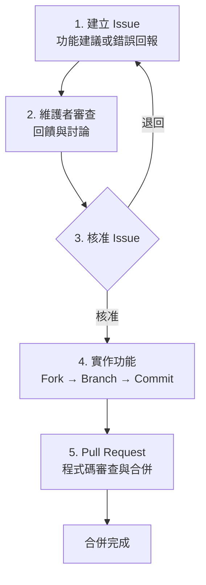

# 參與貢獻

以下說明如何為 Spine 提出功能、錯誤修正與文件改進建議，以及提交 Pull Request。實作前，請先在 GitHub Issue 中討論變更目的與範圍。

## 貢獻流程

依序建立 Issue、由維護者審查並核准、實作，再提交 Pull Request。



## 1. 建立 Issue

實作功能前，務必先建立 Issue。

在 [Spine GitHub Issues](https://github.com/NARUBROWN/spine/issues) 建立新 Issue，並依建議類型提供相關資訊。

提出功能建議時：

- 建議的功能
- 需要此功能的原因
- 預期使用範例

回報錯誤時：

- 重現錯誤的步驟
- 預期行為與實際行為
- Go 版本、作業系統等執行環境

## 2. 維護者審查

維護者會審查 Issue 並留下意見。必要時，雙方會一起討論設計方向與實作範圍。

## 3. 核准 Issue

請在維護者核准 Issue 後開始實作。核准前提交的 Pull Request 可能不會合併。

## 4. Pull Request

完成實作後，請在 GitHub 建立 Pull Request，並在說明中填寫相關 Issue 編號。

```
Closes #123
```

## 修改與翻譯文件

此文件網站以 `docs/ko` 作為內容的單一依據。請先修改並審查韓文文件，再以相同內容、程式碼與結構翻譯至 `docs/en`、`docs/ja`、`docs/zh-Hans` 和 `docs/zh-Hant`。

在文件網站的儲存庫根目錄執行以下指令，即可檢查各語言的文件結構與可執行程式碼是否一致。

```bash
python3 scripts/check-doc-translations.py
```

建置文件後，也請檢查翻譯後的內部路徑與章節連結。

```bash
go run scripts/check-go-examples.go docs
python3 scripts/check-v075-examples.py
npm run docs:build
python3 scripts/check-doc-translations.py --check-rendered
```

## 如有疑問

實作過程中如有需要確認的事項，請在相關 Issue 留言。
