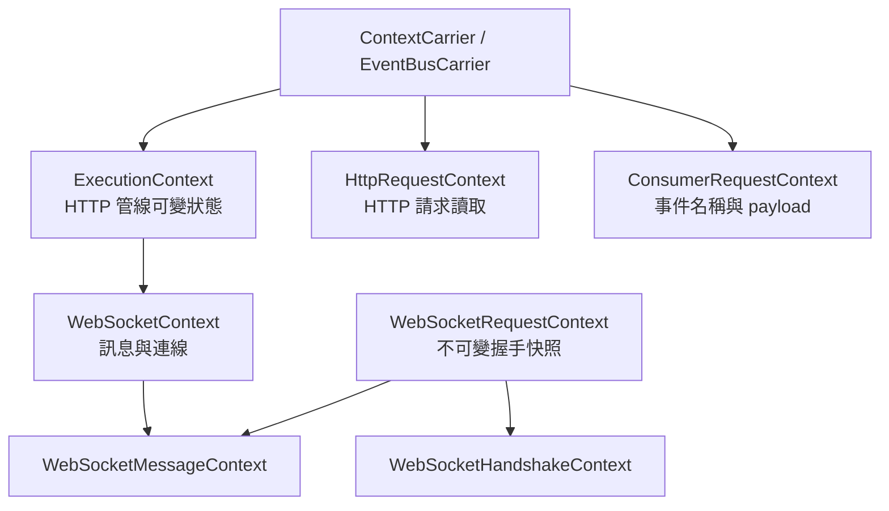

# 執行上下文

Spine 以小型介面區分 HTTP、訊息消費者與 WebSocket 的輸入，同時讓攔截器和解析器共享必要能力。



## HTTP 管線上下文

`core.ExecutionContext` 供管線、路由、攔截器和內部解析器使用，包含方法、路徑、header、path/query 參數，以及 `Set`/`Get` 可變儲存。

控制器不應依賴整個執行上下文。若要讀取攔截器儲存的資料，應注入唯讀的 `core.ControllerContext`：

```go
func (c *UserController) Me(ctx core.ControllerContext) (httpx.Response[User], error) {
	value, ok := ctx.Get("currentUser")
	if !ok {
		return httpx.Response[User]{}, httperr.Unauthorized("需要驗證")
	}
	return httpx.Response[User]{Body: value.(User)}, nil
}
```

`HttpRequestContext` 提供 `Param`、`Query`、`Header`、完整集合、`Bind` 和 `MultipartForm`。解析器需要這些能力時應先進行介面檢查，不應假定訊息消費者也具有 HTTP 資訊。

## 訊息消費者上下文

`ConsumerRequestContext` 只公開 `Context()`、`EventBus()`、`EventName()` 和 `Payload()`。這種分離讓消費者處理器可以重用相依性注入與解析器，而不會偽造 HTTP 方法或路徑。

## WebSocket 上下文

`WebSocketContext` 在 `ExecutionContext` 之上增加 `ConnID()`、`MessageType()` 和 `Payload()`。v0.5.1 還保留 upgrade 請求的不可變快照：

- `WebSocketHandshakeContext` 供握手階段驗證使用。
- `WebSocketMessageContext` 在每則訊息中同時提供訊息資料和原始握手請求。
- `WebSocketRequestContext` 可讀取 path、header、query、cookie、遠端位址、host 和 request URI。

連線槽位會先被保留，接著呼叫 `PreHandshake`，最後才執行 HTTP upgrade。因此等待驗證的連線也會占用 `MaxConnections`。

```go
func (i *AuthInterceptor) PreHandshake(
	ctx core.WebSocketHandshakeContext,
	meta core.HandlerMeta,
) error {
	if ctx.Header("Authorization") == "" {
		return httperr.Unauthorized("missing credentials")
	}
	return nil
}
```

## 設計原則

- 控制器依賴最小唯讀介面，協定細節留在解析器和攔截器中。
- 不支援的上下文型別應回傳錯誤，而不是透過反射 panic。
- `Context()` 傳遞取消和截止時間；不要把請求範圍值提升為全域狀態。
- WebSocket 握手資訊是快照，不會隨外部請求物件改變。

完整簽名請參閱 [`core` 上下文 API](/zh-Hant/reference/api/execution-context)。
