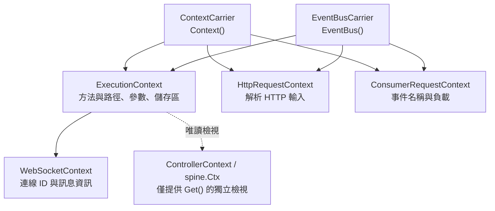

# 執行內容 (ExecutionContext)

::: info
舊輸入 API 的相容規則請參閱[輸入移轉](/zh-Hant/learn/migration/v0.7.1-preview)，文件選項請參閱 [OpenAPI](/zh-Hant/reference/api/openapi)。
:::

Spine 會為每個請求或訊息建立執行內容，將輸入資訊與執行狀態傳給管線。攔截器透過 `core.ExecutionContext` 讀寫執行狀態，HTTP 控制器則透過語意型別與唯讀的 `spine.Ctx`，僅接收所需的值。

本頁的 `src/user` 範例使用[專案結構](/zh-Hant/learn/tutorial/1-project-structure)中的 `legacy` 版面。

理解這項區分後，就能將攔截器儲存的值傳給控制器，並判斷 HTTP、事件消費者與 WebSocket 可使用的輸入。本文的介面與行為以 Spine v0.7.1 為準。

應用程式處理器範例是手動加入[以 CLI 建立的專案](/zh-Hant/learn/tutorial/1-project-structure)的擴充程式碼。請保留產生的 `BuildApplication`，以及會檢查錯誤的 `user.Register(app)` 呼叫。`core/` 介面是公開契約，應用程式不需要複製 `internal/` 實作。

## 控制器與攔截器的存取範圍

內容物件的用途並非將單一大型物件暴露給所有程式碼，而是區分控制管線的程式碼與商業邏輯所需的存取範圍。

| 使用位置 | 接收的型別 | 可使用的功能 |
| --- | --- | --- |
| HTTP 控制器 | `context.Context` | 傳遞取消與逾時資訊、發布領域事件 |
| HTTP 控制器 | `pkg/spine.Ctx` | 查詢攔截器儲存的值 |
| HTTP 控制器 | `input.Path[T]`、`input.Query[T]`、DTO 等 | 綁定好的請求輸入 |
| 攔截器 | `core.ExecutionContext` | 查詢請求資訊、讀寫儲存區，以及執行前後的處理 |
| HTTP 引數解析器 | `core.HttpRequestContext` | 解析 HTTP 主體、標頭、表單等輸入 |
| 消費者引數解析器 | `core.ConsumerRequestContext` | 解析事件名稱與負載 |
| WebSocket 引數解析器 | `core.WebSocketContext` | 解析連線 ID、訊息型別與負載 |

本文中的 `spine.Ctx` 是 `github.com/NARUBROWN/spine/pkg/spine` 的型別，並非根應用程式套件 `github.com/NARUBROWN/spine` 的型別。如果在同一個檔案匯入這兩個套件，請用別名區分。

預設 HTTP 解析器不會將 `core.ExecutionContext` 或 `core.HttpRequestContext` 注入為控制器引數。在控制器中，請透過輸入型別與 `httpx.Response[T]` 回傳值表達所需行為，無須直接操作回應寫入器或主體綁定。

## 內容契約的關係

`ContextCarrier` 與 `EventBusCarrier` 表示共用功能。HTTP 與消費者輸入契約會直接包含這兩個契約，而 WebSocket 訊息契約則擴充 `ExecutionContext`。



箭頭表示契約之間的包含關係。`ControllerContext` 與 `spine.Ctx` 並未嵌入 `ExecutionContext`，而是只公開 `Get()` 的獨立介面，讓使用者能查詢同一個儲存區。

對於 HTTP，核心 HTTPContext 包裝平台輸入檢視並提供 `ExecutionContext` 和 `HttpRequestContext`。回應 writer 透過獨立的 `core.HTTPResponseContext` 存取。`SetRoute` 儲存的路由狀態與使用者 `Set/Get` 儲存空間分離。消費者同時實作 `ExecutionContext` 與 `ConsumerRequestContext`。

## 共用的基礎契約

### ContextCarrier

傳遞 Go 標準的 `context.Context`。用於將取消訊號與截止時間傳給服務、儲存庫與外部 API 呼叫。

```go
// core/context.go
type ContextCarrier interface {
    Context() context.Context
}
```

HTTP 使用請求的 `context.Context`。如果控制器將 `context.Context` 宣告為引數，標準內容解析器就會傳入請求內容，並連結發布領域事件所需的 EventBus。

### EventBusCarrier

存取屬於該次執行的 EventBus。

```go
// core/context.go
type EventBusCarrier interface {
    EventBus() EventBus
}
```

`core.EventBus` 是收集與取出事件的最小契約。`publish.DomainEvent` 定義於 `github.com/NARUBROWN/spine/pkg/event/publish`。

```go
// core/event_bus.go
type EventBus interface {
    Publish(events ...publish.DomainEvent)
    Drain() []publish.DomainEvent
}
```

控制器通常不會直接呼叫 `EventBus()`，而是使用收到的 `context.Context` 呼叫 `publish.Event()`。具體用法請參閱下方的 [EventBus 與事件發布](#event-publishing)。

## ExecutionContext：管線與攔截器的執行狀態

`core.ExecutionContext` 是管線、路由器與攔截器共用的契約。

```go
// core/context.go
type ExecutionContext interface {
    ContextCarrier
    EventBusCarrier

    Method() string
    Path() string
    Params() map[string]string
    Header(name string) string
    PathKeys() []string
    SetRoute(params map[string]string, pathKeys []string)
    Queries() map[string][]string
    Set(key string, value any)
    Get(key string) (any, bool)
}
```

### 請求與路由資訊

| 方法 | 在 HTTP 中的意義 | 注意事項 |
| --- | --- | --- |
| `Method()` | `GET`、`POST` 等請求方法 | 消費者回傳 `EVENT`，WebSocket 回傳 `WS` |
| `Path()` | `/users/123` 等實際請求路徑 | 須與路由模式 `/users/:id` 區分 |
| `Header(name)` | 指定的請求標頭 | 沒有標頭時為空字串 |
| `Params()` | 路由器擷取的路徑值 | 全域 `PreHandle` 在 Spine 路由前執行 |
| `PathKeys()` | 路由中路徑參數的宣告順序 | 用於 `path.*` 型別的順序綁定 |
| `Queries()` | 保留多個值的查詢映射 | 同一個鍵可能有多個值 |

例如，`/users/:userId/posts/:postId` 路由收到 `/users/123/posts/456?tag=go&tag=web` 請求後，可以在路由完成後讀取下列資訊。

```go
ctx.Method()   // "GET"
ctx.Path()     // "/users/123/posts/456"
ctx.Params()   // {"userId": "123", "postId": "456"}
ctx.PathKeys() // ["userId", "postId"]
ctx.Queries()  // {"tag": ["go", "web"]}
```

上述程式碼示範攔截器等程式碼可以讀取的值，不代表 HTTP 控制器會直接收到這個內容物件。

### Set() 與 Get()：在執行期間共用值

攔截器可以透過 `Set()` 儲存驗證結果或請求追蹤資訊。控制器則透過唯讀檢視的 `Get()` 讀取相同的值。

```go
// 在攔截器中儲存
ctx.Set("auth.user", authInfo)

// 在同一次執行中讀取
value, ok := ctx.Get("auth.user")
```

`Get()` 會一併回傳值與是否存在的資訊。鍵存在不代表值就是預期的型別，因此請在使用該值的程式碼中一併確認型別。儲存區屬於單次請求或訊息執行，請勿當作全域快取使用。

和一般映射一樣，是否保證並行存取安全取決於實作。請勿假設可以在多個 goroutine 中，同時讀寫 HTTP 內容物件的儲存區。

## ControllerContext 與 spine.Ctx：控制器的唯讀檢視

`core.ControllerContext` 與 `pkg/spine.Ctx` 提供相同的方法集合。

```go
// core/context.go
type ControllerContext interface {
    Get(key string) (any, bool)
}
```

```go
// pkg/spine/types.go
type Ctx interface {
    Get(key string) (any, bool)
}
```

預設 HTTP 解析器會將執行內容包裝成這個檢視後傳入。控制器可以呼叫 `Get()`，但無法呼叫 `Set()`、`Method()` 或 `EventBus()`。即使透過要求額外方法的自訂介面擴充型別，也不會自動獲得支援。

### 讀取攔截器儲存的驗證資訊

下列方法示範如何在驗證攔截器已儲存 `auth.user` 的應用程式中，為 `UserController` 加入方法。匯入 `context`、`github.com/NARUBROWN/spine/pkg/spine`、`pkg/input` 與 `pkg/httpx`。實際應用程式中，請依驗證原則檢查 `authInfo` 是否存在及其型別。

```go
// src/user/user_controller.go
func (c *UserController) GetUser(ctx context.Context, cc spine.Ctx, userId input.Path[int64]) httpx.Response[any] {
    authInfo, _ := cc.Get("auth.user")
    return httpx.Response[any]{Body: authInfo}
}
```

即使宣告為 `core.ControllerContext`，在 HTTP 中也會收到相同的唯讀檢視。應用程式程式碼可以用 `spine.Ctx` 表達所需的存取範圍。驗證攔截器的撰寫與註冊方式請參閱[攔截器教學](/zh-Hant/learn/tutorial/4-interceptor)。

事件消費者與 WebSocket 的預設管線未註冊 `ControllerContextResolver`。請勿直接在其他協定的處理器中，宣告 HTTP 可用的 `spine.Ctx` 引數。

## HttpRequestContext：解析 HTTP 輸入

`core.HttpRequestContext` 是 HTTP 解析器用來讀取個別參數、全部標頭、主體與 multipart 表單的契約。它不會嵌入 `ExecutionContext`，而是直接包含兩個基礎契約。

```go
// core/context.go
type HttpRequestContext interface {
    ContextCarrier
    EventBusCarrier

    Param(name string) string
    Query(name string) string
    Header(name string) string

    Params() map[string]string
    Queries() map[string][]string
    Headers() map[string][]string

    Bind(out any) error
    MultipartForm() (*multipart.Form, error)
}
```

這裡的 `multipart.Form` 是 Go 標準 `mime/multipart` 的型別。

| 方法 | 行為 |
| --- | --- |
| `Param(name)` | 查詢該路徑參數的值 |
| `Query(name)` | 查詢該查詢參數的第一個值，不存在時為空字串 |
| `Header(name)` | 查詢請求標頭值 |
| `Params()` | 查詢路徑參數映射 |
| `Queries()` | 查詢保留多個值的查詢映射 |
| `Headers()` | 查詢完整的請求標頭映射 |
| `Bind(out)` | 將請求輸入綁定至傳入的 DTO |
| `MultipartForm()` | 查詢 multipart 表單與檔案資訊 |

### HTTP 配接器的行為

在 HTTP v3 中，Echo 或 net/http 提供原始請求，核心請求檢視解析路徑、查詢、標頭和本文。完整標頭映射的擁有權可能因平台而異，因此請將回傳值視為唯讀。

`Bind()` 和 `MultipartForm()` 由核心請求檢視提供。一般本文 DTO 解析器使用 `Bind()`，路徑和查詢不會合併至本文 DTO。Spine DTO 輸入不會呼叫 Echo Binder 或 JSONSerializer 擴充。

```go
func (c *UserController) CreateUser(req *CreateUserRequest) (httpx.Response[User], error)
```

這段程式碼是方法簽章範例，`CreateUserRequest` 與 `User` 是由應用程式定義的型別。表單 DTO 的欄位使用 `form` 標籤，上傳檔案則可以用 `pkg/multipart.UploadedFiles` 接收。

Spine `v0.7.1` 搭配 Echo 平台 `v0.2.0`，對格式錯誤的 JSON、數字或布林路徑值轉換失敗回傳 HTTP 400，對不支援的本文 Content-Type 回傳 415，對超過本文大小限制回傳 413。綁定失敗發生在控制器呼叫之前。請區分綁定失敗與業務驗證，並以實際請求確認。 [執行管線](/zh-Hant/learn/core-concepts/pipeline#error-responses)

## ConsumerRequestContext：解析事件輸入

`core.ConsumerRequestContext` 提供事件名稱與原始負載。

```go
// core/context.go
type ConsumerRequestContext interface {
    ContextCarrier
    EventBusCarrier

    EventName() string
    Payload() []byte
}
```

消費者配接器同時實作這個契約與 `ExecutionContext`。由於不是 HTTP 請求，共用方法的行為如下。

| 方法 | 在消費者中回傳的值 |
| --- | --- |
| `Method()` | `EVENT` |
| `Path()` | 事件名稱 |
| `EventName()` | 事件名稱 |
| `Payload()` | 收到訊息的原始位元組 |
| `Header(name)` | 空字串 |
| `Params()` | `nil` |
| `PathKeys()` | `nil` |
| `Queries()` | `nil` |

預設消費者解析器支援 `context.Context`、字串事件名稱、`[]byte` 負載與結構 DTO 值。DTO 會透過反序列化 JSON 負載建立。HTTP DTO 的指標規則不會直接套用到消費者。

如果缺少解析器所需的負載，或 JSON 反序列化失敗，就不會呼叫處理器。如何將這次執行失敗反映在訊息確認、重試與 dead-letter 處理上，由消費者執行階段與訊息傳輸設定負責。請勿直接套用 HTTP 錯誤回應表。

## WebSocketContext：訊息與連線資訊

`core.WebSocketContext` 在 `ExecutionContext` 上加入 WebSocket 訊息資訊。

```go
// core/context.go
type WebSocketContext interface {
    ExecutionContext

    ConnID() string
    MessageType() int
    Payload() []byte
}
```

WebSocket 執行階段會為每則收到的訊息建立執行內容。`Method()` 回傳 `WS`，`Path()` 回傳連線請求的實際路徑。`ConnID()` 回傳連線 ID，`MessageType()` 回傳文字或二進位等訊框型別，`Payload()` 則回傳該訊息的位元組。

預設解析器支援 `context.Context`、`pkg/ws.ConnectionID`、`[]byte` 與結構 DTO 值。DTO 會將訊息負載以 JSON 反序列化。與 HTTP 不同，DTO 以結構值接收。

### 原始連線請求的資訊

WebSocket 在處理訊息時，也可以查詢 HTTP upgrade 時收到的標頭、查詢參數與 Cookie。為此，另提供獨立的請求檢視。

```go
// core/context.go
type WebSocketRequestContext interface {
    ContextCarrier

    Path() string
    Header(name string) string
    Headers() map[string][]string
    Query(name string) string
    Queries() map[string][]string
    Cookie(name string) (string, bool)
    Cookies() map[string]string
    RemoteAddr() string
    Host() string
    RequestURI() string
}
```

```go
type WebSocketHandshakeContext interface {
    WebSocketRequestContext
}

type WebSocketMessageContext interface {
    WebSocketContext
    WebSocketRequestContext
}
```

預設 WebSocket 實作會複製並保存 upgrade 請求資訊。`Headers()`、`Queries()` 與 `Cookies()` 也會回傳副本，因此變更查詢結果不會改變已保存的請求資訊。這些值是連線當時的資訊，不代表每則訊息都會收到新的 HTTP 請求。

| 所需的值 | 使用的契約 |
| --- | --- |
| 訊息負載與連線 ID | `core.WebSocketContext` |
| upgrade 前的標頭、查詢參數與 Cookie 檢查 | `core.WebSocketHandshakeContext` |
| 處理訊息時一併查詢原始請求資訊 | `core.WebSocketMessageContext` |

預設實作的 `Header()` 與 `Queries()` 會查詢這些請求資訊。值可能不存在，但不會因為是 WebSocket 就一律回傳空值。請勿假設自行撰寫的 `WebSocketContext` 實作也支援額外的請求檢視，應先確認型別。

```go
// 在處理 WebSocket 訊息的攔截器中讀取的範例
if requestCtx, ok := ctx.(core.WebSocketMessageContext); ok {
    origin := requestCtx.Header("Origin")
    _ = origin
}
```

這段程式碼不是控制器引數注入範例，而是從攔截器收到的 `core.ExecutionContext` 確認是否支援額外功能。

### 連線前檢查與訊息前置處理

如果需要在連線前進行驗證或權限檢查，請實作選用的 `core.WebSocketHandshakeInterceptor` 契約。

```go
type WebSocketHandshakeInterceptor interface {
    PreHandshake(ctx WebSocketHandshakeContext, meta HandlerMeta) error
}
```

如果註冊為套用至 WebSocket 的 `core.Interceptor` 也實作這個契約，執行階段會先保留連線名額，再於 HTTP upgrade 前呼叫 `PreHandshake`。等待驗證的連線也會計入連線上限。一般的 `core.Interceptor.PreHandle` 則會在連線後，每次處理訊息時呼叫。請區分必須拒絕連線本身的檢查與各訊息的前置處理。

## 各協定的輸入比較

即使使用相同的執行管線，內容物件的意義與預設引數型別仍不同。

| 項目 | HTTP | 事件消費者 | WebSocket |
| --- | --- | --- | --- |
| 執行單位 | 一次 HTTP 請求 | 一筆收到的事件 | 一則收到的訊息 |
| `Method()` | HTTP 方法 | `EVENT` | `WS` |
| `Path()` | 實際請求路徑 | 事件名稱 | 連線請求的實際路徑 |
| `Header()` | 請求標頭 | 空字串 | 保存的 upgrade 請求標頭 |
| `Queries()` | 請求查詢參數 | `nil` | 保存的 upgrade 請求查詢參數 |
| 主體輸入 | HTTP `Bind()` | 事件 `Payload()` | 訊息 `Payload()` |
| 預設 DTO 型別 | 結構指標 | 結構值 | 結構值 |
| `context.Context` 引數 | 支援 | 支援 | 支援 |
| `spine.Ctx` 引數 | 支援 | 預設未註冊 | 預設未註冊 |

協定特有的功能，請先透過對應介面確認型別再使用。即使有 `ExecutionContext`，也不代表能同時呼叫 HTTP 的 `Bind()` 與 WebSocket 的 `ConnID()`。

## 儲存區鍵與執行時點

路由狀態與 HTTP 回應 writer 使用具有明確型別的契約，與使用者 Set/Get 儲存空間分離。路由器透過 `SetRoute` 儲存路徑值，HTTP 管線透過 `HTTPResponseContext` 選擇 writer。

| API | 值的型別 | 用途 |
| --- | --- | --- |
| `Params()` | `map[string]string` | 路由器擷取的路徑參數 |
| `PathKeys()` | `[]string` | 路徑參數的宣告順序 |
| `HTTPResponseContext.ResponseWriter()` | `core.ResponseWriter` | HTTP 回應寫入與緩衝處理 |

`HTTPResponseContext.ResponseWriter()` 回傳 HTTP 回應 writer。管線準備回應時將其替換為 staging writer，並在傳送前復原。控制器通常回傳 `httpx.Response[T]`、`httpx.Redirect` 或 `httpx.Binary`，而不是直接存取 writer。

能從內容物件讀取哪些值，也取決於執行時點。全域 `PreHandle` 在路由前執行，路由 `PreHandle` 則在路由與引數綁定後執行。設計時，必須一併考慮儲存區應在何時具備該值，以及哪個階段會建立這個值。

## EventBus 與事件發布 {#event-publishing}

控制器宣告 `context.Context` 時，標準內容解析器會連結該次執行的 EventBus 後傳入。控制器可以透過這個內容物件收集領域事件。

下列節錄中的 `publish` 匯入自 `github.com/NARUBROWN/spine/pkg/event/publish`。`OrderCreated` 是由應用程式定義，並實作 `Name() string` 與 `OccurredAt() time.Time` 的事件型別。

```go
// src/user/user_controller.go
func (c *UserController) CreateOrder(ctx context.Context, orderId input.Path[int64]) httpx.Response[string] {
    // 透過連結至 context.Context 的 EventBus 收集事件。
    publish.Event(ctx, OrderCreated{
        OrderID: *orderId,
        At:      time.Now(),
    })

    return httpx.Response[string]{Body: "OK"}
}
```

單憑呼叫 `publish.Event()`，並不會完成向外部訊息代理的傳送。它會將事件收集到已連結的 EventBus；若已註冊事件派送掛鉤，則在成功回應的序列化與驗證完成後，取出事件並傳給派送器。註冊掛鉤需要設定事件發布器。

如果處理器回傳錯誤，或準備成功回應時失敗，就不會執行派送掛鉤。如果派送失敗，該錯誤會視為管線的執行錯誤。派送掛鉤會在 `BeforeResponse` 與實際的 HTTP 回應傳送之前執行，因此不能單憑事件已收集或已派送，就判定交易已提交或回應已傳送完成。

事件發布、交易收尾與回應寫入的順序，請參閱[執行管線](/zh-Hant/learn/core-concepts/pipeline)。
