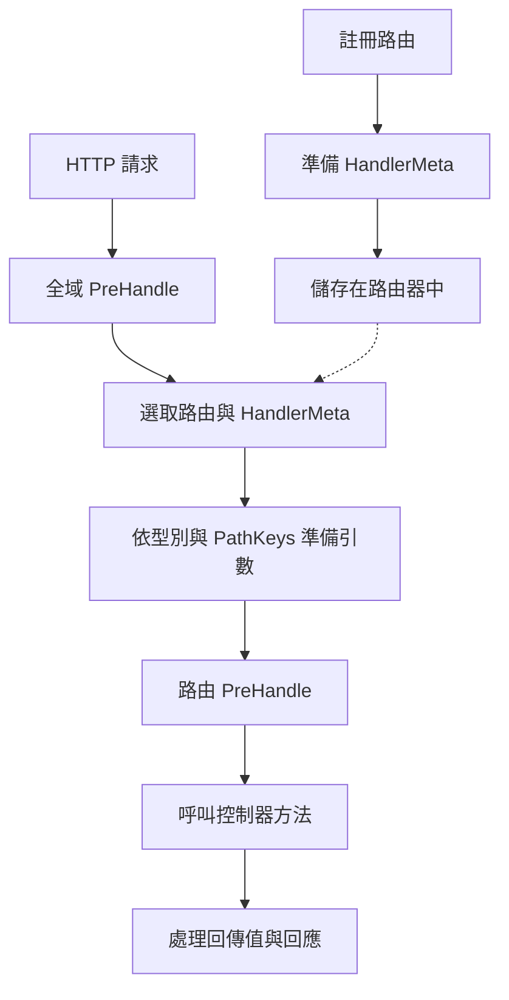

# 處理器中繼資料（HandlerMeta）

::: warning Preview
本頁包含穩定版 `v0.6.5` 範例。Preview 中的 `app.Route` 已標記為 Deprecated。請參閱[控制器與路由遷移](/zh-Hant/learn/migration/preview-controller-routes)。
:::

::: warning v0.7.0 Preview 輸入 API 移轉
本頁既有 API 說明與範例以穩定版 `v0.6.5` 為基準。自 `v0.7.0-preview.1` 起，可依輸入來源使用獨立的 Path、Query 與 Header DTO。`query.Values`、`header.Values` 及其建構與讀取 API、`query.Pagination`、`path.Int`、`path.String`、`path.Boolean` 均標記為 Deprecated。

新的 DTO 方式無法直接用於 `v0.6.5`。在 Preview 中，同一處理器混用新 DTO 與 Deprecated 輸入也會在啟動時遭到拒絕。既有本文 DTO 與情境仍可搭配任一方式使用。

適用版本與移轉範例請見 [Preview 處理器輸入移轉](/zh-Hant/learn/migration/v0.7.0-preview)，規格選項請見 [執行階段 OpenAPI](/zh-Hant/reference/api/openapi)。
:::

`core.HandlerMeta` 包含執行對應請求的控制器方法所需的資訊，包括控制器型別、方法、路徑參數順序，以及路由攔截器。應用程式使用 `app.Route` 註冊處理器，並可在攔截器中讀取 `HandlerMeta`，確認即將執行的對象。

本頁依功能劃分的 `src/user` 範例使用[專案結構](/zh-Hant/learn/tutorial/1-project-structure)中以 `--layout legacy` 建立的 `my-app`。CLI `v0.4.2` 預設產生依角色劃分的 `layered-v1` 結構。兩種布局都使用 Spine `v0.6.5` 與 Echo 平台 `v0.1.0`。

本頁以 Spine v0.6.5 的公開型別和 HTTP 執行流程為基礎。應用程式不需要自行編寫建立中繼資料的函式或路由器內部實作。

## 在 CLI 專案中的位置

以[CLI 專案結構](/zh-Hant/learn/tutorial/1-project-structure)中建立的 `example.com/my-app` 為例，使用者路由宣告於 `src/user/user_route.go` 的 `Register(app)`。產生的處理器為 `(*UserController).Get`，路徑為 `GET /user/:id`。`internal/application/application.go` 中的 `BuildApplication` 會檢查並回傳 `user.Register(app)` 的錯誤，再由產生的 `main.go` 進行驗證與執行。

```go
// 節錄自 src/user/user_route.go 中的 Register
app.Route(
    "GET",
    "/user/:id",
    (*UserController).Get,  // 方法運算式
)
```

以下的 `GetUser`、管理員處理器和驗證攔截器，是用來說明概念的應用程式擴充範例。它們與 CLI 產生的 `Get` 是不同的方法；若要直接加入，還必須實作對應的型別和方法。攔截器的完整實作與註冊方式，請參閱[攔截器教學](/zh-Hant/learn/tutorial/4-interceptor)。

## HandlerMeta 的欄位

`core.HandlerMeta` 的欄位如下，透過 `reflect` 型別表示控制器和方法的資訊。

```go
// core/handler_meta.go
type HandlerMeta struct {
    // 控制器型別（Container Resolve 的目標）
    ControllerType reflect.Type

    // 要呼叫的方法
    Method reflect.Method

    // 路由中宣告的路徑參數鍵順序
    PathKeys []string

    // 套用至處理器的攔截器
    Interceptors []Interceptor
}
```

| 欄位 | 型別 | 用途 |
| --- | --- | --- |
| `ControllerType` | `reflect.Type` | 要從相依性容器取得的控制器指標型別 |
| `Method` | `reflect.Method` | 要呼叫的方法名稱、簽章和函式資訊 |
| `PathKeys` | `[]string` | 路由中宣告的路徑參數名稱順序 |
| `Interceptors` | `[]core.Interceptor` | 套用至該路由的攔截器清單 |

若 `ControllerType` 為 `*UserController`，且 `Method.Name` 為 `GetUser`，管線會先從容器取得 `*UserController` 執行個體，再呼叫 `GetUser`。

```go
meta.ControllerType  // reflect.Type of *UserController
```

```go
meta.Method.Name           // "GetUser"
meta.Method.Type           // func(*UserController, path.Int) (httpx.Response[User], error)
meta.Method.Func           // 可呼叫的 reflect.Value
```

`PathKeys` 儲存的是路徑參數名稱，並非實際請求值。例如 `/users/:userId/orders/:orderId` 會依序儲存 `userId`、`orderId`，再依此順序對應處理器中 `path` 型別的引數。每次請求可能不同的路徑參數值，則從請求上下文讀取。

`Interceptors` 僅包含路由攔截器。透過 `app.Interceptor` 註冊的全域攔截器，由管線另外管理。

```go
meta.Interceptors  // []core.Interceptor（路由層級）
```

## 使用方法運算式註冊處理器

向路由傳入 `(*UserController).GetUser` 之類的**方法運算式**。這個運算式是未綁定至特定控制器執行個體的函式，會以控制器指標作為第一個引數。

```go
// 方法運算式的實際型別
func(*UserController, path.Int) (httpx.Response[User], error)
//   ↑ receiver 轉為第一個參數
```

Spine 會據此確認控制器型別和要呼叫的方法。控制器執行個體則依照應用程式註冊的建構函式，從相依性容器取得。

請區分以下註冊形式。

| 註冊形式 | 是否使用 | 說明 |
| --- | --- | --- |
| `(*UserController).GetUser` | 使用 | 第一個引數為 `*UserController` 的方法運算式 |
| `UserController.GetUser` | 不使用 | 第一個引數為值型別，不符合指標型別的條件 |
| `ctrl.GetUser` | 不使用 | 這是綁定至特定執行個體的方法值，不會另外接收控制器引數 |
| 一般函式或閉包 | 不使用 | 不符合用來確認控制器型別和方法的註冊格式 |

這項條件針對的是傳入路由的運算式形式。請依照教學，以指標接收者編寫應用程式的控制器，並以 `(*Controller).Method` 形式註冊。

## 指定路由攔截器

`route.WithInterceptors` 接收要套用至該路由的攔截器。使用時需匯入 `github.com/NARUBROWN/spine/pkg/route`。

```go
app.Route(
    "GET",
    "/users/:id",
    (*UserController).GetUser,
    route.WithInterceptors(&AuthInterceptor{}),
)
```

傳入攔截器有兩種方式。

| 傳入值 | 建立方式 |
| --- | --- |
| `&AuthInterceptor{}` | 直接使用應用程式建立的執行個體 |
| `(*AuthInterceptor)(nil)` | 在啟動初始化期間，由容器建立該指標型別的執行個體 |

需要注入相依性的攔截器，可以使用帶有型別的 nil 指標。此時必須註冊攔截器的建構函式及所需的相依性。若傳入不含型別資訊的 `nil`，路由攔截器的註冊會失敗。

```go
// 節錄自 src/user/user_route.go 中的 Register
app.Route("GET", "/users/:id", (*UserController).GetUser)

// 搭配路由攔截器
app.Route("GET", "/admin/users/:id", (*AdminController).GetUser,
    route.WithInterceptors((*AuthInterceptor)(nil)),  // nil 指標 → 在 Container 中 Resolve
)
```

也可以同時使用全域攔截器和路由攔截器。全域攔截器套用至所有請求，路由攔截器則只套用至對應的路由。

```go
// 全域：套用至所有請求（路由比對前執行）
app.Interceptor(&CORSInterceptor{})

// 路由：僅套用至特定處理器（路由比對後、Controller 呼叫前執行）
app.Route("GET", "/admin/:id", (*AdminController).Get,
    route.WithInterceptors(&AuthInterceptor{}),
)
```

## 在攔截器中確認執行對象

攔截器的 `PreHandle`、`PostHandle`、`BeforeResponse` 和 `AfterCompletion` 都會接收 `HandlerMeta`。記錄日誌或依處理器套用政策時，可以讀取這些資訊。

全域 `PreHandle` 在路由比對前執行，因此會接收空的 `HandlerMeta`。此時 `ControllerType` 為 nil，`Method.Name` 也是空值。決定路由後才會傳入實際的處理器中繼資料；但若請求在路由比對時就失敗，可能沒有執行對象。請先檢查，再存取欄位。

以下程式碼僅節錄 `PreHandle`。使用時需匯入 `core` 和 `log`；若要註冊該攔截器，還必須實作其餘三個方法。

```go
// src/interceptor/logging_interceptor.go
func (i *LoggingInterceptor) PreHandle(ctx core.ExecutionContext, meta core.HandlerMeta) error {
    controllerName := "<unresolved>"
    if meta.ControllerType != nil {
        controllerName = meta.ControllerType.String()
    }
    log.Printf(
        "[REQ] %s %s -> %s.%s",
        ctx.Method(),
        ctx.Path(),
        controllerName,
        meta.Method.Name,            // "GetUser"
    )
    return nil
}
```

攔截器透過 `core.ExecutionContext` 存取請求資訊，如上述範例所示。HTTP 控制器不必以同一型別作為引數。請在控制器中宣告符合[依型別注入引數](/zh-Hant/learn/tutorial/2-controller)規則的請求型別。

## 註冊階段與請求執行階段

在啟動初始化期間，Spine 會將路由宣告準備為執行資訊。

1. 從 `app.Route` 宣告的處理器確認控制器型別和方法。
2. 準備路由攔截器，並將其連結至 `HandlerMeta`。
3. 向路由器註冊完整路徑及路徑參數順序。
4. 預先建立已註冊的控制器和相依性。

若處理器格式不正確，或無法建立控制器、攔截器的相依性，伺服器就會在啟動過程中失敗。請保留產生專案的錯誤回傳路徑，將這項失敗傳遞給呼叫端。

收到請求時，會依下列順序使用已準備的中繼資料。

1. 執行全域攔截器的 `PreHandle`。
2. 找出符合請求的路由，取得 `HandlerMeta`。
3. 根據方法的參數型別和 `PathKeys` 準備引數。
4. 執行路由攔截器的 `PreHandle`。
5. 取得控制器執行個體，呼叫方法。
6. 處理回傳值並完成回應前處理，再送出回應。

正常執行流程如下。若發生錯誤，或攔截器要求中止，可能會略過後續階段。



請求成功時，`PostHandle` 會先執行路由攔截器，再執行全域攔截器；各清單內皆依註冊的反向順序呼叫。`BeforeResponse` 和 `AfterCompletion` 的錯誤處理與執行條件，請參閱[攔截器教學](/zh-Hant/learn/tutorial/4-interceptor)。

## 發生錯誤時應檢查的位置

| 情況 | 檢查內容 |
| --- | --- |
| 處理器註冊失敗 | 確認是否為 `(*Controller).Method` 形式，以及是否能找到該方法 |
| 控制器建立失敗 | 確認是否已註冊控制器建構函式及該建構函式所接收的相依性 |
| 路由攔截器建立失敗 | 確認是否使用帶有型別的 nil 指標，以及是否已註冊所需的建構函式 |
| 請求引數準備失敗 | 確認處理器引數型別是否受支援，以及路徑參數宣告順序是否正確 |
| 沒有符合的路由 | 確認 HTTP 方法、路徑和全域路徑前綴。預設 HTTP 處理會回傳 404 錯誤回應 |

`HandlerMeta` 描述處理器的執行對象。請求資料的轉換由引數解析器負責，實際將回傳值轉換為 HTTP 回應的工作則由回傳值處理器負責。嘗試直接替換各項職責的實作前，請先檢查路由宣告和控制器簽章。
