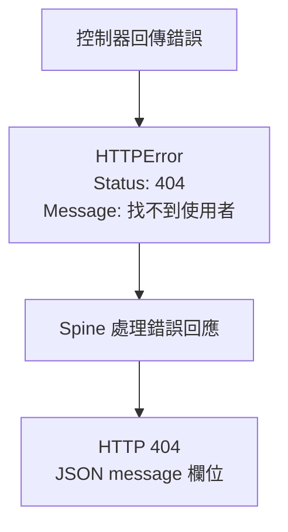

# httperr 套件

`httperr` 套件用來儲存 HTTP 狀態碼和要傳給用戶端的錯誤訊息。控制器回傳 `httperr.NotFound("사용자를 찾을 수 없습니다")` 之類的錯誤時，Spine 會將其轉換為對應的狀態碼和 JSON 錯誤回應。控制器不需要直接操作 Echo 等框架的回應物件。

本頁以 Spine v0.6.0 的 `github.com/NARUBROWN/spine/pkg/httperr` 為基礎。

## 在 CLI 專案中使用

以下控制器是加入[CLI 產生的專案](/zh-Hant/learn/tutorial/1-project-structure)中的程式碼片段。`httpx`、`httperr` 和 `path` 分別是 `github.com/NARUBROWN/spine/pkg` 下的套件。請將控制器建構函式和路由連結至 `BuildApplication` 使用的註冊路徑。`User`、儲存庫、服務等業務型別由應用程式定義。

成功值以 `httpx.Response[T]` 包裝；失敗時則同時回傳空的回應值和錯誤。接收請求主體的範例中，DTO 應像 `*PaymentRequest` 一樣宣告為指標。

```go
func (c *UserController) GetUser(userId path.Int) (httpx.Response[User], error) {
    if userId.Value <= 0 {
        return httpx.Response[User]{}, httperr.BadRequest("유효하지 않은 사용자 ID입니다")
    }

    user, err := c.repo.FindByID(userId.Value)
    if err != nil {
        return httpx.Response[User]{}, httperr.NotFound("사용자를 찾을 수 없습니다")
    }

    return httpx.Response[User]{Body: user}, nil
}
```

若將此方法註冊為 `GET /users/:id`，回應如下。範例假設儲存庫的所有查詢錯誤都以 404 處理。實際應用程式應區分查無結果和資料庫故障，再選擇狀態碼。

```bash
# 잘못된 ID
GET /users/-1
→ 400 {"message": "유효하지 않은 사용자 ID입니다"}

# 존재하지 않는 사용자
GET /users/999
→ 404 {"message": "사용자를 찾을 수 없습니다"}

# 정상
GET /users/123
→ 200 {"id": 123, "name": "john"}
```



## HTTPError 的欄位

`HTTPError` 實作 Go 的 `error` 介面，`Error()` 會回傳 `Message`。

```go
// pkg/httperr/types.go
type HTTPError struct {
    Status  int    // HTTP 상태 코드
    Message string // 에러 메시지
    Cause   error  // 원인 에러 (선택)
}

// error 인터페이스 구현
func (e *HTTPError) Error() string {
    return e.Message
}
```

| 欄位 | 型別 | 用途 |
| --- | --- | --- |
| `Status` | `int` | 傳給用戶端的 HTTP 錯誤狀態碼 |
| `Message` | `string` | 放入 JSON 回應中 `message` 欄位的訊息 |
| `Cause` | `error` | 由應用程式保留的原因錯誤，不包含在 JSON 回應中 |

輔助函式回傳的型別是 `error` 介面，但實際值為 `*httperr.HTTPError`。可以使用 `errors.As` 找出這個型別。即使像 `fmt.Errorf("문맥: %w", err)` 一樣包裝錯誤，Spine 也會找到內層的 `HTTPError`，使用其狀態碼和 `Message`。

`Message` 會原樣傳給用戶端。請勿在訊息中放入 SQL、機密值、內部路徑等不應公開的資訊，應將這些資訊保留在原因錯誤或日誌中。

## 基本輔助函式

Spine v0.6.0 提供以下四個輔助函式，皆接收 `msg string` 並回傳 `error`。

| 函式 | 狀態碼 | 使用情況 |
| --- | --- | --- |
| `BadRequest(msg)` | 400 | 請求值不符合 API 的條件 |
| `Unauthorized(msg)` | 401 | 缺少驗證資訊或驗證失敗 |
| `NotFound(msg)` | 404 | 找不到請求的資源 |
| `InternalServerError(msg)` | 500 | 需要以明確的訊息回應伺服器內部錯誤 |

### 不正確的請求值

完成型別轉換後，若還需檢查業務條件，可以使用 `BadRequest`。

```go
func BadRequest(msg string) error {
    return &HTTPError{Status: 400, Message: msg}
}
```

```go
if userId.Value <= 0 {
    return httpx.Response[User]{}, httperr.BadRequest("유효하지 않은 사용자 ID입니다")
}
```

### 驗證失敗

需要驗證或驗證失敗時，使用 `Unauthorized`。若使用者已通過驗證，但權限不足，可依下方的擴充範例選用 403 狀態碼。

```go
func Unauthorized(msg string) error {
    return &HTTPError{Status: 401, Message: msg}
}
```

```go
if !c.auth.IsValid(token) {
    return httpx.Response[User]{}, httperr.Unauthorized("인증이 필요합니다")
}
```

### 資源不存在

請求的資源不存在時，使用 `NotFound`。

```go
func NotFound(msg string) error {
    return &HTTPError{Status: 404, Message: msg}
}
```

```go
user, err := c.repo.FindByID(id)
if err != nil {
    return httpx.Response[User]{}, httperr.NotFound("사용자를 찾을 수 없습니다")
}
```

### 伺服器內部錯誤

`InternalServerError` 會回傳狀態碼 500 和指定的訊息。與直接回傳一般 `error` 的情況不同，這個訊息會公開給用戶端。

```go
func InternalServerError(msg string) error {
    return &HTTPError{Status: 500, Message: msg}
}
```

```go
result, err := c.externalService.Call()
if err != nil {
    return httpx.Response[Result]{}, httperr.InternalServerError("외부 서비스 호출에 실패했습니다")
}
```

## 控制器回傳值與錯誤回應

Spine 會先從控制器的回傳值中尋找非 nil 的錯誤。若有錯誤，就不會將成功值作為回應處理。

| 回傳值 | 預設 HTTP 處理 |
| --- | --- |
| `httpx.Response[T]`、nil 錯誤 | 處理成功值 |
| `httpx.Response[T]`、`httperr.NotFound(...)` | 以 404 錯誤回應取代成功值 |
| `httpx.Response[T]`、一般 `error` | 以 500 錯誤回應取代成功值 |
| 僅回傳 `error` 且值為 nil | 不寫入錯誤回應 |

請將 JSON 成功值放入 `httpx.Response[T]` 後回傳。重新導向和二進位回應則分別使用 `httpx.Redirect`、`httpx.Binary`。回傳任意 DTO 與回傳 HTTP 成功回應型別並不相同。

錯誤回應主體採用 `{"message":"..."}` 格式。預設處理的差異如下。

| 錯誤種類 | 狀態碼 | `message` |
| --- | --- | --- |
| `*httperr.HTTPError` | `Status` 指定的錯誤狀態碼 | `Message` |
| 以 `%w` 包裝 `HTTPError` 的錯誤 | 內層 `HTTPError` 的狀態碼 | 內層 `HTTPError` 的 `Message` |
| 一般 `error` | 500 | `"Internal server error"` |

一般錯誤的 `Error()` 字串不會出現在預設錯誤回應中。用戶端需要知道的失敗條件，請透過 `httperr` 明確指定；詳細原因則從日誌確認。

## 驗證業務規則

接收請求主體後，仍必須檢查金額、限額、餘額等由應用程式定義的條件。各失敗分支回傳錯誤後，會直接處理對應的錯誤，不會建立成功回應。

```go
func (c *PaymentController) Process(req *PaymentRequest) (httpx.Response[Receipt], error) {
    if req.Amount <= 0 {
        return httpx.Response[Receipt]{}, httperr.BadRequest("결제 금액은 0보다 커야 합니다")
    }

    if req.Amount > 10000000 {
        return httpx.Response[Receipt]{}, httperr.BadRequest("1회 결제 한도를 초과했습니다")
    }

    balance, err := c.wallet.GetBalance(req.UserID)
    if err != nil {
        return httpx.Response[Receipt]{}, httperr.NotFound("지갑을 찾을 수 없습니다")
    }

    if balance < req.Amount {
        return httpx.Response[Receipt]{}, httperr.BadRequest("잔액이 부족합니다")
    }

    receipt, err := c.processPayment(req)
    if err != nil {
        return httpx.Response[Receipt]{}, err
    }
    return httpx.Response[Receipt]{Body: receipt}, nil
}
```

範例中的 `PaymentRequest`、`Receipt`、錢包查詢和付款處理都由應用程式實作。應用程式也負責區分找不到錢包和查詢系統故障的情況。若 `c.processPayment` 回傳一般錯誤，用戶端會收到預設的 500 訊息。

## 僅回傳錯誤的處理器

不需要成功回應主體的方法，可以只回傳 `error`。

```go
func (c *UserController) DeleteUser(userId path.Int) error {
    exists, err := c.repo.Exists(userId.Value)
    if err != nil || !exists {
        return httperr.NotFound("사용자를 찾을 수 없습니다")
    }

    if err := c.repo.Delete(userId.Value); err != nil {
        return httperr.BadRequest("삭제할 수 없습니다")
    }

    return nil  // 성공 시 nil 반환
}
```

回傳 nil 時不會寫入錯誤回應。僅憑這種形式不會指定特定的成功狀態碼。若刪除成功時需要 204 等明確的狀態碼，請使用 `httpx` 回應型別。

為了讓範例保持簡潔，存在性檢查錯誤和刪除錯誤分別以 404、400 處理。實際上必須根據儲存庫錯誤的種類，區分狀態碼和重試政策。

## 使用其他錯誤狀態碼

基本輔助函式未提供的狀態碼，可以直接建立 `HTTPError` 來使用。以下函式是由應用程式定義的範例，並非 `httperr` 提供的函式。

```go
// 직접 HTTPError 생성
func Forbidden(msg string) error {
    return &httperr.HTTPError{Status: 403, Message: msg}
}

func Conflict(msg string) error {
    return &httperr.HTTPError{Status: 409, Message: msg}
}

func UnprocessableEntity(msg string) error {
    return &httperr.HTTPError{Status: 422, Message: msg}
}

func TooManyRequests(msg string) error {
    return &httperr.HTTPError{Status: 429, Message: msg}
}
```

錯誤狀態碼請使用 400 到 599 之間的值。寫入回應時也會檢查狀態碼是否有效，因此請勿將成功或重新導向狀態碼放入 `HTTPError.Status` 來控制流程。

## 保留原因錯誤與記錄日誌

透過 `Cause`，可以同時保留要顯示給用戶端的訊息和內部原因。以下的 `WithCause` 是由應用程式自行定義的輔助函式。

```go
func WithCause(status int, msg string, cause error) error {
    return &httperr.HTTPError{
        Status:  status,
        Message: msg,
        Cause:   cause,
    }
}

// 사용
user, err := c.repo.FindByID(id)
if err != nil {
    return httpx.Response[User]{}, WithCause(404, "사용자를 찾을 수 없습니다", err)
}
```

`HTTPError.Unwrap()` 回傳 `Cause`。可使用 `errors.Is` 和 `errors.As` 檢查原因鏈，也可直接讀取 `Cause` 欄位。原因錯誤不會包含在 JSON 回應中。

攔截器的 `AfterCompletion` 可以在請求結束後記錄原因。以下程式碼僅節錄該方法，使用了 `core`、`httperr`、`errors` 和 `log` 套件。可註冊的實作還需要 `PreHandle`、`PostHandle` 和 `BeforeResponse`。

```go
func (i *LoggingInterceptor) AfterCompletion(ctx core.ExecutionContext, meta core.HandlerMeta, err error) {
    if err != nil {
        var httpErr *httperr.HTTPError
        if errors.As(err, &httpErr) && httpErr.Cause != nil {
            log.Printf("[ERR] %s %s: %s (cause: %v)",
                ctx.Method(), ctx.Path(), httpErr.Message, httpErr.Cause)
        }
    }
}
```

## 執行中的錯誤與回應完成後的處理

除了控制器回傳的錯誤，路由比對、引數轉換、控制器呼叫和回應處理期間，也可能發生錯誤。Spine 會在 HTTP 執行流程中，將這些錯誤轉換為最終錯誤回應。

| 情況 | 預設行為 |
| --- | --- |
| 沒有符合的路由 | 404 錯誤回應 |
| 執行期間發生 `HTTPError` | 以指定的錯誤狀態碼和訊息回應 |
| 發生一般執行錯誤 | 回應 500 和 `"Internal server error"` |
| 超過請求主體大小限制 | 回應 413 和 `"Request entity too large"` |
| 實際回應已寫入 | 不再寫入額外的錯誤回應，避免重複回應 |

Spine v0.6.0 會先完成回應前處理，再將準備好的回應寫入實際傳輸層。若 `BeforeResponse` 發生錯誤，準備中的成功回應可能會改為錯誤回應。`AfterCompletion` 在回應處理後執行，因此在這個階段應記錄錯誤和傳輸結果，而不是嘗試寫入新的錯誤回應。

請透過 Go 的回傳值傳遞錯誤。請勿使用 `panic` 表達一般輸入驗證失敗或業務失敗。攔截器的中止與收尾處理，請參閱[攔截器教學](/zh-Hant/learn/tutorial/4-interceptor)。
