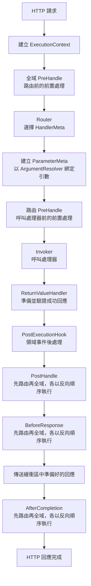

# 執行管線

::: info
舊建構函式和方法運算式為相容性保留。回呼請參閱[控制器遷移](/zh-Hant/learn/migration/preview-controller-routes)，輸入限制請參閱[輸入移轉](/zh-Hant/learn/migration/v0.7.1-preview)，文件選項請參閱 [OpenAPI](/zh-Hant/reference/api/openapi)。
:::

Spine 的執行管線會接收請求、選擇處理器、綁定引數，再將回傳值轉成回應。了解攔截器應在哪個時點執行，以及發生錯誤後會進行到哪個階段時，可以依據這個流程判斷。

本文說明 Spine v0.7.1 的 HTTP 執行順序。HTTP、事件消費者與 WebSocket 使用相同的管線實作，但解析輸入的解析器與回應處理設定各不相同。

控制器範例是要加入[以 CLI 產生的專案](/zh-Hant/learn/tutorial/1-project-structure)的程式碼。請求 DTO 以指標接收，一般成功回應則以 `github.com/NARUBROWN/spine/pkg/httpx` 的 `httpx.Response[T]` 回傳。建構函式與路由在 `BuildApplication` 中註冊。

## HTTP 請求的執行順序

正常請求依下列順序處理。各攔截器的 `PreHandle` 依註冊順序執行，後處理方法則以反向順序執行。



處理器回傳的成功回應不會立即傳送。管線會先在緩衝區中準備回應，等後處理與 `BeforeResponse` 結束後，才寫入實際的 HTTP 回應。如果中途發生錯誤，可以將待傳送的回應改成錯誤回應。

## 建立請求內容

HTTP 配接器會為每個請求建立 `core.ExecutionContext`。管線透過這個物件讀取請求的方法與路徑、共用攔截器儲存的值，並收集屬於該請求的事件。

即使使用相同的內容物件，各元件的存取範圍仍不同。

| 元件 | 內容物件的使用方式 |
| --- | --- |
| 路由器 | 以方法與路徑尋找處理器，並儲存路徑參數 |
| 攔截器 | 查詢請求資訊、儲存執行狀態，以及處理回應前後的工作 |
| 引數解析器 | 從內容物件建立控制器引數 |
| 回傳值處理器 | 透過連結到內容物件的回應寫入器準備回應 |
| 控制器 | 透過語意型別、`context.Context` 與唯讀的 `spine.Ctx`，僅接收所需的值 |

不會直接向控制器注入 `core.ExecutionContext`。如果控制器需要讀取攔截器儲存的值，請使用 `pkg/spine.Ctx`。各方法的存取範圍請參閱[執行內容](/zh-Hant/learn/core-concepts/execution-context)。

## 全域攔截器：路由前的處理

以 `app.Interceptor()` 註冊的全域攔截器，其 `PreHandle` 最先執行。此時尚未選擇處理器，因此這次呼叫會傳入空的 `core.HandlerMeta{}`。

這個階段用於 CORS preflight 等必須在選擇路由前處理的工作。例如，CORS 攔截器可以為允許的 `OPTIONS` 請求準備回應，再回傳 `core.ErrAbortPipeline`，中止後續執行。

全域 `PreHandle` 必須考慮下列限制。

- 尚未決定要執行的控制器與方法。
- Spine 路由器尚未儲存路徑參數。
- 尚未建立請求 DTO 與 `input.Path[int64]` 等控制器引數。

路由成功後執行的 `PostHandle`、`BeforeResponse` 與 `AfterCompletion`，會收到所選處理器的中繼資料。如果在路由前中止或失敗，則以空的中繼資料完成收尾。

## 路由器：選擇處理器與路徑參數

路由器以 `ctx.Method()` 與 `ctx.Path()` 尋找已註冊的處理器。如果沒有符合的處理器，就回傳 404 錯誤。若路徑含有參數，會將值儲存於內容物件，並在中繼資料中保留宣告順序。

`HandlerMeta` 包含要執行的目標與路由設定。

```go
// core/handler_meta.go
type HandlerMeta struct {
    ControllerType reflect.Type   // 從相依性容器中尋找的控制器型別
    Method         reflect.Method // 要呼叫的方法
    Callback       reflect.Value
    PathKeys       []string       // 路由中宣告的路徑參數順序
    Interceptors   []Interceptor  // 要套用至此處理器的攔截器
}
```

`HandlerMeta` 不要求為每個請求建立控制器。舊方法表達式從容器取得控制器；新路由回呼會呼叫準備階段綁定的函式。詳情請參閱 [HandlerMeta](/zh-Hant/learn/core-concepts/handler-meta)。

## 引數綁定：ParameterMeta 與 ArgumentResolver

選擇處理器後，管線會讀取函式簽章，建立表示各引數型別與位置的 `ParameterMeta`。接著，由已註冊的解析器中第一個支援該型別的解析器建立值。

如果解析器無法建立值，或沒有支援的解析器，就會進入錯誤處理，不會呼叫控制器。**這個階段會在路由攔截器的 `PreHandle` 之前執行。** 因此，不應假設路由攔截器能在主體綁定前執行檢查。

### 路徑輸入對應

在 v0.7.1 中，每個路徑變數對應一個純量 `input.Path[T]` 引數，順序與路由一致。數量必須相同，且不可在同一處理器中混用路徑 DTO 或舊路徑包裝型別。

### HTTP 支援的輸入

除了 `context.Context` 和 `spine.Ctx`，處理器還可接收 `input.Path[T]`、`input.Query[T]` 和 `input.Body[T]`。標頭使用帶 `header` 標籤的獨立結構體指標，檔案使用 `multipart.UploadedFiles`。舊 `path` 包裝型別、`query.Values`、`header.Values` 和 `query.Pagination` 已棄用，不能在同一處理器中與新的 Path、Query 或 Header 輸入混用。

### 解析器的契約

以下是內部解析器遵循的契約。應用程式不需要複製並註冊這個介面或 `internal/` 套件。

```go
type ArgumentResolver interface {
    Supports(parameterMeta ParameterMeta) bool
    Resolve(ctx core.ExecutionContext, parameterMeta ParameterMeta) (any, error)
}
```

解析器收到共用的 `ExecutionContext` 後，如果需要 HTTP 輸入，會透過型別斷言確認是否支援 `core.HttpRequestContext`。消費者與 WebSocket 解析器則分別從對應協定的內容物件讀取訊息主體。

## 路由攔截器：呼叫處理器前的處理

以 `api.Interceptors()` / `route.WithInterceptors()` 註冊的攔截器，只套用到特定處理器。路由與引數綁定完成後才會呼叫 `PreHandle`，因此可以使用所選的 `HandlerMeta` 與路徑參數。

| 類別 | 註冊方式 | `PreHandle` 執行時點 | 傳入的中繼資料 |
| --- | --- | --- | --- |
| 全域 | `app.Interceptor()` | 路由前 | 空的 `HandlerMeta{}` |
| 路由 | `api.Interceptors()` / `route.WithInterceptors()` | 引數綁定後、呼叫處理器前 | 所選的 `HandlerMeta` |

兩種方式都會實作 `core.Interceptor` 的四個方法。

```go
// core/interceptor.go
type Interceptor interface {
    PreHandle(ctx ExecutionContext, meta HandlerMeta) error
    PostHandle(ctx ExecutionContext, meta HandlerMeta)
    BeforeResponse(ctx ExecutionContext, meta HandlerMeta, executionErr error) error
    AfterCompletion(ctx ExecutionContext, meta HandlerMeta, err error)
}
```

`PreHandle` 回傳一般錯誤時，會進入錯誤處理；回傳 `core.ErrAbortPipeline` 時，則視為刻意結束請求。此時，攔截器必須自行準備所需的回應。這兩種情況都不會執行後續的 `PreHandle` 與控制器。

註冊範例請參閱[攔截器教學](/zh-Hant/learn/tutorial/4-interceptor)。

## Invoker：呼叫控制器

Invoker 以綁定的引數呼叫新路由回呼。對於舊方法表達式，它會先從相依性容器取得控制器執行個體。處理器檢查輸入、呼叫服務並回傳結果或錯誤。

下列方法是要加入已有 `UserController`、`User` 與 `c.repo` 的應用程式的範例。`input`、`httpx` 與 `httperr` 分別從 Spine 的 `pkg/` 套件匯入。

```go
func (c *UserController) GetUser(userId input.Path[int64]) (httpx.Response[User], error) {
    if *userId <= 0 {
        return httpx.Response[User]{}, httperr.BadRequest("유효하지 않은 사용자 ID")
    }
    user, err := c.repo.FindByID(*userId)
    if err != nil {
        return httpx.Response[User]{}, err
    }
    return httpx.Response[User]{Body: user}, nil
}
```

`userId` 的數字轉換會在呼叫控制器前完成。上述 `BadRequest` 只會在轉換後的值小於或等於 0 時執行。不應假設無法轉成數字的路徑值會進入這項檢查。

## ReturnValueHandler：將回傳值轉成回應

管線會先從回傳值中尋找非 `nil` 的 `error`。如果有錯誤，就會進入錯誤回應流程，不處理成功值。如果沒有錯誤，則將第一個非 `nil` 的成功值，傳給支援該值的回傳值處理器。

帶有型別資訊的指標或介面若內含 `nil`，也會略過。回傳不支援的成功型別會產生錯誤。請用 `httpx.Response[T]` 包裝，不要直接回傳一般結構。

| 回傳值處理器 | 支援的回傳型別 | HTTP 回應 |
| --- | --- | --- |
| `RedirectReturnValueHandler` | `httpx.Redirect` 及其指標 | `Location` 標頭與狀態碼，預設為 302 |
| `BinaryReturnHandler` | `httpx.Binary` 及其指標 | 二進位主體 |
| `StringReturnHandler` | `httpx.Response[string]` 及其指標 | 文字主體 |
| `JSONReturnHandler` | 主體不是字串的 `httpx.Response[T]` 及其指標 | JSON 主體 |
| `ErrorReturnHandler` | `error` | 包含狀態碼與 `message` 的 JSON |

可以透過 `ResponseOptions` 指定狀態碼、標頭與 Cookie。如果準備回應時序列化或 Cookie 驗證失敗，就不會傳送成功回應。

內部回傳值處理器的契約如下。

```go
type ReturnValueHandler interface {
    Supports(returnType reflect.Type) bool
    Handle(value any, ctx core.ExecutionContext) error
}
```

## PostExecutionHook：事件後處理

成功回傳值的序列化與回應驗證完成後，會執行已註冊的 `PostExecutionHook`。領域事件派送掛鉤會從請求的 EventBus 取出事件，並傳給派送器。

如果處理器回傳錯誤，或準備成功回應時失敗，就不會進入這個階段。掛鉤本身若回傳錯誤，也會視為執行失敗，並略過後續的 `PostHandle`。

這個階段結束不代表 HTTP 回應已傳送完成。`BeforeResponse` 與實際的回應傳送會在後面執行。事件收集與發布方式請參閱[執行內容的 EventBus](/zh-Hant/learn/core-concepts/execution-context#event-publishing)。

## 回應前後的攔截器處理

### PostHandle

處理器、成功回應準備與後處理掛鉤全部成功後，才會呼叫 `PostHandle`。先以反向順序執行路由攔截器，再以反向順序執行全域攔截器。

`PostHandle` 無法回傳錯誤。像交易提交這類結果必須反映在最終回應中的工作，請在 `BeforeResponse` 處理。

### BeforeResponse

無論成功或失敗流程，`BeforeResponse` 都**只會呼叫 `PreHandle` 成功的攔截器**。先以反向順序執行路由攔截器，再以反向順序執行全域攔截器。

`executionErr` 會收到截至該時點所發生的錯誤。如果 `BeforeResponse` 回傳新的錯誤，會與既有錯誤合併，再傳給下一個攔截器與最終錯誤處理。交易攔截器可以在這個時點依成功與否決定提交或回復。

在 `PreHandle` 回傳錯誤或 `core.ErrAbortPipeline` 的攔截器本身，不會列入 `BeforeResponse` 的呼叫對象。

### AfterCompletion

回應處理後會呼叫 `AfterCompletion`。如果已選擇路由，會以反向順序呼叫全部路由攔截器，再以反向順序呼叫全部全域攔截器。成功、錯誤與刻意中止，都會經過這個清理階段。

其呼叫範圍與 `BeforeResponse` 不同。即使攔截器尚未執行 `PreHandle`，或在 `PreHandle` 失敗，也可能呼叫 `AfterCompletion`。請確保資源尚未建立時，清理程式碼仍能運作。如果在路由前結束，由於尚未選擇路由攔截器，只會執行全域清理。

這個階段會進行記錄日誌、收集指標與清理資源等工作。此時已嘗試寫入 HTTP 回應，因此 `AfterCompletion` 中發生的錯誤無法變更已傳送的回應。

## 錯誤回應與回應傳送 {#error-responses}

執行錯誤會在 `BeforeResponse` 結束後轉成 HTTP 錯誤回應。如果已準備好成功回應，會先撤回，再準備錯誤回應。接著將緩衝區中的回應寫入實際的回應寫入器。

| 錯誤條件 | HTTP 處理 |
| --- | --- |
| 找不到已註冊的處理器 | 404 |
| 有效的 `httperr.HTTPError` | 指定的狀態碼與訊息 |
| 所選驗證器的 DTO 規則違反（`validation.Error`） | 包含 `message` 與 `fields` 的 400 回應 |
| 超過請求主體限制的 `http.MaxBytesError` | 413 |
| 未另行對應的執行錯誤 | 500，`Internal server error` |
| 實際回應已提交 | 不會重複寫入回應 |

Spine `v0.7.1` 搭配 Echo 平台 `v0.2.0`，對格式錯誤的 JSON、數字或布林路徑值轉換失敗回傳 HTTP 400，對不支援的本文 Content-Type 回傳 415，對超過本文大小限制回傳 413。綁定失敗發生在控制器呼叫之前。請區分綁定失敗與業務驗證，並以實際請求確認。

實際傳送回應時若發生錯誤，會納入最終執行錯誤。如果回應尚未提交，會嘗試寫入 500 回應。已傳送的回應無法撤回。

## 各中止位置的執行範圍

以下範例假設全域攔截器與路由攔截器各註冊一個。`before` 代表 `BeforeResponse`，`after` 代表 `AfterCompletion`。

### 正常處理

```text
pre:global → routing → binding → pre:route → handler
→ return → hook → post:route → post:global
→ before:route → before:global → flush → after:route → after:global
```

### 在路由 PreHandle 中止

```text
pre:global → routing → binding → pre:route(中止)
→ before:global → flush → after:route → after:global
```

不會呼叫控制器。中止的路由攔截器不會呼叫 `BeforeResponse`，但會呼叫 `AfterCompletion`。

### 在全域 PreHandle 中止

```text
pre:global(中止) → flush → after:global
```

不會執行路由器與引數綁定。這個範例沒有成功的 `PreHandle`，因此也不會呼叫 `BeforeResponse`。

### 在引數綁定時失敗

```text
pre:global → routing → binding(失敗)
→ before:global → 準備錯誤回應 → flush → after:route → after:global
```

由於已選擇路由攔截器，會呼叫 `AfterCompletion`。不過，該攔截器的 `PreHandle` 尚未執行，因此不會呼叫路由的 `BeforeResponse`。

## HTTP 以外的執行

事件消費者與 WebSocket 也會在各自的管線執行個體中，使用相同的執行結構。HTTP 的解析器與回傳值處理器不會直接套用到這些協定。

| 執行種類 | 路由依據 | 預設引數 | 回應處理 |
| --- | --- | --- | --- |
| HTTP | HTTP 方法與請求路徑 | `context.Context`、`spine.Ctx`、路徑與查詢型別、DTO 等 | 以 HTTP 回傳值處理器準備回應 |
| 事件消費者 | `EVENT` 與事件名稱 | `context.Context`、事件名稱、原始負載、結構 DTO | 由消費者執行階段處理執行結果 |
| WebSocket | `WS` 與連線請求路徑 | `context.Context`、`ws.ConnectionID`、原始負載、結構 DTO | 使用訊息處理器的傳送 API |

特別是 HTTP DTO 會接收指標，而預設的消費者與 WebSocket DTO 解析器支援結構值。HTTP 的 `spine.Ctx` 解析器也未註冊於預設的消費者與 WebSocket 管線中。各協定的內容物件與輸入差異請參閱[執行內容](/zh-Hant/learn/core-concepts/execution-context)。
