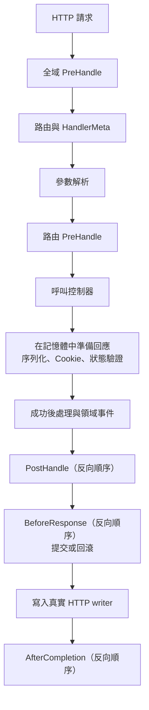

# 執行管線

Spine 在寫出 HTTP 回應之前完成業務執行、回應準備和可失敗的提交階段。v0.5.1 的順序如下：



## 階段保證

1. 全域攔截器在路由前執行 `PreHandle`；路由攔截器在參數解析後、控制器前執行。
2. 控制器錯誤和回應準備錯誤都會成為 `executionErr`。
3. JSON 序列化、Cookie/狀態驗證和回傳值處理先在記憶體中完成。
4. 只有回應可準備時才執行領域事件後處理；接著執行 `PostHandle`。
5. 成功完成 `PreHandle` 的攔截器以反向順序執行 `BeforeResponse`。任一錯誤都會阻止成功回應寫出。
6. 準備好的回應只在所有 `BeforeResponse` 成功後寫入真實 writer。
7. `AfterCompletion` 最後執行，用於日誌、指標和清理，不用於決定交易提交。

## 攔截器錯誤與中止

`PreHandle` 回傳一般錯誤時，管線進入錯誤回應路徑。回傳 `core.ErrAbortPipeline` 表示攔截器已完成所需處理，例如 CORS 預檢；仍會為已進入的攔截器執行完成階段。

```go
type Interceptor interface {
	PreHandle(ctx ExecutionContext, meta HandlerMeta) error
	PostHandle(ctx ExecutionContext, meta HandlerMeta)
	BeforeResponse(ctx ExecutionContext, meta HandlerMeta, executionErr error) error
	AfterCompletion(ctx ExecutionContext, meta HandlerMeta, err error)
}
```

## 回應與外部副作用

準備回應後再派發領域事件，可以防止序列化或 Cookie/狀態驗證失敗時提前發布事件。但資料庫提交、訊息代理發布和實體 socket 寫入不能組成同一個原子交易。需要可靠的跨系統一致性時，應使用 transactional outbox、冪等鍵和至少一次傳遞設計。

## HTTP、消費者與 WebSocket

HTTP、訊息消費者和 WebSocket 都重用管線概念，但上下文與回傳處理器依傳輸區分。`App.Interceptor` 預設同時註冊至 HTTP 與 WebSocket；需要明確範圍時使用 `InterceptorFor`。WebSocket 握手驗證是訊息管線之前的獨立階段，連線槽位先保留，再呼叫 `PreHandshake`，最後才 upgrade。

關於交易邊界，請參閱[交易管理教學](/zh-Hant/learn/tutorial/6-transaction)。
