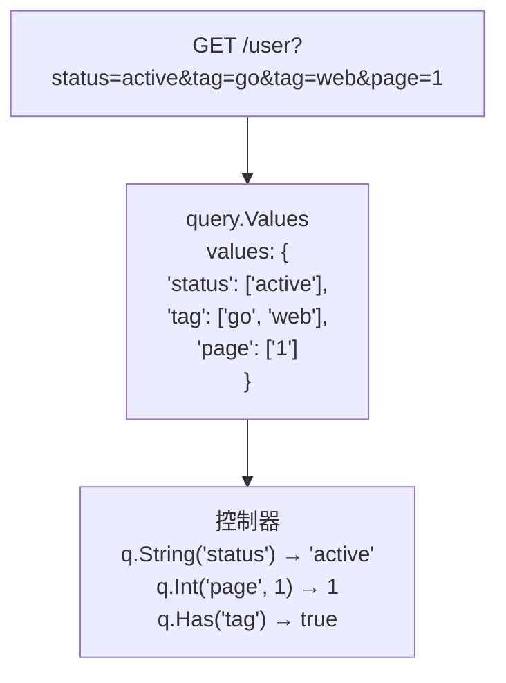

# query.Values

`query.Values` 可用來讀取 HTTP 查詢參數並指定預設值。在控制器引數中宣告 `q query.Values` 後，即可依需求將各鍵的值讀取為字串、整數或布林值。不支援將查詢參數自動對應至任意 DTO。

本頁依功能劃分的 `src/user` 範例使用[專案結構](/zh-Hant/learn/tutorial/1-project-structure)中以 `--layout legacy` 建立的 `my-app`。CLI `v0.4.2` 預設產生依角色劃分的 `layered-v1` 結構。兩種布局都使用 Spine `v0.6.5` 與 Echo 平台 `v0.1.0`。

本頁以 Spine v0.6.5 的 `github.com/NARUBROWN/spine/pkg/query` 為基礎。

## 在 CLI 專案中使用

請先依照[第一個應用程式](/zh-Hant/learn/getting-started/first-app)建立專案，再依照[控制器](/zh-Hant/learn/tutorial/2-controller)建立 `src/user` 資源，然後繼續操作。將範例處理器加入同一個 `package user`，並註冊使用該處理器的路由。

`User`、搜尋條件與分頁回應型別，以及服務的搜尋方法，都由應用程式自行定義。商品和訂單範例也是以相同方式擴充功能。各範例是獨立的替代方案，請只加入需要的方法和路由。成功回應需以 `httpx.Response[T]` 包裝，並匯入以下兩個套件。

```go
import (
    "github.com/NARUBROWN/spine/pkg/httpx"
    "github.com/NARUBROWN/spine/pkg/query"
)
```

基本範例會從查詢參數讀取 `id` 和 `name`，並將它們放入回應。

```go
// src/user/user_controller.go
func (c *UserController) GetUserQuery(q query.Values) httpx.Response[User] {
    return httpx.Response[User]{Body: User{
        ID:   q.Int("id", 0),
        Name: q.String("name"),
    }}
}
```

將此方法註冊至 `GET /user` 後，請求與回應如下。

```bash
# 요청
GET /user?id=123&name=john

# 응답
{
    "id": 123,
    "name": "john"
}
```

## 查詢值的傳遞方式

HTTP 請求的查詢參數中，一個鍵可以包含多個字串值。例如 `?tag=go&tag=web` 包含兩個 `tag` 值。Spine 會將這個查詢映射包裝為 `query.Values`，再傳給控制器。



請在處理器中將 `query.Values` 宣告為值型別。預設解析器只處理這個確切的型別，`*query.Values` 並非相同的注入對象。查詢值注入適用於 HTTP 請求，因此不應預期 Consumer 或 WebSocket 處理器具有相同行為。

`query.Values` 的讀取方法不會修改原始查詢映射。若要在應用程式程式碼或單元測試中自行建立，可使用 `query.NewValues(values map[string][]string)`。

```go
// pkg/query/types.go
type Values struct {
    values map[string][]string
}

func NewValues(values map[string][]string) Values {
    return Values{values: values}
}
```

`NewValues` 會直接儲存傳入的映射，不會複製。建立後若變更原始映射，包裝同一映射的 `Values` 也會讀到變更後的值。一般 HTTP 處理器不需要自行建立。

## 讀取方法

| 方法 | 回傳型別 | 值不存在或無法轉換時 |
| --- | --- | --- |
| `Get(key)` | `string` | 空字串 |
| `String(key)` | `string` | 空字串。行為與 `Get` 相同 |
| `Int(key, def)` | `int64` | 呼叫時指定的 `def` |
| `GetBoolByKey(key, def)` | `bool` | 呼叫時指定的 `def` |
| `Has(key)` | `bool` | 若鍵不存在則為 `false` |

讀取值的方法只使用第一個值。即使同一個鍵重複出現，`Get`、`String`、`Int` 和 `GetBoolByKey` 也不會回傳或檢查所有值。

### 讀取字串

`Get` 和 `String` 的行為相同。若鍵不存在或值清單為空，會回傳空字串。

```go
// GET /user?name=john&status=active

q.Get("name")    // "john"
q.Get("status")  // "active"
q.Get("missing") // ""
```

```go
q.String("name")  // "john"
```

### 讀取整數

`Int(key string, def int64) int64` 會將第一個值轉換為十進位的 64 位元有號整數。若鍵不存在或值為空字串，會回傳 `def`。若值不是數字或超出 `int64` 範圍，也不會回傳錯誤，而是使用 `def`。

```go
// GET /user?page=3&size=20

q.Int("page", 1)    // 3
q.Int("size", 10)   // 20
q.Int("offset", 0)  // 0 (키 없음 → 기본값)
q.Int("page", 1)    // 1 (만약 page=abc라면 → 기본값)
```

轉換成功的負數或 0 會直接回傳。頁碼、價格範圍等只允許正數的值，必須由應用程式另外檢查。

### 讀取布林值

`GetBoolByKey(key string, def bool) bool` 會先將第一個值轉為小寫，再判斷下列字串。

| 結果 | 可辨識的值 |
| --- | --- |
| `true` | `"true"`, `"1"`, `"yes"`, `"y"`, `"on"` |
| `false` | `"false"`, `"0"`, `"no"`, `"n"`, `"off"` |
| `def` | 鍵不存在，或值不在上列清單中 |

不區分大小寫，但不會移除空白。例如 `" TRUE "` 不在可辨識的清單內，因此會使用預設值。

```go
// GET /user?active=true&verified=1&premium=yes

q.GetBoolByKey("active", false)    // true
q.GetBoolByKey("verified", false)  // true
q.GetBoolByKey("premium", false)   // true
q.GetBoolByKey("deleted", false)   // false (키 없음 → 기본값)
q.GetBoolByKey("active", false)    // false (만약 active=maybe → 기본값)
```

### 檢查鍵是否存在

`Has(key string) bool` 檢查的是鍵是否存在，而非鍵的值。即使值像 `?empty=` 一樣為空，只要鍵存在，就會是 `true`。

```go
// GET /user?status=active&empty=

q.Has("status")  // true
q.Has("empty")   // true (값은 비었지만 키는 존재)
q.Has("missing") // false
```

若需要區分鍵不存在和明確傳入空字串的情況，除了 `Get` 的結果，也要檢查 `Has`。同樣地，`Has` 為 `true` 並不表示整數或布林值轉換已成功。

## 用於搜尋與篩選

各篩選條件的預設值可以在呼叫處指定。以下範例會讀取搜尋詞、分類、價格範圍和是否有庫存，再傳給服務。

```go
func (c *ProductController) Search(q query.Values) httpx.Response[SearchResult] {
    keyword := q.String("q")
    category := q.String("category")
    minPrice := q.Int("min_price", 0)
    maxPrice := q.Int("max_price", 999999)
    inStock := q.GetBoolByKey("in_stock", true)

    products := c.service.Search(SearchCriteria{
        Keyword:  keyword,
        Category: category,
        MinPrice: minPrice,
        MaxPrice: maxPrice,
        InStock:  inStock,
    })

    return httpx.Response[SearchResult]{Body: SearchResult{
        Query:    keyword,
        Count:    len(products),
        Products: products,
    }}
}
```

```bash
GET /product?q=laptop&category=electronics&min_price=500&in_stock=true
```

這個範例也會以預設值處理不正確的數字或布林值。若 API 需要對不正確的輸入回傳 400 回應，請先用 `String` 讀取原始字串，檢查 `strconv.ParseInt` 等方法的轉換結果，再回傳 `httperr.BadRequest`。套用預設值和驗證有效性是不同的政策。

### 只套用已傳入的篩選條件

若篩選條件為選填，請使用 `Has` 檢查是否傳入對應的鍵。

```go
func (c *OrderController) List(q query.Values) httpx.Response[[]Order] {
    filters := OrderFilters{}

    if q.Has("user_id") {
        filters.UserID = q.Int("user_id", 0)
    }

    if q.Has("status") {
        filters.Status = q.String("status")
    }

    if q.Has("from_date") {
        filters.FromDate = parseDate(q.String("from_date"))
    }

    if q.Has("to_date") {
        filters.ToDate = parseDate(q.String("to_date"))
    }

    return httpx.Response[[]Order]{Body: c.service.FindByFilters(filters)}
}
```

`OrderFilters` 和 `parseDate` 是應用程式定義的型別和函式。日期格式、開始日與結束日的先後順序，以及省略篩選條件時的行為，也必須由應用程式決定。此範例的 `Has` 檢查不能取代格式驗證。

### 自行選取允許的篩選條件

也可以如下所示，只檢查應用程式接受的篩選條件名稱，再傳給服務。

```go
// 동적 필터 처리
func (c *ProductController) Search(q query.Values) httpx.Response[[]Product] {
    filters := make(map[string]string)

    // 어떤 필터가 올지 미리 알 수 없음
    if q.Has("min_price") {
        filters["min_price"] = q.String("min_price")
    }
    if q.Has("max_price") {
        filters["max_price"] = q.String("max_price")
    }
    if q.Has("category") {
        filters["category"] = q.String("category")
    }

    return httpx.Response[[]Product]{Body: c.service.FindByFilters(filters)}
}
```

## 搭配分頁使用

固定的 `page` 和 `size` 可交由 `query.Pagination` 處理，搜尋條件則透過 `query.Values` 讀取。

```go
func (c *UserController) List(p query.Pagination, q query.Values) httpx.Response[PagedResult] {
    status := q.String("status")
    sortBy := q.String("sort_by")

    users := c.service.FindAll(status, sortBy, p.Page, p.Size)
    total := c.service.Count(status)

    return httpx.Response[PagedResult]{Body: PagedResult{
        Data:  users,
        Page:  p.Page,
        Size:  p.Size,
        Total: total,
    }}
}
```

```bash
GET /user?page=2&size=20&status=active&sort_by=created_at
```

| 項目 | `query.Values` | `query.Pagination` |
| --- | --- | --- |
| 用途 | 名稱和預設值由應用程式決定的查詢參數 | 使用 `page` 和 `size` 的分頁 |
| 預設值 | 呼叫各讀取方法時指定 | `page=1`, `size=20` |
| 型別轉換 | 針對需要的鍵逐一呼叫方法 | 注入分頁引數時轉換 |

同一個請求可以同時宣告這兩種型別。由於 `query.Values` 也能讀取 `page` 和 `size`，請選定其中一方作為傳給服務的分頁資訊來源，避免重複處理。

```go
// 고정된 페이지네이션만 필요 → query.Pagination
func List(p query.Pagination) httpx.Response[[]User]

// 동적 필터 + 페이지네이션 → 둘 다 사용
func Search(p query.Pagination, q query.Values) httpx.Response[[]User]

// 완전히 동적인 쿼리 → query.Values만
func CustomSearch(q query.Values) httpx.Response[[]User]
```

## 同一個鍵有多個值時

HTTP 查詢可以如下所示，重複使用同一個鍵。

```
GET /product?tag=go&tag=web&tag=api
```

對這個請求，`q.String("tag")` 和 `q.Get("tag")` 都只會回傳 `"go"`。Spine v0.6.5 的 `query.Values` 沒有可取得完整值清單的公開方法，應用程式也無法直接存取非公開欄位 `values`。

若需要接收多個值，可將 API 設計為接收一個以逗號分隔的字串，再由應用程式拆分。以下範例也需要 `strings` 套件。

```go
// 쉼표 구분 방식
// GET /product?tags=go,web,api

func (c *ProductController) Search(q query.Values) httpx.Response[[]Product] {
    tagsRaw := q.String("tags")
    tags := strings.Split(tagsRaw, ",")

    return httpx.Response[[]Product]{Body: c.service.FindByTags(tags)}
}
```

此範例中，若 `tags` 為空，`strings.Split` 的結果會包含空字串。請由應用程式決定並檢查是否允許空項目、重複標籤，以及標籤名稱中的逗號。

將查詢參數的鍵、預設值和允許範圍放在控制器附近，較容易確認請求處理規則。接收請求主體 DTO 的方式，請參閱[控制器教學](/zh-Hant/learn/tutorial/2-controller)；錯誤回應則請參閱 [httperr](/zh-Hant/learn/core-concepts/httperr)。
