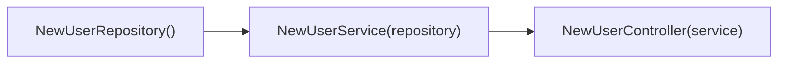

# 依賴注入

查看[控制器](/zh-Hant/learn/tutorial/2-controller)中 CLI 產生的 `src/user` 資源的相依關係。安裝與產生專案請參考[第一個應用程式](/zh-Hant/learn/getting-started/first-app)。

了解 Spine 的 DI。

## 關鍵概念

Spine 的依賴注入是**基於建構子的**。

- 無註解（`@Autowired`、`@Injectable` 不需要）
- 沒有設定檔
- 建構子參數被宣告為依賴項

```go
// 透過查看參數類型自動注入依賴項
func NewUserService(repository *UserRepository) *UserService {
    return &UserService{repository: repository}
}
```

## CLI 產生的相依項目

尚未產生資源時，在 `hello-spine` 根目錄執行以下命令。已經存在時請略過。

```bash
spine generate resource user --dry-run
```

在預覽中檢查產生檔案與註冊程式碼的變更，再執行下方命令產生。

```bash
spine generate resource user
```

CLI 在 `src/user` 的同一個 `package user` 中產生以下建構子。

```go
// src/user/user_repository.go
package user

type UserRepository struct{}

func NewUserRepository() *UserRepository { return &UserRepository{} }
```

```go
// src/user/user_service.go
package user

type UserService struct{ repository *UserRepository }

func NewUserService(repository *UserRepository) *UserService {
    return &UserService{repository: repository}
}
```

```go
// src/user/user_controller.go
package user

type UserController struct{ service *UserService }

func NewUserController(service *UserService) *UserController {
    return &UserController{service: service}
}
```

`src/user/user_route.go` 的 `Register` 註冊這些建構子與 `GET /user/:id`。CLI 在 `internal/application/application.go` 的 `BuildApplication()` 中加入檢查錯誤的 `user.Register(app)`。請勿重複註冊相同建構子。

```go
// src/user/user_route.go: Register
app.Constructor(NewUserRepository, NewUserService, NewUserController)
app.Route("GET", "/user/:id", (*UserController).Get)
```

## 註冊與解析順序

無論註冊順序如何，都會先解析需要的相依項目。容器共用已建立的實例，不會為每個請求重新建立。

```go
// 此範例取代 user_route.go 中現有的 Constructor 呼叫。
app.Constructor(NewUserController, NewUserService, NewUserRepository)
```



## 建構函式規則

### 參數

建構函式參數必須是**已註冊的型別**。

```go
// ✅ 正確的例子
func NewUserService(repo *UserRepository) *UserService

// ✅ 可能有多個依賴項
func NewUserController(svc *UserService, logger *Logger) *UserController

// ✅ 沒有依賴性
func NewLogger() *Logger
```

### 傳回類型

建構子必須只回傳一個值，不支援回傳 `(值, error)`。回傳型別決定提供的型別；回傳 nil 也會報錯。

```go
func NewUserService(repository *UserRepository) *UserService {
    return &UserService{repository: repository}
}
```

資料庫provider也應像[資料庫範例](/zh-Hant/learn/tutorial/5-database)中的 `database.NewDB() *bun.DB` 一樣只回傳一個值，並註冊建構函式。`BuildApplication` 只負責註冊，因此產生的驗證測試不會連接資料庫。連線錯誤在應用程式啟動、執行provider時處理；實際連線需要另外驗證。

```go
// internal/application/application.go: BuildApplication
app.Constructor(database.NewDB)
```

## 使用介面

本節是[資料庫](/zh-Hant/learn/tutorial/5-database)中的手動擴充；`resource` 不會產生 Bun 設定。優先使用型別精確符合的介面 provider，否則只能有一個實作該介面的 provider。多個候選會產生錯誤。請求中的 `bun.Tx` 不會自動重新注入應用程式層級的建構子。應從請求上下文讀取交易，經控制器與服務傳給接受 `bun.IDB` 的儲存庫方法。

### 問題狀況

使用交易時，儲存庫必須同時處理 `*bun.DB` 和 `bun.Tx`。

```go
// ❌這將禁用交易
type UserRepository struct {
    db *bun.DB  // 無法接收 bun.Tx
}
```

### 已解決：使用介面

`bun.IDB` 介面可讓您同時容納兩者。

```go
// ✅ *bun.DB 和 bun.Tx 都實作了 bun.IDB
type UserRepository struct {
    db bun.IDB
}

func NewUserRepository(db bun.IDB) *UserRepository {
    return &UserRepository{db: db}
}
```

### 攔截器中的交易注入

```go
// 攔截器/tx_interceptor.go
func (i *TxInterceptor) PreHandle(ctx core.ExecutionContext, meta core.HandlerMeta) error {
    tx, err := i.db.BeginTx(ctx.Context(), nil)
    if err != nil {
        return err
    }

    ctx.Set("tx", tx)  // 保存事务
    return nil
}

func (i *TxInterceptor) PostHandle(ctx core.ExecutionContext, meta core.HandlerMeta) {}

func (i *TxInterceptor) BeforeResponse(ctx core.ExecutionContext, meta core.HandlerMeta, executionErr error) error {
    v, ok := ctx.Get("tx")
    if !ok {
        return nil
    }

    tx, ok := v.(bun.Tx)
    if !ok {
        return errors.New("transaction type is invalid")
    }

    if executionErr != nil {
        return tx.Rollback()
    }
    return tx.Commit()
}

func (i *TxInterceptor) AfterCompletion(ctx core.ExecutionContext, meta core.HandlerMeta, err error) {}
```

## 依功能註冊

使用 CLI 產生另一個功能後，它會註冊到同一個組裝進入點。以下產生獨立的 `order` 資源。CLI 會加入 `user.Register` 和 `order.Register` 呼叫，請勿手動重複加入。

```bash
spine generate resource order --dry-run
```

在預覽中檢查產生檔案與註冊程式碼的變更，再執行下方命令產生。

```bash
spine generate resource order
```

### 多次呼叫 Constructor

可以在同一個 `Register` 中分多次呼叫註冊。每個型別只註冊一次。

```go
// src/user/user_route.go: Register
app.Constructor(NewUserRepository)
app.Constructor(NewUserService)
app.Constructor(NewUserController)
```

## 多個相同類型

如果需要同一類型的多個實例，請使用包裝類型。

```go
// ❌ 難以區分
func NewApp(db1 *bun.DB, db2 *bun.DB) *App  // 無法区分各自用途

// ✅ 依包裝類型分類
type PrimaryDB struct{ *bun.DB }
type ReplicaDB struct{ *bun.DB }

func NewPrimaryDB() *PrimaryDB {
    return &PrimaryDB{connectToPrimary()}
}

func NewReplicaDB() *ReplicaDB {
    return &ReplicaDB{connectToReplica()}
}

func NewUserRepository(primary *PrimaryDB, replica *ReplicaDB) *UserRepository {
    return &UserRepository{
        writer: primary.DB,
        reader: replica.DB,
    }
}
```## 錯誤處理

### 循環依賴

```go
// ❌A→B→A循環
func NewA(b *B) *A { ... }
func NewB(a *A) *B { ... }

// 啟動時出現錯誤
// circular dependency detected: *user.A -> *user.B -> *user.A
```

### 缺少依賴項

```go
// 如果您沒有註冊UserRepository
app.Constructor(
    NewUserService,     // *需要 UserRepository
    NewUserController,
)

// 啟動時出現錯誤
// no constructor registered for *user.UserRepository
```

## 驗證範圍

```bash
spine doctor
spine contract check
spine verify
```

`contract check` 檢查靜態 DI 契約，`verify` 也會執行本機程式碼檢查。只呼叫 `app.Validate(options)` 不能證明建構子執行或 DI warm-up 成功。實際初始化、資料庫連線和請求需要執行應用程式並另外進行 E2E 驗證。循環或缺少相依項目會在解析時回傳錯誤，產生的 main 會檢查 Run 錯誤。

## 主要摘要

|概念|描述 |
|------|------|
| **基於建構子** |宣告與參數型別的依賴關係 |
| **自動解析** |不考慮註冊順序，圖分析後產生|
| **類型匹配** |相同類型自動注入 |
| **介面** |靈活的依賴性處理成為可能 |

## 後續步驟

- [教學：攔截器](/zh-Hant/learn/tutorial/4-interceptor) — 請求前/請求後處理
- [教學：資料庫](/zh-Hant/learn/tutorial/5-database) — Bun ORM 連接
