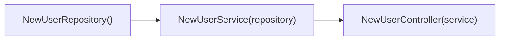

# 相依性注入

以[控制器](/zh-Hant/learn/tutorial/2-controller)中建立的 `src/user` 資源為基礎，說明建構函式註冊與相依性注入（DI）。完成後，您可以串接控制器、服務與儲存庫，並確認是否存在循環相依性或缺少建構函式。

本頁依功能劃分的 `src/user` 範例使用[專案結構](/zh-Hant/learn/tutorial/1-project-structure)中以 `--layout legacy` 建立的 `my-app`。CLI `v0.4.2` 預設產生依角色劃分的 `layered-v1` 結構。兩種布局都使用 Spine `v0.6.5` 與 Echo 平台 `v0.1.0`。

請準備好[第一個應用程式](/zh-Hant/learn/tutorial/1-project-structure)的專案，並在 `my-app` 根目錄操作。後面的資料庫與包裝型別範例是獨立擴充，不會自動包含在基本資源中。


## 核心概念

Spine 會根據已註冊建構函式的參數型別，先建立需要的物件再傳入。不使用 `@Autowired` 或 `@Injectable` 之類的註解，也不使用 DI 專用設定檔。`spine.toml` 是 CLI 專案設定檔。

在下列建構函式中，`*UserRepository` 是 `UserService` 需要的相依性。

```go
// 根據參數型別自動注入相依性
func NewUserService(repository *UserRepository) *UserService {
    return &UserService{repository: repository}
}
```

## CLI 產生的相依性

若尚未產生，請在 `my-app` 根目錄執行。若已產生，請勿重複執行。

```bash
spine generate resource user --dry-run
```

在預覽中確認將產生的檔案與註冊程式碼的變更後，執行下列命令產生檔案。

```bash
spine generate resource user
```

以下僅擷取 CLI 在同一個 `user` 套件中產生的型別與建構函式。請勿以這些程式碼覆寫現有檔案。控制器的 `Get` 方法應保留在產生的檔案中。

```go
// src/user/user_repository.go
package user

type UserRepository struct{}

func NewUserRepository() *UserRepository { return &UserRepository{} }
```

```go
// src/user/user_service.go
package user

type UserService struct{ repository *UserRepository }

func NewUserService(repository *UserRepository) *UserService {
    return &UserService{repository: repository}
}
```

```go
// src/user/user_controller.go
package user

type UserController struct{ service *UserService }

func NewUserController(service *UserService) *UserController {
    return &UserController{service: service}
}
```

`src/user/user_route.go` 的 `Register` 會註冊三個建構函式與 `GET /user/:id`。CLI 會在 `internal/application/application.go` 的 `BuildApplication()` 中加入 `user.Register(app)` 呼叫與錯誤處理。請勿重複新增已註冊的建構函式。

```go
// src/user/user_route.go: Register
app.Constructor(NewUserRepository, NewUserService, NewUserController)
app.Route("GET", "/user/:id", (*UserController).Get)
```

## 註冊順序與解析順序

建構函式的註冊順序不會決定物件的建立順序。建立控制器需要服務，而建立服務需要儲存庫，因此會先建立儲存庫。產生的執行個體由容器共用，不會在每次請求時重新建立。

即使如下變更註冊順序，相依性解析的順序也相同。

```go
// 替換 user_route.go 中既有 Constructor 呼叫的範例。
app.Constructor(NewUserController, NewUserService, NewUserRepository)
```



## 建構函式規則

### 參數

必須註冊可提供各參數型別的建構函式。沒有相依性時可省略參數，需要多個相依性時則宣告多個參數。

以下範例僅顯示簽章。在實際程式碼中，需要實作各函式的主體與回傳型別。

```go
// 宣告 Repository 相依性
func NewUserService(repo *UserRepository) *UserService

// 宣告多個相依性
func NewUserController(svc *UserService, logger *Logger) *UserController

// 無相依性的建構函式
func NewLogger() *Logger
```

### 回傳型別

建構函式必須恰好傳回一個值，其回傳型別就是註冊到容器的型別。不支援傳回 `(值, error)` 的建構函式；若傳回指標或介面的建構函式傳回 `nil`，相依性解析就會失敗。

```go
func NewUserService(repository *UserRepository) *UserService {
    return &UserService{repository: repository}
}
```

資料庫連線函式也必須實作為只傳回一個值，例如[資料庫範例](/zh-Hant/learn/tutorial/5-database)中的 `database.NewDB() *bun.DB`。僅在 `BuildApplication` 註冊建構函式，並不會呼叫連線函式。因此，產生的驗證測試成功，不代表資料庫連線成功。請在建構函式執行的應用程式啟動階段確認連線初始化與錯誤處理。

```go
// internal/application/application.go: BuildApplication
app.Constructor(database.NewDB)
```

## 使用介面

將參數宣告為介面型別時，會依照下列順序尋找相依性。

1. 使用回傳型別與該介面完全相符的建構函式。
2. 若沒有完全相符的建構函式，則尋找可指派給該介面的回傳型別。
3. 只有一個候選項目時會注入；有多個候選項目時，會傳回 `multiple constructors registered for interface` 錯誤。沒有候選項目時，則傳回缺少相依性的錯誤。

以下是在完成[資料庫](/zh-Hant/learn/tutorial/5-database)設定的應用程式中套用的擴充範例。CLI 的 `resource` 產生結果不包含 Bun 設定。

### 資料庫與交易的共通型別

若將儲存庫欄位固定為 `*bun.DB`，就無法將 `bun.Tx` 放入該欄位。

```go
// 此欄位只能儲存 *bun.DB
type UserRepository struct {
    db *bun.DB  // 無法接收 bun.Tx
}
```

使用 `*bun.DB` 和 `bun.Tx` 都實作的 `bun.IDB`，即可透過相同契約處理這兩種型別。下列程式碼示範儲存庫建構函式如何接收 `bun.IDB` 相依性。

```go
// *bun.DB 與 bun.Tx 均實作 bun.IDB
type UserRepository struct {
    db bun.IDB
}

func NewUserRepository(db bun.IDB) *UserRepository {
    return &UserRepository{db: db}
}
```

### 傳遞個別請求的交易

建構函式注入與個別請求的值傳遞具有不同的生命週期。透過建構函式建立的服務與儲存庫由應用程式共用，因此每次請求建立的 `bun.Tx` 不會自動重新注入既有執行個體的欄位。若以個別請求的交易覆寫共用欄位，可能會與其他請求混用。

請依照下列順序傳遞個別請求的交易。

1. 在攔截器的 `PreHandle` 中啟動交易，並以 `ctx.Set("tx", tx)` 儲存。
2. 控制器以 `spine.Ctx.Get("tx")` 讀取值，並確認是否為 `bun.Tx` 型別。
3. 控制器將交易以 `bun.IDB` 引數明確傳遞給服務與儲存庫的方法。
4. 在攔截器的 `BeforeResponse` 中，根據執行結果提交或回滾交易，並傳回過程中發生的錯誤。

攔截器的四個生命週期方法實作與註冊方式，請參考[需要相依性注入的攔截器](/zh-Hant/learn/tutorial/4-interceptor)。


## 依功能註冊

使用 CLI 產生其他功能時，會連接到各套件的 `Register` 函式，以及組裝應用程式的 `BuildApplication`。以下是新增獨立 `order` 資源的選用範例。CLI 會加入 `order.Register(app)` 呼叫，請勿手動重複註冊。

```bash
spine generate resource order --dry-run
```

在預覽中確認將產生的檔案與註冊程式碼的變更後，執行下列命令產生檔案。

```bash
spine generate resource order
```

### 將建構函式註冊拆成多次呼叫

在同一個 `Register` 中，也可以將註冊拆成多次呼叫。每個型別請只註冊一次。

```go
// src/user/user_route.go: Register
app.Constructor(NewUserRepository)
app.Constructor(NewUserService)
app.Constructor(NewUserController)
```

## 同一型別的多個執行個體

若以相同型別註冊主要資料庫與複本資料庫，無法僅憑參數名稱區分兩者。請宣告不同的包裝型別來區分。

以下是獨立的儲存庫設計範例。`App`、`UserRepository` 的 `writer` 與 `reader` 欄位，以及 `connectToPrimary`、`connectToReplica` 都需要依照應用程式實作。

```go
// 無法僅憑參數名稱區分執行個體
func NewApp(db1 *bun.DB, db2 *bun.DB) *App  // 如何區分這兩個參數？

// 透過不同的包裝型別區分
type PrimaryDB struct{ *bun.DB }
type ReplicaDB struct{ *bun.DB }

func NewPrimaryDB() *PrimaryDB {
    return &PrimaryDB{connectToPrimary()}
}

func NewReplicaDB() *ReplicaDB {
    return &ReplicaDB{connectToReplica()}
}

func NewUserRepository(primary *PrimaryDB, replica *ReplicaDB) *UserRepository {
    return &UserRepository{
        writer: primary.DB,
        reader: replica.DB,
    }
}
```

## 確認相依性錯誤

### 循環相依性

若 `A` 需要 `B`，而 `B` 又需要 `A`，就無法先建立其中任何一個物件。下列虛擬碼顯示這種關係。

```go
// A → B → A 循環相依
func NewA(b *B) *A { ... }
func NewB(a *A) *B { ... }

// 啟動時發生錯誤
// circular dependency detected: *user.A -> *user.B -> *user.A
```

### 缺少相依性

若沒有提供所需型別的建構函式，相依性解析就會失敗。以下是省略 `NewUserRepository` 註冊的情況。

```go
// 如果未註冊 UserRepository
app.Constructor(
    NewUserService,     // 需要 *UserRepository
    NewUserController,
)

// 啟動時發生錯誤
// no constructor registered for *user.UserRepository
```

## 驗證註冊與確認執行

在專案根目錄執行下列命令。

```bash
spine doctor
spine contract check
spine verify
```

`spine contract check` 會檢查從原始碼擷取的 DI 契約，`spine verify` 也會檢查格式、`go vet` 與測試。僅憑 `app.Validate(options)` 成功，無法確認建構函式執行與執行個體初始化。

請以 `spine dev` 啟動應用程式後，確認實際初始化與請求處理。若已連接資料庫，還需要另外確認實際連線與查詢。循環相依性或缺少建構函式會在相依性解析過程中傳回錯誤，產生的 `main.go` 會檢查 `Run` 錯誤。

## 下一步

- [教學：攔截器](/zh-Hant/learn/tutorial/4-interceptor) — 請求前後的處理
- [教學：資料庫](/zh-Hant/learn/tutorial/5-database) — 連接 Bun ORM
