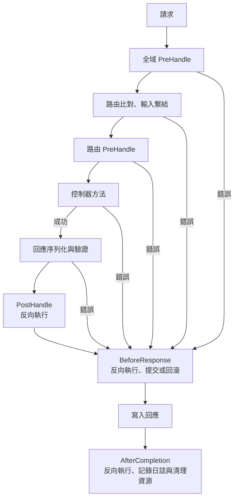

# 攔截器

攔截器處理身分驗證和日誌等共通邏輯。此獨立應用程式為群組中的所有路由和單一路由套用驗證。權杖僅供示範。

## 套用至群組和路由

將以下程式碼儲存為獨立 Go 模組中的 `main.go` 並執行。

```bash
go get github.com/NARUBROWN/spine@v0.7.1 github.com/NARUBROWN/spine-echo-platform@v0.2.0
```

```go
package main

import (
	"github.com/NARUBROWN/spine"
	echoplatform "github.com/NARUBROWN/spine-echo-platform"
	"github.com/NARUBROWN/spine/core"
	"github.com/NARUBROWN/spine/pkg/api"
	"github.com/NARUBROWN/spine/pkg/boot"
	"github.com/NARUBROWN/spine/pkg/constructor"
	"github.com/NARUBROWN/spine/pkg/httperr"
	"github.com/NARUBROWN/spine/pkg/httpx"
	"github.com/NARUBROWN/spine/pkg/input"
	"log"
)

type Auth struct{}

func (*Auth) PreHandle(ctx core.ExecutionContext, meta core.HandlerMeta) error {
	if ctx.Header("Authorization") != "Bearer demo-token" {
		return httperr.Unauthorized("unauthorized")
	}
	return nil
}
func (*Auth) PostHandle(core.ExecutionContext, core.HandlerMeta)                  {}
func (*Auth) BeforeResponse(core.ExecutionContext, core.HandlerMeta, error) error { return nil }
func (*Auth) AfterCompletion(core.ExecutionContext, core.HandlerMeta, error)      {}

type Controller struct{}

func (*Controller) Constructor() *Controller { return &Controller{} }
func (*Controller) RegisterRoutes(r *api.Registry) {
	users := r.Group("/users", api.Interceptors(&Auth{}))
	users.GET("/:id", func(id input.Path[int64]) httpx.Response[map[string]int64] {
		return httpx.Response[map[string]int64]{Body: map[string]int64{"id": *id}}
	})
	r.GET("/profile", func() httpx.Response[string] {
		return httpx.Response[string]{Body: "profile"}
	}, api.Interceptors(&Auth{}))
}
func main() {
	app := spine.New(echoplatform.Option())
	app.Constructor(constructor.Controller(&Controller{}))
	if err := app.Run(boot.Options{Address: ":8080", HTTP: &boot.HTTPOptions{}}); err != nil {
		log.Fatal(err)
	}
}
```

`/users/:id` 從群組繼承驗證，`/profile` 在路由上直接指定驗證。巢狀群組也會繼承上層群組的設定。

未驗證的請求回傳 401，攜帶權杖的請求回傳 200。正式環境中請實作安全的權杖驗證。

```bash
curl -i http://localhost:8080/users/1
curl -i -H 'Authorization: Bearer demo-token' http://localhost:8080/users/1
curl -i -H 'Authorization: Bearer demo-token' http://localhost:8080/profile
```

## 攔截器生命週期

Spine v0.7.1 的 HTTP 請求會依序執行全域攔截器、路由比對與輸入繫結、路由攔截器、控制器。攔截器必須實作全部四個生命週期方法。



輸入繫結失敗時，路由的 `PreHandle` 也不會執行。需要在檢查主體格式之前先驗證身分的政策，請在全域攔截器中處理。


## 介面

```go
type Interceptor interface {
    PreHandle(ctx ExecutionContext, meta HandlerMeta) error
    PostHandle(ctx ExecutionContext, meta HandlerMeta)
    BeforeResponse(ctx ExecutionContext, meta HandlerMeta, executionErr error) error
    AfterCompletion(ctx ExecutionContext, meta HandlerMeta, err error)
}
```

| 方法 | 執行時機 | 回傳值 | 用途 |
|--------|----------|------|------|
| `PreHandle` | 全域在路由比對之前，路由則在輸入繫結之後 | `error` | 身分驗證、資料驗證、啟動交易 |
| `PostHandle` | 控制器與回應準備成功之後 | 無 | 記錄處理完成、後續作業 |
| `BeforeResponse` | 實際寫入回應之前 | `error` | 提交或回滾交易 |
| `AfterCompletion` | 嘗試寫入回應之後 | 無 | 記錄日誌、清理資源 |

`BeforeResponse` 透過 `executionErr` 接收先前的執行錯誤，以及回應序列化、Cookie 與狀態碼驗證錯誤。只有 `PreHandle` 成功的攔截器會執行此方法，因此適合用來結束在該階段啟動的交易。提交或回滾失敗時，請傳回錯誤。

即使發生錯誤，`AfterCompletion` 仍會在全域攔截器，以及路由比對所確認的路由攔截器上呼叫。其中可能包含尚未執行 `PreHandle` 的攔截器，因此必須先確認是否有需要清理的資源。此時回應可能已經寫入，請勿用於修改回應。


## 進一步了解

全域註冊、建構函式注入和生命週期詳情請參閱[攔截器 API](/zh-Hant/reference/api/interceptor)。
