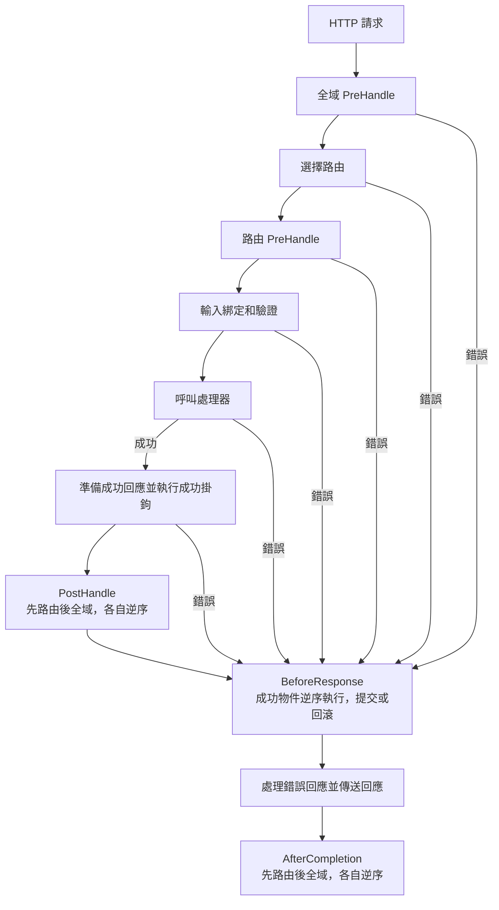

# 攔截器

全域與路由 PreHandle 都在輸入綁定前執行。驗證失敗會在解析本文前回傳 401。

## 執行範例

[控制器依賴](/zh-Hant/learn/tutorial/2-controller)

取代 main.go。固定權杖僅供學習。constructor.Interceptor 註冊 DI，api.Interceptors 指定作用範圍。(*Auth)(nil) 表示從 DI 解析已註冊型別。

本站範例中，所有攔截器都先透過 `app.Constructor` 註冊。實作 `Constructor` 方法的自訂攔截器使用 `constructor.Interceptor(&Auth{})` 註冊，套用時傳入 `(*Auth)(nil)` 這樣的 typed nil，從容器取得實例。不要直接向套用 API 傳入 `&Auth{}`：目前實作會略過建構方法並直接執行該物件。註冊和指定套用範圍是兩個獨立步驟。

```go
package main

import (
	"github.com/NARUBROWN/spine"
	echoplatform "github.com/NARUBROWN/spine-echo-platform"
	"github.com/NARUBROWN/spine/core"
	"github.com/NARUBROWN/spine/pkg/api"
	"github.com/NARUBROWN/spine/pkg/boot"
	"github.com/NARUBROWN/spine/pkg/constructor"
	"github.com/NARUBROWN/spine/pkg/httperr"
	"github.com/NARUBROWN/spine/pkg/httpx"
	"github.com/NARUBROWN/spine/pkg/input"
	spinectx "github.com/NARUBROWN/spine/pkg/spine"
	"log"
)

type Auth struct{}

func (*Auth) Constructor() *Auth { return &Auth{} }
func (*Auth) PreHandle(ctx spinectx.Ctx, meta core.HandlerMeta) error {
	request, ok := ctx.HTTPRequestContext()
	if !ok {
		return httperr.InternalServerError("HTTP request context unavailable")
	}
	if request.Header("Authorization") != "Bearer demo-token" {
		return httperr.Unauthorized("unauthorized")
	}
	ctx.ExecutionContext().Set("userID", "demo-user")
	return nil
}
func (*Auth) PostHandle(spinectx.Ctx, core.HandlerMeta)                  {}
func (*Auth) BeforeResponse(spinectx.Ctx, core.HandlerMeta, error) error { return nil }
func (*Auth) AfterCompletion(spinectx.Ctx, core.HandlerMeta, error)      {}

type Controller struct{}
type CreateUser struct {
	Name string `json:"name"`
}

func (*Controller) Constructor() *Controller { return &Controller{} }
func (*Controller) RegisterRoutes(r *api.Registry) {
	users := r.Group("/users", api.Interceptors((*Auth)(nil)))
	users.GET("/:id", func(ctx spinectx.Ctx, id input.Path[int64]) httpx.Response[map[string]int64] {
		return httpx.Response[map[string]int64]{Body: map[string]int64{"id": *id}}
	})
	users.POST("/", func(ctx spinectx.Ctx, body input.Body[CreateUser]) httpx.Response[string] {
		return httpx.Response[string]{Body: body.Name}
	})
	r.GET("/profile", func(ctx spinectx.Ctx) httpx.Response[string] {
		return httpx.Response[string]{Body: "profile"}
	}, api.Interceptors((*Auth)(nil)))
}
func BuildApplication() (spine.App, boot.Options, error) {

	app := spine.New(echoplatform.Option())
	app.Constructor(constructor.Controller(&Controller{}), constructor.Interceptor(&Auth{}))
	return app, boot.Options{Address: ":8080", HTTP: &boot.HTTPOptions{}, EnableGracefulShutdown: true}, nil
}
func main() {
	app, options, err := BuildApplication()
	if err != nil {
		log.Fatal(err)
	}
	if err := app.Validate(options); err != nil {
		log.Fatal(err)
	}
	if err := app.Run(options); err != nil {
		log.Fatal(err)
	}
}
```

## 群組與路由

```go
app.Constructor(
	constructor.Interceptor(&AuthInterceptor{}),
	constructor.Interceptor(&AuditInterceptor{}),
)
```

```go
func (*UserController) RegisterRoutes(r *api.Registry) {
	auth := (*AuthInterceptor)(nil)
	audit := (*AuditInterceptor)(nil)
	users := r.Group("/users", api.Interceptors(auth))
	users.GET("/", func() httpx.Response[[]int64] {
		return httpx.Response[[]int64]{Body: []int64{1}}
	})
	users.DELETE("/:id", func() httpx.Response[struct{}] {
		return httpx.Response[struct{}]{Options: httpx.ResponseOptions{Status: 204}}
	}, api.Interceptors(audit))
	r.GET("/profile", func() httpx.Response[string] {
		return httpx.Response[string]{Body: "profile"}
	}, api.Interceptors(auth))
}
```

使用此範例前，將 Auth 和 Audit 攔截器註冊到 DI。GET /users 執行 Auth，DELETE /users/:id 依序執行 Auth、Audit。子群組繼承攔截器，路由選項繼續追加。HTTP 全域使用 InterceptorFor(boot.InterceptorHTTP, ...)，HTTP 與 WebSocket 全部使用 app.Interceptor 或 InterceptorAll。避免重複套用同一驗證。

## 驗證請求

```sh
go run .
#
curl -i http://localhost:8080/users/1
curl -i -H 'Authorization: Bearer demo-token' http://localhost:8080/users/1
curl -i -H 'Authorization: Bearer demo-token' http://localhost:8080/profile
curl -i -H 'Content-Type: application/json' -d '{' http://localhost:8080/users
curl -i -H 'Authorization: Bearer demo-token' -H 'Content-Type: application/json' -d '{' http://localhost:8080/users
```

依序為 401、200、200、401、400。本文格式錯誤時，驗證失敗仍優先回傳 401。

## 生命週期



PreHandle 按註冊順序執行；成功後的 PostHandle、寫入前的 BeforeResponse、嘗試寫入後的 AfterCompletion 按反序執行。BeforeResponse 僅對 PreHandle 成功的物件執行，並接收綁定、處理器、序列化與回應驗證錯誤。AfterCompletion 也可能用於未執行 PreHandle 的物件，須檢查資源是否存在。

BeforeResponse 錯誤優先於處理器錯誤決定回應。多個掛鉤失敗時使用最後一個失敗的錯誤，完成掛鉤也會收到先前錯誤。

## 公開上下文

四個掛鉤均接收 spine.Ctx。值使用 ExecutionContext().Set/Get，標準上下文使用 ExecutionContext().Context()；存取 HTTP 前檢查 HTTPRequestContext() 的布林值。處理器仍相容直接注入 context.Context。

## 下一步

[交易](/zh-Hant/learn/tutorial/6-transaction) / [錯誤處理](/zh-Hant/learn/tutorial/7-error-handling)
