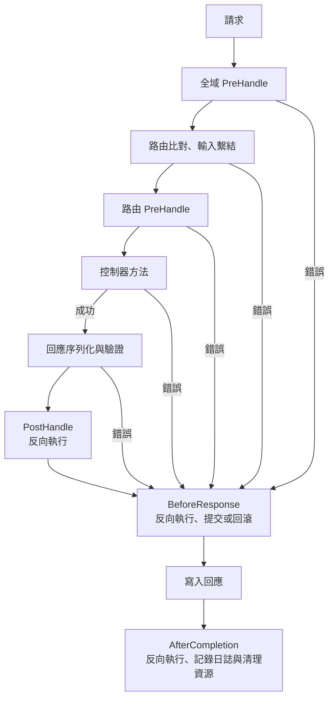

# 攔截器

在使用者查詢請求中加入日誌記錄與示範驗證，並確認請求通過攔截器的順序。攔截器負責多個處理器共用的身分驗證、權限檢查、日誌記錄與交易處理。

本頁依功能劃分的 `src/user` 範例使用[專案結構](/zh-Hant/learn/tutorial/1-project-structure)中以 `--layout legacy` 建立的 `my-app`。CLI `v0.4.0` 預設產生依角色劃分的 `layered-v1` 結構。兩種布局都使用 Spine `v0.6.0` 與 Echo 平台 `v0.1.0`。

## 從 CLI 專案開始

使用[第一個應用程式](/zh-Hant/learn/tutorial/1-project-structure)與[專案結構](/zh-Hant/learn/tutorial/1-project-structure)中建立的專案。程式碼的模組路徑以 `example.com/my-app` 為基準，如果建立時使用其他模組路徑，請依照專案調整。

若尚無使用者資源，請在專案根目錄產生。若已建立，請略過產生步驟。

```sh
spine generate resource user --dry-run
```

在預覽中確認將產生的檔案與註冊程式碼的變更後，再產生檔案。

```sh
spine generate resource user
```

CLI 會產生 `src/user` 檔案與 `BuildApplication` 中的 `user.Register(app)` 呼叫。由於沒有攔截器產生器，請建立 `src/interceptor` 目錄，並自行撰寫下列日誌與驗證攔截器檔案。

應用程式的全域註冊寫在 `internal/application/application.go`，使用者路由的驗證政策則寫在 `src/user/user_route.go`。保留根目錄 `main.go` 的組態、驗證與執行流程。後面的稽核日誌與訂單交易範例是獨立擴充，基本應用程式的驗證步驟不需要這些內容。


## 攔截器生命週期

Spine v0.6.0 的 HTTP 請求會依序執行全域攔截器、路由比對與輸入繫結、路由攔截器、控制器。攔截器必須實作全部四個生命週期方法。



輸入繫結失敗時，路由的 `PreHandle` 也不會執行。需要在檢查主體格式之前先驗證身分的政策，請在全域攔截器中處理。


## 介面

```go
type Interceptor interface {
    PreHandle(ctx ExecutionContext, meta HandlerMeta) error
    PostHandle(ctx ExecutionContext, meta HandlerMeta)
    BeforeResponse(ctx ExecutionContext, meta HandlerMeta, executionErr error) error
    AfterCompletion(ctx ExecutionContext, meta HandlerMeta, err error)
}
```

| 方法 | 執行時機 | 回傳值 | 用途 |
|--------|----------|------|------|
| `PreHandle` | 全域在路由比對之前，路由則在輸入繫結之後 | `error` | 身分驗證、資料驗證、啟動交易 |
| `PostHandle` | 控制器與回應準備成功之後 | 無 | 記錄處理完成、後續作業 |
| `BeforeResponse` | 實際寫入回應之前 | `error` | 提交或回滾交易 |
| `AfterCompletion` | 嘗試寫入回應之後 | 無 | 記錄日誌、清理資源 |

`BeforeResponse` 透過 `executionErr` 接收先前的執行錯誤，以及回應序列化、Cookie 與狀態碼驗證錯誤。只有 `PreHandle` 成功的攔截器會執行此方法，因此適合用來結束在該階段啟動的交易。提交或回滾失敗時，請傳回錯誤。

即使發生錯誤，`AfterCompletion` 仍會在全域攔截器，以及路由比對所確認的路由攔截器上呼叫。其中可能包含尚未執行 `PreHandle` 的攔截器，因此必須先確認是否有需要清理的資源。此時回應可能已經寫入，請勿用於修改回應。


## 全域攔截器與路由攔截器

應用程式的全域政策註冊在全域攔截器，特定路由的政策則註冊在路由攔截器。

| 分類 | 全域攔截器 | 路由攔截器 |
|------|--------------|----------------|
| 套用範圍 | 該傳輸方式的所有請求 | 僅限特定路由 |
| 註冊方式 | `app.Interceptor()` | `route.WithInterceptors()` |
| 用途 | CORS、日誌記錄、交易 | 身分驗證、權限檢查 |
| 執行順序 | 先執行 | 在全域攔截器之後執行 |


## 全域攔截器

將下列日誌攔截器註冊為全域攔截器後，就會記錄請求方法與路徑。成功時可查看 `PostHandle` 的日誌，失敗時則可查看 `AfterCompletion` 的日誌。

### 日誌攔截器範例

```go
// src/interceptor/logging_interceptor.go
package interceptor

import (
    "log"
    "github.com/NARUBROWN/spine/core"
)

type LoggingInterceptor struct{}

func (i *LoggingInterceptor) PreHandle(ctx core.ExecutionContext, meta core.HandlerMeta) error {
    log.Printf("[REQ] %s %s", ctx.Method(), ctx.Path())
    return nil
}

func (i *LoggingInterceptor) PostHandle(ctx core.ExecutionContext, meta core.HandlerMeta) {
    log.Printf("[RES] %s %s OK",
        ctx.Method(),
        ctx.Path(),
    )
}

func (i *LoggingInterceptor) BeforeResponse(ctx core.ExecutionContext, meta core.HandlerMeta, executionErr error) error {
    return nil
}

func (i *LoggingInterceptor) AfterCompletion(ctx core.ExecutionContext, meta core.HandlerMeta, err error) {
    if err != nil {
        log.Printf("[ERR] %s %s : %v",
            ctx.Method(),
            ctx.Path(),
            err,
        )
    }
}
```

全域 HTTP `PreHandle` 在路由比對之前執行，因此此階段的 `HandlerMeta` 沒有控制器型別與方法。若需要這些資訊，請在路由攔截器或後續生命週期中讀取。

### 註冊全域攔截器

如下修改 `internal/application/application.go`。保留產生的健康檢查控制器與 `user.Register(app)` 呼叫，並新增日誌攔截器。

```go
// internal/application/application.go
package application

import (
    platform "github.com/NARUBROWN/spine-echo-platform"
    "os"

    "example.com/my-app/src/interceptor"
    "example.com/my-app/src/user"
    "github.com/NARUBROWN/spine"
    "github.com/NARUBROWN/spine/pkg/boot"
    "github.com/NARUBROWN/spine/pkg/httpx"
)

type HealthController struct{}

func NewHealthController() *HealthController { return &HealthController{} }

func (c *HealthController) Get() httpx.Response[map[string]string] {
    return httpx.Response[map[string]string]{Body: map[string]string{"status": "ok"}}
}

func BuildApplication() (spine.App, boot.Options, error) {
    app := platform.New()
    app.Constructor(NewHealthController)
    app.Route("GET", "/health", (*HealthController).Get)
    app.Interceptor(&interceptor.LoggingInterceptor{})

    if err := user.Register(app); err != nil {
        return nil, boot.Options{}, err
    }

    address := ":8080"
    if port := os.Getenv("SPINE_PORT"); port != "" {
        address = ":" + port
    }
    return app, boot.Options{Address: address, HTTP: &boot.HTTPOptions{}}, nil
}
```


## 路由攔截器

將驗證攔截器註冊到 `GET /user/:id`，以 HTTP 401 拒絕沒有權杖的請求。健康檢查路由 `/health` 不套用這項驗證政策。

### 驗證攔截器範例

```go
// src/interceptor/auth_interceptor.go
package interceptor

import (
    "errors"

    "github.com/NARUBROWN/spine/core"
    "github.com/NARUBROWN/spine/pkg/httperr"
)

type AuthInterceptor struct{}

func (i *AuthInterceptor) PreHandle(ctx core.ExecutionContext, meta core.HandlerMeta) error {
    token := ctx.Header("Authorization")

    if token == "" {
        return httperr.Unauthorized("인증이 필요합니다.")
    }

    user, err := validateToken(token)
    if err != nil {
        return httperr.Unauthorized("유효하지 않은 토큰입니다.")
    }

    ctx.Set("currentUser", user)
    return nil
}

func (i *AuthInterceptor) PostHandle(ctx core.ExecutionContext, meta core.HandlerMeta) {}

func (i *AuthInterceptor) BeforeResponse(ctx core.ExecutionContext, meta core.HandlerMeta, executionErr error) error { return nil }

func (i *AuthInterceptor) AfterCompletion(ctx core.ExecutionContext, meta core.HandlerMeta, err error) {}

func validateToken(token string) (map[string]string, error) {
    if token != "Bearer demo-token" {
        return nil, errors.New("invalid demo token")
    }
    return map[string]string{"id": "1", "name": "Alice"}, nil
}
```

此範例只允許 `Authorization: Bearer demo-token`，其他權杖一律傳回 HTTP 401。固定權杖是用於確認運作的公開示範，實際應用程式請改用身分驗證服務。

### 註冊路由攔截器

將產生的 `src/user/user_route.go` 修改為下列程式碼。以 `route.WithInterceptors()` 加入驗證政策，並保留 `BuildApplication` 中的 `user.Register(app)` 呼叫。

```go
// src/user/user_route.go
package user

import (
    "example.com/my-app/src/interceptor"
    "github.com/NARUBROWN/spine"
    "github.com/NARUBROWN/spine/pkg/route"
)

func Register(app spine.App) error {
    app.Constructor(NewUserRepository, NewUserService, NewUserController)
    app.Route(
        "GET",
        "/user/:id",
        (*UserController).Get,
        route.WithInterceptors(&interceptor.AuthInterceptor{}),
    )
    return nil
}
```


## 同時套用日誌記錄、身分驗證與 CORS

將前一節的 `BuildApplication` 替換為下列程式碼，即可在日誌記錄之外套用 CORS 政策。使用者路由的驗證攔截器仍保留在 `user_route.go`。

CORS 設定為允許來自 `https://app.example.com` 的請求。請檢查 `cors.NewValidated` 的設定錯誤；由於這是 HTTP 專用政策，請以 `InterceptorFor(boot.InterceptorHTTP, ...)` 註冊。

```go
// internal/application/application.go
package application

import (
    platform "github.com/NARUBROWN/spine-echo-platform"
    "os"

    "example.com/my-app/src/interceptor"
    "example.com/my-app/src/user"
    "github.com/NARUBROWN/spine"
    "github.com/NARUBROWN/spine/pkg/boot"
    "github.com/NARUBROWN/spine/pkg/httpx"
    "github.com/NARUBROWN/spine/interceptor/cors"
)

type HealthController struct{}

func NewHealthController() *HealthController { return &HealthController{} }

func (c *HealthController) Get() httpx.Response[map[string]string] {
    return httpx.Response[map[string]string]{Body: map[string]string{"status": "ok"}}
}

func BuildApplication() (spine.App, boot.Options, error) {
    app := platform.New()
    app.Constructor(NewHealthController)
    app.Route("GET", "/health", (*HealthController).Get)
    app.Interceptor(&interceptor.LoggingInterceptor{})
    corsInterceptor, err := cors.NewValidated(cors.Config{
        AllowOrigins:     []string{"https://app.example.com"},
        AllowMethods:     []string{"GET", "POST", "PUT", "DELETE", "OPTIONS"},
        AllowHeaders:     []string{"Authorization", "Content-Type"},
        AllowCredentials: true,
    })
    if err != nil {
        return nil, boot.Options{}, err
    }
    app.InterceptorFor(boot.InterceptorHTTP, corsInterceptor)

    if err := user.Register(app); err != nil {
        return nil, boot.Options{}, err
    }

    address := ":8080"
    if port := os.Getenv("SPINE_PORT"); port != "" {
        address = ":" + port
    }
    return app, boot.Options{Address: address, HTTP: &boot.HTTPOptions{}}, nil
}
```


## 驗證日誌記錄與身分驗證的運作

套用基本範例的日誌記錄、身分驗證與 CORS 程式碼後，在專案根目錄執行。`spine contract check` 檢查靜態契約，`spine verify` 則執行本機程式碼檢查。實際請求的身分驗證與回應，需要啟動伺服器後另外確認。

```sh
gofmt -w src/interceptor/*.go src/user/user_route.go internal/application/application.go
spine contract check
spine verify
spine dev
```

在另一個終端機送出下列請求。

- `/health` 應在未驗證身分的情況下傳回 HTTP 200。
- 沒有權杖的 `/user/1` 請求應傳回 HTTP 401。
- 傳送示範權杖的 `/user/1` 請求應傳回 HTTP 200 與 `{"id":1}`。
- 最後一個回應應包含 `Access-Control-Allow-Origin: https://app.example.com` 標頭。

```bash
curl -i http://localhost:8080/health
curl -i http://localhost:8080/user/1
curl -i http://localhost:8080/user/1 \
  -H 'Authorization: Bearer demo-token' \
  -H 'Origin: https://app.example.com'
```

上述請求只確認示範用的 HTTP 身分驗證。實際身分驗證服務、WebSocket 身分驗證與資料庫交易的運作，請在設定各自環境後另外驗證。

## 執行順序

`PreHandle` 依註冊順序執行。成功後的 `PostHandle`、`BeforeResponse`、`AfterCompletion`，會先反向執行路由攔截器，再反向執行全域攔截器。

### 成功請求的執行流程

先前註冊的日誌、CORS 與驗證攔截器全部成功時，會依照下列順序執行。

```text
請求 (GET /user/1)
   │
   ├─→ Logging.PreHandle     (全域 1)
   ├─→ CORS.PreHandle        (全域 2)
   ├─→ 路由比對與輸入繫結
   ├─→ Auth.PreHandle        (路由 1)
   │
   ├─→ UserController.Get
   ├─→ 回應序列化與驗證
   │
   ├─→ Auth.PostHandle       (路由 1)
   ├─→ CORS.PostHandle       (全域 2)
   ├─→ Logging.PostHandle    (全域 1)
   │
   ├─→ Auth.BeforeResponse       (路由 1)
   ├─→ CORS.BeforeResponse       (全域 2)
   ├─→ Logging.BeforeResponse    (全域 1)
   │
   ├─→ 寫入回應
   │
   ├─→ Auth.AfterCompletion       (路由 1)
   ├─→ CORS.AfterCompletion       (全域 2)
   └─→ Logging.AfterCompletion    (全域 1)

完成
```

即使控制器成功，若回應序列化或驗證失敗，`PostHandle` 也不會執行。`BeforeResponse` 只會在 `PreHandle` 成功的攔截器上執行，`AfterCompletion` 的清理對象則包含路由比對所確認的攔截器。


## 處理發生錯誤的請求

### 在 PreHandle 傳回錯誤

若 `PreHandle` 傳回錯誤，就不會呼叫後續攔截器的 `PreHandle` 與控制器。已成功執行 `PreHandle` 的攔截器仍會執行 `BeforeResponse`，最後再以 `AfterCompletion` 清理。

下列程式碼只擷取驗證失敗的分支。若以此程式碼取代先前撰寫的 `AuthInterceptor`，就會遺漏權杖有效性檢查，因此請保留原本的實作。

```go
func (i *AuthInterceptor) PreHandle(ctx core.ExecutionContext, meta core.HandlerMeta) error {
    token := ctx.Header("Authorization")
    if token == "" {
        return httperr.Unauthorized("인증이 필요합니다.")
    }
    return nil
}
```

```text
請求 (GET /user/1, 無權杖)
   │
   ├─→ Logging.PreHandle     (成功)
   ├─→ CORS.PreHandle        (成功)
   ├─→ 路由比對與輸入繫結
   ├─→ Auth.PreHandle        (傳回錯誤)
   │
   ├─→ CORS.BeforeResponse
   ├─→ Logging.BeforeResponse
   │
   ├─→ 寫入回應 (401 Unauthorized)
   │
   ├─→ Auth.AfterCompletion
   ├─→ CORS.AfterCompletion
   └─→ Logging.AfterCompletion

完成
```


## 共用請求值：ExecutionContext

攔截器從 `core.ExecutionContext` 讀取請求資訊，並將值傳遞給處理同一請求的其他攔截器或控制器。控制器透過唯讀的 `spine.Ctx` 讀取共用值。

### 方法

| 方法 | 說明 |
|--------|------|
| `Context()` | 傳回 `context.Context` |
| `Method()` | HTTP 方法（GET、POST 等） |
| `Path()` | 請求路徑 |
| `Header(name)` | 讀取標頭值 |
| `Params()` | 讀取所有路徑參數 |
| `PathKeys()` | 路由中宣告的路徑參數名稱順序 |
| `Queries()` | 讀取所有查詢參數 |
| `EventBus()` | 取得請求的事件匯流排 |
| `Set(key, value)` | 儲存值 |
| `Get(key)` | 讀取值 |

### 在攔截器之間傳遞資料

以下範例只擷取稽核攔截器讀取驗證攔截器所儲存 `currentUser` 的部分。若要新增稽核攔截器，請實作 `AuditInterceptor` 型別與四個生命週期方法，並註冊在驗證攔截器之後。請勿重複宣告既有驗證攔截器的 `PreHandle`。

```go
// AuthInterceptor — 사용자 정보 저장
func (i *AuthInterceptor) PreHandle(ctx core.ExecutionContext, meta core.HandlerMeta) error {
    token := ctx.Header("Authorization")
    user, err := validateToken(token)
    if err != nil {
        return httperr.Unauthorized("invalid credentials")
    }
    ctx.Set("currentUser", user)
    return nil
}

// 컨트롤러에서는 읽기 전용 spine.Ctx로 조회
// 또는 다른 인터셉터에서 조회
func (i *AuditInterceptor) PreHandle(ctx core.ExecutionContext, meta core.HandlerMeta) error {
    user, ok := ctx.Get("currentUser")
    if ok {
        log.Printf("User %v accessing %s", user, ctx.Path())
    }
    return nil
}
```


## 處理器資訊：HandlerMeta

`core.HandlerMeta` 包含由路由比對決定的控制器與方法資訊。在全域 `PreHandle` 中，由於尚未進行路由比對，無法使用型別與方法。

| 欄位 | 型別 | 說明 |
|------|------|------|
| `ControllerType` | `reflect.Type` | 控制器型別 |
| `Method` | `reflect.Method` | 處理器方法 |
| `PathKeys` | `[]string` | 路由中宣告的路徑參數名稱順序 |
| `Interceptors` | `[]Interceptor` | 繫結至路由的攔截器 |

### 使用範例

以下是顯示中繼資料讀取部分的獨立範例。在路由攔截器中執行時，可以記錄控制器與方法。請勿重複宣告與既有日誌攔截器相同的方法。

```go
func (i *LoggingInterceptor) PreHandle(ctx core.ExecutionContext, meta core.HandlerMeta) error {
    if meta.ControllerType != nil {
        log.Printf("컨트롤러: %s", meta.ControllerType.String())
    }
    log.Printf("메서드: %s", meta.Method.Name)              // GetUser
    return nil
}
```


## 需要相依性注入的攔截器

需要相依性的攔截器，必須將建構函式註冊到 `app.Constructor`，並在註冊攔截器時傳入表示型別的指標。容器會建立該型別的執行個體並注入。

### 交易攔截器範例

以下是加入已連接[資料庫](/zh-Hant/learn/tutorial/5-database)的應用程式中的獨立擴充範例。驗證基本日誌與身分驗證範例時，不需要這個擴充。

`PreHandle` 將交易儲存於請求內容，`BeforeResponse` 則在有執行錯誤時回滾，沒有錯誤時提交。控制器必須從 `spine.Ctx` 讀取交易，並傳遞給服務與儲存庫方法。個別請求的交易不會自動重新注入由共用建構函式建立的服務或儲存庫。

```go
// src/interceptor/tx_interceptor.go
package interceptor

import (
    "github.com/NARUBROWN/spine/core"
    "github.com/uptrace/bun"
)

type TxInterceptor struct {
    db *bun.DB
}

func NewTxInterceptor(db *bun.DB) *TxInterceptor {
    return &TxInterceptor{db: db}
}

func (i *TxInterceptor) PreHandle(ctx core.ExecutionContext, meta core.HandlerMeta) error {
    tx, err := i.db.BeginTx(ctx.Context(), nil)
    if err != nil {
        return err
    }
    ctx.Set("tx", tx)
    return nil
}

func (i *TxInterceptor) PostHandle(ctx core.ExecutionContext, meta core.HandlerMeta) {}

func (i *TxInterceptor) BeforeResponse(ctx core.ExecutionContext, meta core.HandlerMeta, executionErr error) error {
    v, ok := ctx.Get("tx")
    if !ok {
        return nil
    }

    tx, ok := v.(bun.Tx)
    if !ok {
        return nil
    }
    if executionErr != nil {
        return tx.Rollback()
    } else {
        return tx.Commit()
    }
}

func (i *TxInterceptor) AfterCompletion(ctx core.ExecutionContext, meta core.HandlerMeta, err error) {}
```

### 全域註冊

以下註冊程式碼是要加入 `BuildApplication` 的部分。`NewDB` 必須實作為傳回一個 `*bun.DB` 的建構函式。

```go
app.Constructor(
    NewDB,
    interceptor.NewTxInterceptor,
)

app.Interceptor(
    (*interceptor.TxInterceptor)(nil),  // 타입으로 참조
)
```

### 路由註冊

若只要套用到建立訂單的請求，請改為如下註冊到路由，而非全域註冊。`OrderController` 的建構函式與 `CreateOrder` 方法，需要另外實作並註冊。

```go
app.Constructor(
    NewDB,
    interceptor.NewTxInterceptor,
)

app.Route(
    "POST",
    "/orders",
    (*OrderController).CreateOrder,
    route.WithInterceptors((*interceptor.TxInterceptor)(nil)),  // 타입으로 참조
)
```


## 選擇註冊方式

無論全域或路由註冊，沒有相依性的攔截器都可以直接傳入執行個體。有相依性的攔截器則先註冊建構函式，再以型別參照。

| 方式 | 全域註冊 | 路由註冊 |
|------|----------|------------|
| 傳入執行個體 | `app.Interceptor(&interceptor.LoggingInterceptor{})` | `route.WithInterceptors(&interceptor.AuthInterceptor{})` |
| 參照由建構函式解析的型別 | `app.Interceptor((*interceptor.TxInterceptor)(nil))` | `route.WithInterceptors((*interceptor.TxInterceptor)(nil))` |


## 下一步

- [教學：資料庫](/zh-Hant/learn/tutorial/5-database) — 連接 Bun ORM
- [教學：錯誤處理](/zh-Hant/learn/tutorial/7-error-handling) — httperr 用法
