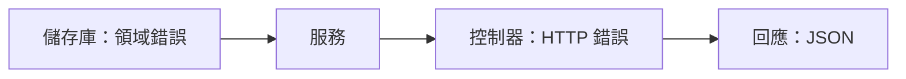

# 錯誤處理

依照使用者查詢失敗的原因回傳 HTTP 400 或 404，並在回應中隱藏未預期錯誤的內部資訊。

本頁依功能劃分的 `src/user` 範例使用[專案結構](/zh-Hant/learn/tutorial/1-project-structure)中以 `--layout legacy` 建立的 `my-app`。CLI `v0.4.0` 預設產生依角色劃分的 `layered-v1` 結構。兩種布局都使用 Spine `v0.6.0` 與 Echo 平台 `v0.1.0`。

使用[第一個應用程式](/zh-Hant/learn/tutorial/1-project-structure)和[控制器](/zh-Hant/learn/tutorial/2-controller)中的 CLI 專案。需要先以 `spine-cli generate resource user` 產生 `src/user`。下方會將 GET 處理器改為唯讀的記憶體查詢，因此請與資料庫教學分開套用。領域錯誤與 HTTP 狀態之間的對應程式碼需要自行撰寫。

## HTTP 錯誤與回應

將成功結果放入 `httpx.Response[T]`，錯誤則透過獨立的 `error` 回傳值傳遞。處理器的回傳型別應寫為 `(httpx.Response[User], error)`，不要使用 `(User, error)`。`httperr` 提供以下四個函式。

| 函式 | HTTP 狀態 | 用途 |
|---|---|---|
| `httperr.BadRequest(message)` | 400 | 無效輸入 |
| `httperr.Unauthorized(message)` | 401 | 需要驗證身分 |
| `httperr.NotFound(message)` | 404 | 資源不存在 |
| `httperr.InternalServerError(message)` | 500 | 向用戶端公開的伺服器錯誤訊息 |

`HTTPError.Message` 會向用戶端公開，因此請勿直接放入內部 DB 錯誤或機密值。若回傳一般 `error`，就會轉換為 HTTP 500 與 `{"message":"Internal server error"}`。

## 在產生的資源中新增查詢錯誤

以下列內容取代產生的 `src/user/user_repository.go` 與 `src/user/user_controller.go`，並在 `src/user/user_service.go` 新增 `Find` 方法。所有檔案都放在 `package user` 中。保留既有的建構函式名稱、`user.Register(app)` 與 `GET /user/:id` 註冊。

儲存庫只保留 ID 為 1 的 Alice。此範例用來重現查詢錯誤，不會將資料儲存至 DB。

```go
// src/user/user_repository.go
package user

import "errors"

var ErrUserNotFound = errors.New("user not found")
var ErrEmailAlreadyExists = errors.New("email already exists")

type User struct {
    ID int64 `json:"id"`
    Name string `json:"name"`
}

type UserRepository struct{ users map[int64]User }

func NewUserRepository() *UserRepository {
    return &UserRepository{users: map[int64]User{1: {ID: 1, Name: "Alice"}}}
}

func (r *UserRepository) FindByID(id int64) (User, error) {
    user, ok := r.users[id]
    if !ok {
        return User{}, ErrUserNotFound
    }
    return user, nil
}
```

```go
// src/user/user_service.go
func (s *UserService) Find(id int64) (User, error) {
    return s.repository.FindByID(id)
}
```

```go
// src/user/user_controller.go
package user

import (
    "errors"
    "net/http"

    "github.com/NARUBROWN/spine/pkg/httperr"
    "github.com/NARUBROWN/spine/pkg/httpx"
    "github.com/NARUBROWN/spine/pkg/path"
)

type UserController struct{ service *UserService }

func NewUserController(service *UserService) *UserController {
    return &UserController{service: service}
}

func (c *UserController) Get(id path.Int) (httpx.Response[User], error) {
    if id.Value <= 0 {
        return httpx.Response[User]{}, httperr.BadRequest("invalid user ID")
    }
    user, err := c.service.Find(id.Value)
    if err != nil {
        return httpx.Response[User]{}, toHTTPError(err)
    }
    return httpx.Response[User]{Body: user}, nil
}

func toHTTPError(err error) error {
    switch {
    case errors.Is(err, ErrUserNotFound):
        return httperr.NotFound("user not found")
    case errors.Is(err, ErrEmailAlreadyExists):
        return &httperr.HTTPError{
            Status: http.StatusConflict,
            Message: "email already exists",
            Cause: err,
        }
    default:
        return err
    }
}
```

## 各層的責任

儲存庫回傳領域錯誤，服務則將其傳遞至控制器。控制器將預期中的錯誤轉換為 HTTP 狀態。使用 `errors.Is` 也能辨識被其他錯誤包裝的領域錯誤。

未知錯誤直接回傳，交由一般 HTTP 500 處理。若改為 `BadRequest(err.Error())`，內部錯誤訊息就會暴露在回應中。上方的記憶體儲存庫只會回傳 `ErrUserNotFound`，而 `ErrEmailAlreadyExists` 分支是供日後新增儲存功能時使用的對應範例。



## HTTPError 與其他狀態

`HTTPError.Unwrap()` 回傳 `Cause`。可使用 `errors.Is` 和 `errors.As` 檢查原因鏈，也可直接讀取 `Cause` 欄位。原因錯誤不會包含在 JSON 回應中。

```go
type HTTPError struct {
    Status int
    Message string
    Cause error
}

func (e *HTTPError) Error() string { return e.Message }
func (e *HTTPError) Unwrap() error { return e.Cause }
```

```go
return &httperr.HTTPError{
    Status: http.StatusForbidden,
    Message: "permission denied",
}
```

## 驗證請求 DTO

若要新增輸入驗證，請撰寫以下 `src/user/user_create.go`。`Validate()` 不會自動呼叫，因此必須在處理器中直接呼叫，並以指標接收請求 DTO。

此 POST 處理器會在名稱或電子郵件為空，或名稱超過 100 個字元時回傳 HTTP 400。通過驗證後，會以 HTTP 201 回傳輸入內容，但不會儲存使用者。若要使用，請在 `src/user/user_route.go` 的 `Register` 中一併新增下方的 POST 路由。

```go
// src/user/user_create.go
package user

import (
    "errors"
    "net/http"
    "unicode/utf8"

    "github.com/NARUBROWN/spine/pkg/httperr"
    "github.com/NARUBROWN/spine/pkg/httpx"
)

type CreateUserRequest struct {
    Name string `json:"name"`
    Email string `json:"email"`
}

func (r *CreateUserRequest) Validate() error {
    if r == nil || r.Name == "" {
        return errors.New("name is required")
    }
    if utf8.RuneCountInString(r.Name) > 100 {
        return errors.New("name must be at most 100 characters")
    }
    if r.Email == "" {
        return errors.New("email is required")
    }
    return nil
}

func (c *UserController) Create(req *CreateUserRequest) (httpx.Response[CreateUserRequest], error) {
    if err := req.Validate(); err != nil {
        return httpx.Response[CreateUserRequest]{}, httperr.BadRequest(err.Error())
    }
    return httpx.Response[CreateUserRequest]{
        Body: *req,
        Options: httpx.ResponseOptions{Status: http.StatusCreated},
    }, nil
}
```

```go
// src/user/user_route.go: Register
app.Route("POST", "/user", (*UserController).Create)
```

## 攔截器的錯誤處理

若在 `PreHandle` 回傳錯誤，就不會執行控制器。以下是具備自訂身分驗證服務的攔截器方法片段，不能只複製此方法就使用。必須在 `src/interceptor` 中定義型別與身分驗證服務，並實作 `PreHandle`、`PostHandle`、`BeforeResponse`、`AfterCompletion` 全部四個方法。若要套用至 HTTP 請求，請在 `BuildApplication()` 中以 `boot.InterceptorHTTP` 範圍註冊。

```go
func (i *AuthInterceptor) PreHandle(ctx core.ExecutionContext, meta core.HandlerMeta) error {
    token := ctx.Header("Authorization")
    if token == "" {
        return httperr.Unauthorized("authentication required")
    }
    user, err := i.auth.Validate(token)
    if err != nil {
        return httperr.Unauthorized("invalid token")
    }
    ctx.Set("auth.user", user)
    return nil
}
```

## 記錄錯誤日誌

可以在 `AfterCompletion` 中記錄最終執行錯誤。以下同樣是從日誌攔截器中擷取的方法，因此需要完整的攔截器型別與註冊。請勿在日誌中記錄身分驗證權杖或請求中的機密值。

```go
func (i *LoggingInterceptor) AfterCompletion(ctx core.ExecutionContext, meta core.HandlerMeta, err error) {
    if err != nil {
        log.Printf("[ERR] %s %s: %v", ctx.Method(), ctx.Path(), err)
    }
}
```

## 驗證與確認 HTTP 回應

```bash
gofmt -w src/user
go mod tidy
go mod download all
spine-cli doctor
spine-cli contract check
spine-cli verify
spine-cli dev
```

通過契約與本機檢查後，在另一個終端機確認回應。以下結果是套用唯讀記憶體範例後的行為。

```bash
curl -i http://localhost:8080/user/1
curl -i http://localhost:8080/user/0
curl -i http://localhost:8080/user/2
```

| 請求 | HTTP 狀態 | JSON |
|---|---|---|
| `/user/1` | 200 | `{"id":1,"name":"Alice"}` |
| `/user/0` | 400 | `{"message":"invalid user ID"}` |
| `/user/2` | 404 | `{"message":"user not found"}` |

以上請求確認的是已傳遞至處理器的整數 ID 如何處理。無法解讀為數字的路徑值，其錯誤處理與本範例的 `id.Value <= 0` 驗證不同。

串接實際 DB 或身分驗證服務後，也請直接傳送請求，確認該服務的失敗路徑。僅靠靜態契約檢查無法驗證外部服務的錯誤對應。

- [httperr](/zh-Hant/learn/core-concepts/httperr)
- [攔截器](/zh-Hant/learn/tutorial/4-interceptor)
