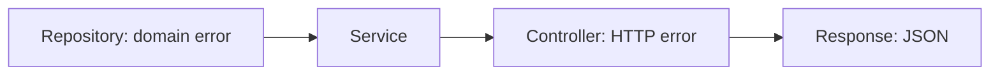

# 錯誤處理

使用[第一個應用程式](/zh-Hant/learn/getting-started/first-app)與[控制器](/zh-Hant/learn/tutorial/2-controller)中的 CLI 專案，手動擴充 `spine generate resource user` 產生的 `src/user` GET 處理函式。CLI 負責產生與註冊，領域錯誤與 HTTP 對應由應用程式實作。

## HTTP 錯誤與回應

將成功結果放入 `httpx.Response[T]` 並另外回傳 `error`，不支援直接將一般結構體 `(User, error)` 當成 HTTP 回應。目前 `httperr` 套件提供四個輔助函式。

| Helper | HTTP | |
|---|---|---|
| `httperr.BadRequest(message)` | 400 | 無效輸入 |
| `httperr.Unauthorized(message)` | 401 | 需要驗證身分 |
| `httperr.NotFound(message)` | 404 | 資源不存在 |
| `httperr.InternalServerError(message)` | 500 | 刻意公開的錯誤訊息 |

`HTTPError.Message` 會公開給用戶端，不要直接放入資料庫內部錯誤或秘密值。未知的一般錯誤會轉換為 HTTP 500 與 `{"message":"Internal server error"}`。

## 為產生的資源加入查詢錯誤

以下是教學用的唯讀記憶體查詢。取代產生的 repository、controller 檔案，並為服務加入 `Find`。所有檔案放在同一個 `package user`。沿用現有建構子名稱、`user.Register(app)` 與 `GET /user/:id` 註冊。此範例不提供資料庫持久化或完整 CRUD。

```go
// src/user/user_repository.go
package user

import "errors"

var ErrUserNotFound = errors.New("user not found")
var ErrEmailAlreadyExists = errors.New("email already exists")

type User struct {
    ID int64 `json:"id"`
    Name string `json:"name"`
}

type UserRepository struct{ users map[int64]User }

func NewUserRepository() *UserRepository {
    return &UserRepository{users: map[int64]User{1: {ID: 1, Name: "Alice"}}}
}

func (r *UserRepository) FindByID(id int64) (User, error) {
    user, ok := r.users[id]
    if !ok {
        return User{}, ErrUserNotFound
    }
    return user, nil
}
```

```go
// src/user/user_service.go
func (s *UserService) Find(id int64) (User, error) {
    return s.repository.FindByID(id)
}
```

```go
// src/user/user_controller.go
package user

import (
    "errors"
    "net/http"

    "github.com/NARUBROWN/spine/pkg/httperr"
    "github.com/NARUBROWN/spine/pkg/httpx"
    "github.com/NARUBROWN/spine/pkg/path"
)

type UserController struct{ service *UserService }

func NewUserController(service *UserService) *UserController {
    return &UserController{service: service}
}

func (c *UserController) Get(id path.Int) (httpx.Response[User], error) {
    if id.Value <= 0 {
        return httpx.Response[User]{}, httperr.BadRequest("invalid user ID")
    }
    user, err := c.service.Find(id.Value)
    if err != nil {
        return httpx.Response[User]{}, toHTTPError(err)
    }
    return httpx.Response[User]{Body: user}, nil
}

func toHTTPError(err error) error {
    switch {
    case errors.Is(err, ErrUserNotFound):
        return httperr.NotFound("user not found")
    case errors.Is(err, ErrEmailAlreadyExists):
        return &httperr.HTTPError{
            Status: http.StatusConflict,
            Message: "email already exists",
            Cause: err,
        }
    default:
        return err
    }
}
```

## 各層責任

儲存庫回傳領域錯誤，服務向上傳遞，控制器只將預期錯誤對應為 HTTP 狀態碼。`errors.Is` 也能識別包裝過的錯誤。將未知錯誤轉換成 `BadRequest(err.Error())` 會洩漏內部細節，應原樣回傳以使用通用的去識別化 500 回應。



## HTTPError 與其他狀態碼

使用 `HTTPError` 表達沒有輔助函式的狀態，如 403、409。`Cause` 可透過 `Unwrap()` 追蹤原因，不會出現在 JSON 回應中。

```go
type HTTPError struct {
    Status int
    Message string
    Cause error
}

func (e *HTTPError) Error() string { return e.Message }
func (e *HTTPError) Unwrap() error { return e.Cause }
```

```go
return &httperr.HTTPError{
    Status: http.StatusForbidden,
    Message: "permission denied",
}
```

## 驗證請求 DTO

以下是選用的輸入驗證擴充。Spine 不會自動呼叫 `Validate()`，需要在處理函式中呼叫。請求 DTO 必須使用指標。此 POST 只回傳驗證後的輸入，不會儲存使用者；使用時在 `Register` 中手動加入 POST 路由。

```go
// src/user/user_create.go
package user

import (
    "errors"
    "net/http"
    "unicode/utf8"

    "github.com/NARUBROWN/spine/pkg/httperr"
    "github.com/NARUBROWN/spine/pkg/httpx"
)

type CreateUserRequest struct {
    Name string `json:"name"`
    Email string `json:"email"`
}

func (r *CreateUserRequest) Validate() error {
    if r == nil || r.Name == "" {
        return errors.New("name is required")
    }
    if utf8.RuneCountInString(r.Name) > 100 {
        return errors.New("name must be at most 100 characters")
    }
    if r.Email == "" {
        return errors.New("email is required")
    }
    return nil
}

func (c *UserController) Create(req *CreateUserRequest) (httpx.Response[CreateUserRequest], error) {
    if err := req.Validate(); err != nil {
        return httpx.Response[CreateUserRequest]{}, httperr.BadRequest(err.Error())
    }
    return httpx.Response[CreateUserRequest]{
        Body: *req,
        Options: httpx.ResponseOptions{Status: http.StatusCreated},
    }, nil
}
```

```go
// src/user/user_route.go: Register
app.Route("POST", "/user", (*UserController).Create)
```

## 攔截器錯誤處理

`PreHandle` 回傳錯誤會停止控制器執行。以下是 `src/interceptor` 中使用自訂身分驗證服務的方法片段。完整型別必須實作 `PreHandle`、`PostHandle`、`BeforeResponse` 和 `AfterCompletion`，並在 `BuildApplication()` 中以 HTTP scope 註冊。

```go
func (i *AuthInterceptor) PreHandle(ctx core.ExecutionContext, meta core.HandlerMeta) error {
    token := ctx.Header("Authorization")
    if token == "" {
        return httperr.Unauthorized("authentication required")
    }
    user, err := i.auth.Validate(token)
    if err != nil {
        return httperr.Unauthorized("invalid token")
    }
    ctx.Set("auth.user", user)
    return nil
}
```

## 記錄錯誤

`AfterCompletion` 可以記錄執行錯誤。以下也是完整日誌攔截器中的方法片段。不要記錄驗證權杖或請求中的秘密值。

```go
func (i *LoggingInterceptor) AfterCompletion(ctx core.ExecutionContext, meta core.HandlerMeta, err error) {
    if err != nil {
        log.Printf("[ERR] %s %s: %v", ctx.Method(), ctx.Path(), err)
    }
}
```

## 驗證並檢查 HTTP 回應

```bash
gofmt -w src/user
go mod tidy
spine doctor
spine contract check
spine verify
spine dev
```

通過契約與本機檢查後，在另一個終端機確認實際回應。以下結果對應上方的唯讀記憶體範例。

```bash
curl -i http://localhost:8080/user/1
curl -i http://localhost:8080/user/0
curl -i http://localhost:8080/user/2
```

| Request | HTTP | JSON |
|---|---|---|
| `/user/1` | 200 | `{"id":1,"name":"Alice"}` |
| `/user/0` | 400 | `{"message":"invalid user ID"}` |
| `/user/2` | 404 | `{"message":"user not found"}` |

連接真實資料庫或身分驗證服務後，需要另外執行失敗路徑 E2E 檢查。靜態契約不能證明外部服務的錯誤對應正確。

- [httperr](/zh-Hant/learn/core-concepts/httperr)
- [Interceptors](/zh-Hant/learn/tutorial/4-interceptor)
