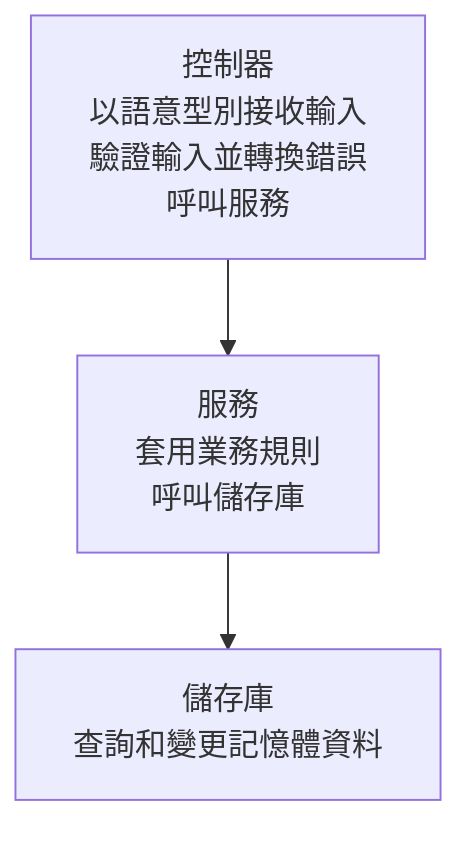

# 建立使用者 CRUD API

建立可新增、列出、查詢、修改和刪除使用者的 HTTP API。此範例使用記憶體儲存庫，不使用 ORM，因此不必準備資料庫即可執行。

## 開始前的準備

請先完成 [CLI 安裝](/zh-Hant/learn/getting-started/installation)。此範例會在 CLI 0.1.4 建立的基本應用程式中，手動加入完整的 CRUD 程式碼。CLI 的 `resource` 提供 GET 骨架，`slice --storage memory` 則提供新增和查詢的骨架。以下程式碼包含修改和刪除功能。

伺服器程序結束後，已儲存的使用者資料就會消失。

請求依序經過控制器、服務和儲存庫。各元件的職責如下。



## 1. 建立專案

建立基本應用程式，並檢查相依套件和專案設定。後續命令均在 `crud-example/` 中執行。

```sh
spine new crud-example --module example.com/crud-example
cd crud-example
go mod tidy
spine doctor
```

### 檔案配置

接下來會在 `src/` 下新增五個檔案，並取代產生的 `internal/application/application.go`。根目錄的 `main.go` 和 `spine.toml` 繼續沿用。

```text
crud-example/
├── go.mod
├── main.go
├── spine.toml
├── internal/application/
│   ├── application.go
│   └── application_test.go
└── src/
    ├── model/user.go
    ├── repository/user_repository.go
    ├── dto/user_dto.go
    ├── service/user_service.go
    └── controller/user_controller.go
```

## 2. 新增使用者模型

建立 `src/model/user.go`。此結構體儲存使用者資訊，以及建立和修改時間。

```go
// src/model/user.go
package model

import "time"

type User struct {
    ID        int64     `json:"id"`
    Name      string    `json:"name"`
    Email     string    `json:"email"`
    CreatedAt time.Time `json:"created_at"`
    UpdatedAt time.Time `json:"updated_at"`
}
```

## 3. 新增記憶體儲存庫

建立 `src/repository/user_repository.go`。它負責查詢、儲存和刪除使用者，並提供檢查電子郵件是否重複的函式。

```go
// src/repository/user_repository.go
package repository

import (
    "errors"
    "sync"
    "time"

    "example.com/crud-example/src/model"
)

var (
    ErrUserNotFound      = errors.New("user not found")
    ErrEmailAlreadyExists = errors.New("email already exists")
)

type UserRepository struct {
    mu      sync.RWMutex
    users   map[int64]*model.User
    counter int64
}

func NewUserRepository() *UserRepository {
    return &UserRepository{
        users:   make(map[int64]*model.User),
        counter: 0,
    }
}

func (r *UserRepository) FindAll() []*model.User {
    r.mu.RLock()
    defer r.mu.RUnlock()

    result := make([]*model.User, 0, len(r.users))
    for _, user := range r.users {
        result = append(result, user)
    }
    return result
}

func (r *UserRepository) FindByID(id int64) (*model.User, error) {
    r.mu.RLock()
    defer r.mu.RUnlock()

    user, ok := r.users[id]
    if !ok {
        return nil, ErrUserNotFound
    }
    return user, nil
}

func (r *UserRepository) FindByEmail(email string) (*model.User, error) {
    r.mu.RLock()
    defer r.mu.RUnlock()

    for _, user := range r.users {
        if user.Email == email {
            return user, nil
        }
    }
    return nil, ErrUserNotFound
}

func (r *UserRepository) ExistsByEmail(email string) bool {
    _, err := r.FindByEmail(email)
    return err == nil
}

func (r *UserRepository) Save(user *model.User) *model.User {
    r.mu.Lock()
    defer r.mu.Unlock()

    now := time.Now()

    if user.ID == 0 {
        r.counter++
        user.ID = r.counter
        user.CreatedAt = now
    }
    user.UpdatedAt = now

    r.users[user.ID] = user
    return user
}

func (r *UserRepository) Delete(id int64) error {
    r.mu.Lock()
    defer r.mu.Unlock()

    if _, ok := r.users[id]; !ok {
        return ErrUserNotFound
    }

    delete(r.users, id)
    return nil
}

func (r *UserRepository) Count() int {
    r.mu.RLock()
    defer r.mu.RUnlock()
    return len(r.users)
}
```

## 4. 新增請求和回應 DTO

建立 `src/dto/user_dto.go`。它定義請求接收的欄位和回應傳送的欄位，並將儲存庫的使用者模型轉換為回應 DTO。

```go
// src/dto/user_dto.go
package dto

import (
    "time"

    "example.com/crud-example/src/model"
)

// 요청 DTO

type CreateUserRequest struct {
    Name  string `json:"name"`
    Email string `json:"email"`
}

type UpdateUserRequest struct {
    Name  string `json:"name"`
    Email string `json:"email"`
}

// 응답 DTO

type UserResponse struct {
    ID        int64     `json:"id"`
    Name      string    `json:"name"`
    Email     string    `json:"email"`
    CreatedAt time.Time `json:"created_at"`
    UpdatedAt time.Time `json:"updated_at"`
}

type UserListResponse struct {
    Users []UserResponse `json:"users"`
    Total int            `json:"total"`
}

// 변환 함수

func ToUserResponse(user *model.User) UserResponse {
    return UserResponse{
        ID:        user.ID,
        Name:      user.Name,
        Email:     user.Email,
        CreatedAt: user.CreatedAt,
        UpdatedAt: user.UpdatedAt,
    }
}

func ToUserListResponse(users []*model.User) UserListResponse {
    responses := make([]UserResponse, len(users))
    for i, user := range users {
        responses[i] = ToUserResponse(user)
    }
    return UserListResponse{
        Users: responses,
        Total: len(responses),
    }
}
```

## 5. 新增使用者服務

建立 `src/service/user_service.go`。它會在新增和修改前檢查電子郵件是否重複，並將儲存庫的回傳值轉換為回應 DTO。

```go
// src/service/user_service.go
package service

import (
    "example.com/crud-example/src/dto"
    "example.com/crud-example/src/model"
    "example.com/crud-example/src/repository"
)

type UserService struct {
    repo *repository.UserRepository
}

func NewUserService(repo *repository.UserRepository) *UserService {
    return &UserService{repo: repo}
}

func (s *UserService) GetAllUsers() dto.UserListResponse {
    users := s.repo.FindAll()
    return dto.ToUserListResponse(users)
}

func (s *UserService) GetUserByID(id int64) (*dto.UserResponse, error) {
    user, err := s.repo.FindByID(id)
    if err != nil {
        return nil, err
    }

    response := dto.ToUserResponse(user)
    return &response, nil
}

func (s *UserService) CreateUser(req *dto.CreateUserRequest) (*dto.UserResponse, error) {
    // 이메일 중복 체크
    if s.repo.ExistsByEmail(req.Email) {
        return nil, repository.ErrEmailAlreadyExists
    }

    user := &model.User{
        Name:  req.Name,
        Email: req.Email,
    }

    saved := s.repo.Save(user)
    response := dto.ToUserResponse(saved)
    return &response, nil
}

func (s *UserService) UpdateUser(id int64, req *dto.UpdateUserRequest) (*dto.UserResponse, error) {
    user, err := s.repo.FindByID(id)
    if err != nil {
        return nil, err
    }

    // 이메일 변경 시 중복 체크
    if req.Email != user.Email && s.repo.ExistsByEmail(req.Email) {
        return nil, repository.ErrEmailAlreadyExists
    }

    user.Name = req.Name
    user.Email = req.Email

    saved := s.repo.Save(user)
    response := dto.ToUserResponse(saved)
    return &response, nil
}

func (s *UserService) DeleteUser(id int64) error {
    return s.repo.Delete(id)
}
```

## 6. 新增使用者控制器

建立 `src/controller/user_controller.go`。它會驗證輸入值後呼叫服務，並將找不到使用者和電子郵件重複的情況轉換為 HTTP 錯誤。

```go
// src/controller/user_controller.go
package controller

import (
    "errors"

    "github.com/NARUBROWN/spine/pkg/httperr"
    "github.com/NARUBROWN/spine/pkg/httpx"
    "github.com/NARUBROWN/spine/pkg/path"

    "example.com/crud-example/src/dto"
    "example.com/crud-example/src/repository"
    "example.com/crud-example/src/service"
)

type UserController struct {
    service *service.UserService
}

func NewUserController(service *service.UserService) *UserController {
    return &UserController{service: service}
}

// GET /users
func (c *UserController) List() httpx.Response[dto.UserListResponse] {
    return httpx.Response[dto.UserListResponse]{Body: c.service.GetAllUsers()}
}

// GET /users/:id
func (c *UserController) GetByID(id path.Int) (httpx.Response[dto.UserResponse], error) {
    if id.Value <= 0 {
        return httpx.Response[dto.UserResponse]{}, httperr.BadRequest("유효하지 않은 사용자 ID입니다")
    }

    user, err := c.service.GetUserByID(id.Value)
    if err != nil {
        return httpx.Response[dto.UserResponse]{}, toHTTPError(err)
    }

    return httpx.Response[dto.UserResponse]{Body: *user}, nil
}

// POST /users
func (c *UserController) Create(req *dto.CreateUserRequest) (httpx.Response[dto.UserResponse], error) {
    if req.Name == "" {
        return httpx.Response[dto.UserResponse]{}, httperr.BadRequest("이름은 필수입니다")
    }
    if req.Email == "" {
        return httpx.Response[dto.UserResponse]{}, httperr.BadRequest("이메일은 필수입니다")
    }

    user, err := c.service.CreateUser(req)
    if err != nil {
        return httpx.Response[dto.UserResponse]{}, toHTTPError(err)
    }

    return httpx.Response[dto.UserResponse]{Body: *user}, nil
}

// PUT /users/:id
func (c *UserController) Update(id path.Int, req *dto.UpdateUserRequest) (httpx.Response[dto.UserResponse], error) {
    if id.Value <= 0 {
        return httpx.Response[dto.UserResponse]{}, httperr.BadRequest("유효하지 않은 사용자 ID입니다")
    }
    if req.Name == "" {
        return httpx.Response[dto.UserResponse]{}, httperr.BadRequest("이름은 필수입니다")
    }
    if req.Email == "" {
        return httpx.Response[dto.UserResponse]{}, httperr.BadRequest("이메일은 필수입니다")
    }

    user, err := c.service.UpdateUser(id.Value, req)
    if err != nil {
        return httpx.Response[dto.UserResponse]{}, toHTTPError(err)
    }

    return httpx.Response[dto.UserResponse]{Body: *user}, nil
}

// DELETE /users/:id
func (c *UserController) Delete(id path.Int) error {
    if id.Value <= 0 {
        return httperr.BadRequest("유효하지 않은 사용자 ID입니다")
    }

    err := c.service.DeleteUser(id.Value)
    if err != nil {
        return toHTTPError(err)
    }

    return nil
}

// Repository 에러를 HTTP 에러로 변환
func toHTTPError(err error) error {
    switch {
    case errors.Is(err, repository.ErrUserNotFound):
        return httperr.NotFound("사용자를 찾을 수 없습니다")
    case errors.Is(err, repository.ErrEmailAlreadyExists):
        return httperr.BadRequest("이미 사용 중인 이메일입니다")
    default:
        return httperr.BadRequest(err.Error())
    }
}
```

## 7. 註冊建構函式和路由

以下列程式碼取代整個 `internal/application/application.go`。註冊儲存庫、服務和控制器的建構函式，並連接五個路由。產生在根目錄的 `main.go` 會依序執行 `BuildApplication`、`Validate`、`Run`。

```go
// internal/application/application.go
package application

import (
    "time"

    "example.com/crud-example/src/controller"
    "example.com/crud-example/src/repository"
    "example.com/crud-example/src/service"

    "github.com/NARUBROWN/spine"
    "github.com/NARUBROWN/spine/interceptor/cors"
    "github.com/NARUBROWN/spine/pkg/boot"
)

func BuildApplication() (spine.App, boot.Options, error) {
    app := spine.New()
    app.Constructor(
        repository.NewUserRepository,
        service.NewUserService,
        controller.NewUserController,
    )
    app.Route("GET", "/users", (*controller.UserController).List)
    app.Route("GET", "/users/:id", (*controller.UserController).GetByID)
    app.Route("POST", "/users", (*controller.UserController).Create)
    app.Route("PUT", "/users/:id", (*controller.UserController).Update)
    app.Route("DELETE", "/users/:id", (*controller.UserController).Delete)

    corsInterceptor, err := cors.NewValidated(cors.Config{
        AllowOrigins: []string{"*"},
        AllowMethods: []string{"GET", "POST", "PUT", "DELETE", "OPTIONS"},
        AllowHeaders: []string{"Content-Type"},
    })
    if err != nil {
        return nil, boot.Options{}, err
    }
    app.InterceptorFor(boot.InterceptorHTTP, corsInterceptor)

    return app, boot.Options{
        Address: ":8080",
        EnableGracefulShutdown: true,
        ShutdownTimeout: 10 * time.Second,
        HTTP: &boot.HTTPOptions{},
    }, nil
}
```

## 8. 驗證並啟動伺服器

在專案根目錄整理格式，檢查相依套件和程式碼，然後啟動伺服器。

```sh
gofmt -w src internal/application
go mod tidy
spine contract check
spine verify
spine dev
```

`contract check` 檢查靜態契約。`verify` 檢查靜態契約，並執行 gofmt、go vet 和 Go 測試。接著透過 HTTP 請求確認伺服器是否實際處理請求。

## 9. 透過 HTTP 請求確認 CRUD

保持伺服器執行，在另一個終端機依序傳送以下請求。新啟動的伺服器中，第一個使用者的 ID 為 `1`。回應中的日期僅供示範，會隨實際建立和修改時間而不同。

### 新增使用者

傳送姓名和電子郵件後，會收到 HTTP 200 和新增的使用者資訊。

```bash
curl -X POST http://localhost:8080/users \
  -H "Content-Type: application/json" \
  -d '{"name": "홍길동", "email": "hong@example.com"}'
```

```json
{
  "id": 1,
  "name": "홍길동",
  "email": "hong@example.com",
  "created_at": "2025-01-19T10:00:00Z",
  "updated_at": "2025-01-19T10:00:00Z"
}
```

### 取得使用者清單

確認 `users` 包含剛才新增的使用者，且 `total` 為 `1`。

```bash
curl http://localhost:8080/users
```

```json
{
  "users": [
    {
      "id": 1,
      "name": "홍길동",
      "email": "hong@example.com",
      "created_at": "2025-01-19T10:00:00Z",
      "updated_at": "2025-01-19T10:00:00Z"
    }
  ],
  "total": 1
}
```

### 查詢使用者

查詢 ID 為 `1` 的使用者資訊。

```bash
curl http://localhost:8080/users/1
```

```json
{
  "id": 1,
  "name": "홍길동",
  "email": "hong@example.com",
  "created_at": "2025-01-19T10:00:00Z",
  "updated_at": "2025-01-19T10:00:00Z"
}
```

### 修改使用者

同時傳送姓名和電子郵件。確認回應中的這兩個欄位和 `updated_at` 已變更。

```bash
curl -X PUT http://localhost:8080/users/1 \
  -H "Content-Type: application/json" \
  -d '{"name": "홍길동(수정)", "email": "hong2@example.com"}'
```

```json
{
  "id": 1,
  "name": "홍길동(수정)",
  "email": "hong2@example.com",
  "created_at": "2025-01-19T10:00:00Z",
  "updated_at": "2025-01-19T10:05:00Z"
}
```

### 刪除使用者

刪除 ID 為 `1` 的使用者。再次查詢已刪除的 ID 時，會收到 HTTP 404。

```bash
curl -X DELETE http://localhost:8080/users/1
```

### 不存在的使用者和重複的電子郵件

查詢儲存庫中不存在的 ID 時，會收到 HTTP 404 和以下錯誤訊息。

```bash
# 존재하지 않는 사용자
curl http://localhost:8080/users/999
```

```json
{
  "message": "사용자를 찾을 수 없습니다"
}
```

由於上一個步驟已刪除使用者，請先以相同的電子郵件重新新增使用者。第一個請求會成功並回傳 HTTP 200，接著以相同電子郵件新增的第二個請求會回傳 HTTP 400 和重複錯誤。

```bash
curl -X POST http://localhost:8080/users \
  -H "Content-Type: application/json" \
  -d '{"name": "홍길동", "email": "hong@example.com"}'
# 중복 이메일
curl -X POST http://localhost:8080/users \
  -H "Content-Type: application/json" \
  -d '{"name": "김철수", "email": "hong@example.com"}'
```

```json
{
  "message": "이미 사용 중인 이메일입니다"
}
```

## 實作時的注意事項

### 以語意型別接收請求值

控制器的參數使用 `path.Int` 等語意型別，而非 HTTP 請求物件。錯誤以 `httperr` 表示。

```go
// 의미 타입으로 입력 받음
func (c *UserController) GetByID(id path.Int) (httpx.Response[dto.UserResponse], error)

// httperr로 의미만 표현
return httpx.Response[dto.UserResponse]{}, httperr.NotFound("사용자를 찾을 수 없습니다")
```

### 相依性注入

根據已註冊建構函式的參數型別，連接儲存庫、服務和控制器的相依關係。

```go
// 생성자 등록만으로 의존성 자동 해결
app.Constructor(
    repository.NewUserRepository,  // 의존성 없음
    service.NewUserService,        // Repository 의존
    controller.NewUserController,  // Service 의존
)
```

### 各元件的職責

| 元件 | 職責 | 使用的元件 |
|-------|------|------|
| 控制器 | 驗證輸入、轉換 HTTP 錯誤 | 服務 |
| 服務 | 檢查電子郵件是否重複、轉換回應 DTO | 儲存庫 |
| 儲存庫 | 查詢和變更記憶體資料 | 無 |

## 下一步

若要持久儲存資料，請依照[連接資料庫](/zh-Hant/learn/tutorial/5-database)更換儲存庫。若要進一步了解錯誤處理方式，請參閱[錯誤處理教學](/zh-Hant/learn/tutorial/7-error-handling)。
